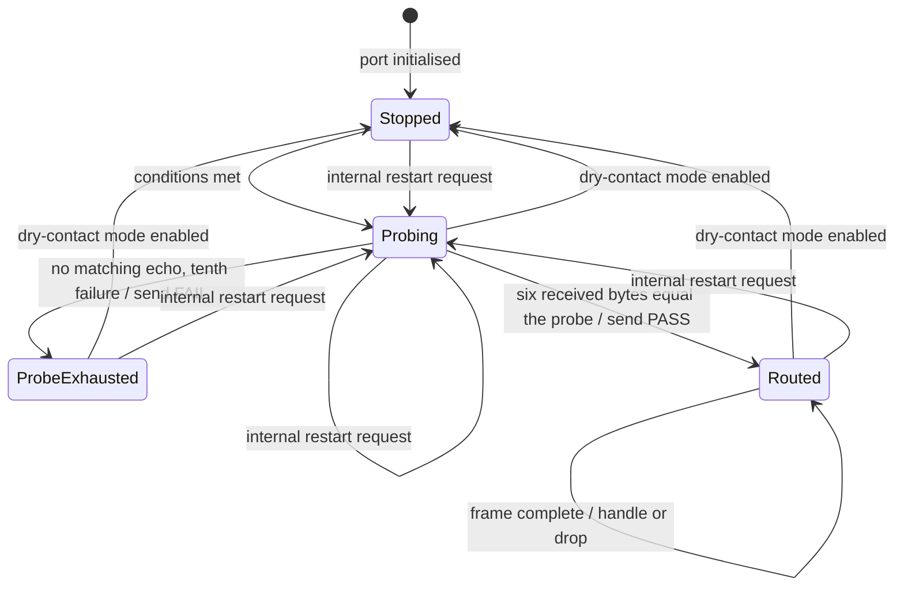
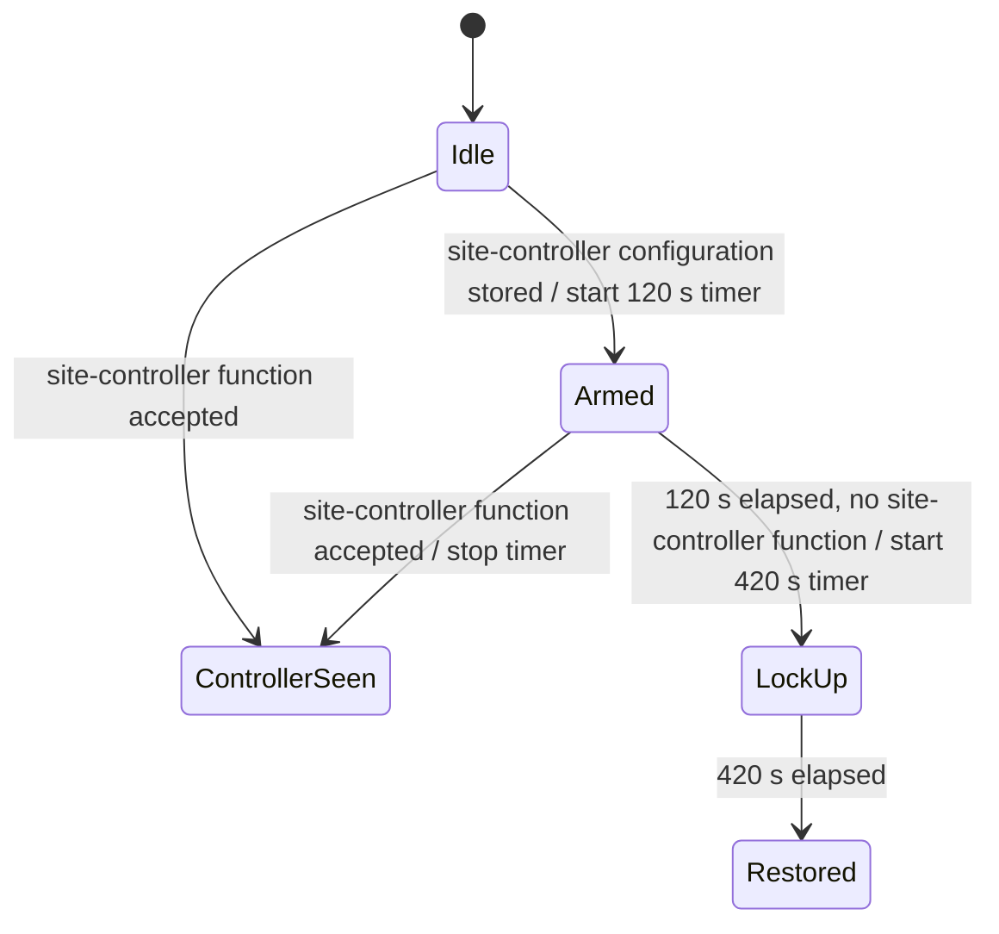

# Wall Connector Gen 3 external RS-485 port: site-controller protocol (function codes 100 to 105)

## 1. Scope and conventions

### 1.1 Scope

This document specifies the protocol that the Wall Connector Gen 3 speaks on
its external RS-485 port towards a site controller:

- the serial link: electrical and character parameters, addressing, framing,
  CRC, timing and roles;
- the start-up exchange that brings the port into addressed operation;
- function codes 100 to 105: messages, fields, processing rules, side effects
  and errors.

It does not specify:

- the messages carried inside function code 100. They are defined in a
  separate document, the [TEDAPI message specification](tedapi-specification.md);
- the HTTP interface of the same message API;
- the register map of the energy meter that the station polls on the same
  port;
- the RS-485 protocol of earlier Wall Connector generations, which is a
  different protocol.

### 1.2 Function codes

| Code | Hex | Name | Request / response messages |
|---:|---:|---|---|
| 100 | `0x64` | `TedapiTunnel` | `MODBUSTedAPIRequest` / `MODBUSTedAPIResponse`: the TEDAPI envelope in each direction, without an additional wrapper message |
| 101 | `0x65` | `HscControlStatus` | `HscControlStatusRequest` / `HscControlStatusResponse` |
| 102 | `0x66` | `HscStateSync` | `HscStateSyncRequest` / `HscStateSyncResponse` |
| 103 | `0x67` | `HscVoltageTripRules` | `HscVoltageTripRulesRequest` / `HscVoltageTripRulesResponse` |
| 104 | `0x68` | `HscFrequencyTripRules` | `HscFrequencyTripRulesRequest` / `HscFrequencyTripRulesResponse` |
| 105 | `0x69` | `HscVoltageFrequencyWindow` | `HscVoltageFrequencyWindowRequest` / `HscVoltageFrequencyWindowResponse` |

### 1.3 Terms

<!-- legacy-role-mapping:begin -->

| Term | Meaning |
|---|---|
| Station | The Wall Connector Gen 3. |
| Port | The station's external RS-485 port. |
| Site controller | The external device that the station serves as a slave on the port. Message names abbreviate it as HSC (Home Site Controller). |
| Peer | Any device on the RS-485 pair other than the station. |
| Meter | The energy meter that the station polls on the same port. |
| Serial controller | The part of the station that operates the port. It runs the start-up exchange, checks frames and serves functions 101 to 105 itself. |
| Main controller | The part of the station that implements TEDAPI. Function 100 is relayed to it. |
| TEDAPI | The protobuf message API of the station, also served over HTTP at `/tedapi/v1`. |
| Family, tag | In a TEDAPI envelope, the family is the field number of the payload member that is present; the tag is the field number of the member that is present inside the family message. "6/1" means family 6, tag 1. |
| Address | The first byte of a frame (the Modbus "node" or "slave" address). |
| Probe | The six bytes that the station sends in the start-up exchange. |
| Routed mode | The mode of the port in which addressed frames are accepted and answered. |
| Site-controller configuration | The identity and address of a site controller stored in the station. It is set through TEDAPI. |
| Hardware-variant identifier | A number that identifies the hardware variant of a station (section 3.1). |

<!-- legacy-role-mapping:end -->

### 1.4 Conventions

- Function, message and field names are the names used in this
  specification.
- **must**, **must not**, **should** and **may** state what a peer is required,
  forbidden, recommended or allowed to do.
- **Provisional**: described to the best of current knowledge; may be revised.
- **Not specified**: this revision does not define the behaviour;
  implementations must not rely on it.
- **Reserved**: a field whose meaning this revision does not define. Its number
  and wire type are given. A peer must not rely on its value and must preserve
  it, like any unknown field, when it decodes and re-encodes a message.
- **Nominal**: a design value of the station's time base. The real duration can
  differ; its tolerance is Not specified.
- **Typical**: a value that a peer can expect in normal operation. It is not a
  guaranteed limit.
- Numbers are decimal unless written with the prefix `0x`. Byte sequences are
  written as hexadecimal bytes separated by spaces.
- Protobuf messages use the proto3 wire encoding. The definitions are in
  sections 6 to 10 and, complete, in Appendix A.

### 1.5 Firmware versions and applicability

| Firmware | Covered |
|---|---|
| 24.28.3 | Link layer, start-up exchange, functions 100 to 102 |
| 24.44.3 | Link layer, start-up exchange, functions 100 to 102 |
| MID 25.2.2 | Link layer, start-up exchange, functions 100 to 102 |
| 26.18.0 | Link layer, start-up exchange, functions 100 to 105 |
| 26.34.0 | Link layer, start-up exchange, functions 100 to 105 |
| 26.42.0 | Link layer and function 100. Of the start-up exchange, only the points that name 26.42.0. |

- MID 25.2.2 is the firmware of the MID hardware variant. It belongs to a
  different product line from the other versions. A statement about one line
  does not carry over to the other unless it names both.
- A table states the firmware versions it applies to in a Firmware column or
  in a note above it. Any other statement ends with them, in parentheses.
  "All" means 24.28.3, 24.44.3, MID 25.2.2, 26.18.0 and 26.34.0.
- For a firmware version that a statement does not name, the behaviour is
  Not specified.
- Rules addressed to a peer (must, should, may) are independent of the
  firmware version unless they name one.
- Firmware versions earlier than 24.28.3 are not covered by this revision.

## 2. Link layer

### 2.1 Electrical and character parameters

| Parameter | Value | Firmware |
|---|---|---|
| Medium | RS-485, one two-conductor pair, half duplex. The station's terminals are marked "+" and "−". | 26.34.0, 26.42.0 |
| Bit rate | 115200 bit/s | 24.28.3, 24.44.3, 26.34.0, 26.42.0. Provisional for MID 25.2.2 and 26.18.0. |
| Character format | 8 data bits, no parity, 1 stop bit | 24.28.3, 24.44.3, 26.34.0, 26.42.0. Provisional for MID 25.2.2 and 26.18.0. |
| Flow control | None | 26.34.0 |
| Format during the start-up exchange | The same bit rate and character format as in routed mode | 26.34.0 |
| End of frame | An idle time of 35 bit times on the line, about 304 µs at 115200 bit/s. | 24.44.3, 26.34.0 |
| Inter-character limit | None. The idle time above is the only gap criterion. | 24.44.3 |
| Line driver | Provisional: the station drives the pair only while it transmits. | 24.44.3 |
| Polarity of the pair, bias, termination | Not specified | — |

### 2.2 Roles on the port

The port carries two protocols with different roles (24.44.3).

<!-- legacy-role-mapping:begin -->

| Role | The station | The peer | Address used | Function codes | Firmware |
|---|---|---|---|---|---|
| Site controller | Slave: it answers requests sent to its own address and never initiates in this role. | The site controller is the master. | The station address: the configured value, by default 16. | 100 to 102 (All); 103 to 105 (26.18.0, 26.34.0); see section 4 | All. Function 100 also 26.42.0. |
| Meter | Master: it sends read requests and consumes the replies. | The meter is the slave. | The meter's address, 1. The station has no address of its own in this role. | 03 (read holding registers) | Address and function: 24.28.3, 24.44.3, 26.34.0. The role exists in All. |

<!-- legacy-role-mapping:end -->

In the start-up exchange (section 3) neither role applies: the station sends
bytes without an address and the peer echoes them (24.44.3, 26.34.0).

The meter requests are four reads with function 03 at address 1: start 40002
quantity 6; start 244 quantity 8; start 1 quantity 55; start 136 quantity 10
(24.28.3, 24.44.3). No request with function 06 or 16 is among the meter
requests (24.44.3). The meter requests of the other firmware versions are Not
specified.

Section 2.9 describes how the two roles share the port.

### 2.3 Addressing

- The address is one byte (24.44.3).
- A station without a site-controller configuration uses address 16 (`0x10`)
  (All, 26.42.0).
- A site-controller configuration supplies the address. It is written with
  TEDAPI message 6/43; see the TEDAPI message specification. The station
  accepts 1 to 255 (MID 25.2.2, 26.18.0, 26.34.0) or any non-zero value
  (24.28.3, 24.44.3).
- The station compares the address for equality. Address 0 is not a broadcast
  address. Address 255 is an ordinary address. A frame for any other address
  than those of section 2.8 is dropped without a reply (24.44.3).
- Address 1 is the meter's. The station does not refuse 1 as its own address,
  but then handles frames for address 1 as site-controller requests first
  (24.44.3). Provisional: a reply of the meter is then answered with an
  exception reply and not used. A station should not be configured with
  address 1.
- Frames carry no device identifier (26.34.0, 26.42.0). The protocol has no
  broadcast and no discovery function (24.44.3). A peer must know the station
  address; it must not scan addresses.

### 2.4 Frame layout

```text
offset  size     field
0       1        address
1       1        function code (bit 7 set in an exception reply)
2       N        payload, N = 0 to 252
2+N     1        CRC, low byte
3+N     1        CRC, high byte
```

A frame is 4 to 256 bytes long (24.44.3, 26.34.0). Firmware 26.42.0 uses the
same layout.

For function codes 100 to 105 the payload is:

```text
offset  size     field
2       1        L: number of protobuf bytes that follow
3       L        one protobuf message
```

(Functions 100 to 102: 24.44.3. Functions 103 to 105: 26.18.0, 26.34.0.
Function 100 also 26.42.0.)

In an exception reply the function code has bit 7 set and the payload is one
byte, the exception code (24.28.3, 24.44.3, 26.34.0).

A frame has no transaction identifier, no sequence number and no separate
two-byte length (24.44.3).

### 2.5 Length rules and maximum payload

- `L` is one byte and must equal the number of payload bytes that follow it
  (`N − 1`). The station rejects a function-100 request in which it does not
  (24.44.3).
- The payload is at most 252 bytes; one protobuf message is therefore at most
  251 bytes (24.44.3).
- There is no fragmentation. One request or one reply is one frame (24.44.3).
- The station encodes a function-100 reply into at most 252 bytes (24.28.3,
  24.44.3, 26.34.0). Whether that limit includes the length byte is Not
  specified.
- `L = 0` is a well-formed frame at this layer (24.44.3). Whether an empty
  message is accepted depends on the function.

### 2.6 CRC

(24.44.3, 26.34.0, 26.42.0)

- Algorithm: the CRC-16 of Modbus RTU. Initial value `0xFFFF`, reflected
  polynomial `0xA001`, no final XOR.
- The CRC covers the address, the function code and every payload byte.
- The low byte is transmitted first.
- The station drops a frame with a wrong CRC and sends no reply.

### 2.7 Timing and half-duplex rules

Reception by the station:

- The station takes an idle time of 35 bit times as the end of a frame
  (24.44.3, 26.34.0).
- All bytes that arrive without such a gap are handled as one frame. If the
  six probe bytes are joined to a valid frame, the whole is discarded and not
  answered (26.34.0). The handling of other bytes joined to a valid frame, and
  of two valid frames that arrive without a gap, is Not specified.
- A peer should send each frame as one contiguous transmission and should
  leave more than 35 bit times between two frames.

Transmission by the station:

- The station sends replies and meter requests only in routed mode. In any
  other mode it sends only the tokens of section 3.2 (24.44.3, 26.34.0).
- The station handles one outgoing frame at a time. A reply that has not yet
  been transmitted is replaced by a newer outgoing frame (24.44.3). A peer
  must wait for the reply, or for its timeout, before it sends the next
  request; otherwise a pending reply can be lost.
- The station does not sense the line before it transmits and does not detect
  collisions (24.44.3).

Request and reply:

- Functions 101 and 102 are answered by the serial controller directly
  (24.44.3). So are functions 103 to 105 (26.18.0, 26.34.0).
- Function 100 is relayed to the main controller and answered asynchronously.
  The serial controller sends no immediate reply (24.44.3, 26.34.0).
- The minimum and maximum reply times are Not specified. Typical reply time
  for function 100: 6 to 340 ms, median 20 ms (26.34.0); 6 to 376 ms, median
  17 ms (26.42.0).
- The station does not repeat a reply. A reply belongs to the request that
  precedes it; nothing else relates the two (24.44.3).
- A request can remain unanswered without an exception reply. Typically
  about 2 % of requests go unanswered (26.34.0, 26.42.0). The cause is Not
  specified. A peer must apply a timeout to every request; a timeout of 1 s or
  more covers the typical reply times.
- The station does not need periodic traffic to remain in routed mode
  (24.44.3, 26.34.0).

### 2.8 Handling by address

In routed mode the station handles a frame with a valid length and CRC
according to its address (24.44.3; the first row also 26.34.0).

| Address of the frame | Handling |
|---|---|
| Station address | The function code is dispatched (section 4). A function code that the firmware does not support is answered with an exception reply. |
| 1 | The frame is taken as a reply from the meter and passed to the station's meter function. |
| Any other | The frame is dropped. No reply is sent. |

The rows are applied in this order (24.44.3). Provisional: on a station whose
own address is 1, a frame with function code 03 is therefore handled as a
site-controller request and answered with an exception reply; it is not taken
as a meter reply.

### 2.9 Sharing the port between the two roles

<!-- legacy-role-mapping:begin -->

- Both roles use the same line and the same transmit path of the station.
  The rule of section 2.7 on one outgoing frame at a time covers replies and
  meter requests together (24.44.3).
- Both roles are active only in routed mode. A failed start-up exchange does
  not make the station poll the meter (24.44.3, MID 25.2.2, 26.18.0, 26.34.0).
  Firmware 24.28.3 also sends meter requests only in routed mode.
- The station runs its regular meter poll only while no site-controller
  configuration is stored and dry-contact mode is disabled (24.44.3, 26.34.0).
  Firmware 24.28.3 runs it only while no site-controller configuration is
  stored; its dry-contact rule is Not specified.
- A station without a site-controller configuration and with dry-contact mode
  disabled therefore does both: it polls address 1 and answers at its own
  address (26.34.0).
- A stored site-controller configuration stops the regular meter poll and
  leaves the slave role active. Enabling dry-contact mode stops the whole port
  (26.34.0).
- This is an exclusion by configuration. The station has no arbitration
  between its own meter requests and the requests of a site controller: it
  does not cancel a meter request in progress, reserves no quiet time and
  detects no collision (24.44.3).
- A site controller must expect function-03 requests to address 1 on the pair
  and should not transmit frames with address 1 unless it is the meter.

<!-- legacy-role-mapping:end -->

Not specified: the period of the meter poll; the further conditions under
which firmware 26.34.0 runs the regular poll; the meter requests of firmware
26.34.0 outside the regular poll; the result of a meter request and a
site-controller request that overlap; whether such overlaps cause the
unanswered requests of section 2.7.

## 3. Start-up exchange

Before the station accepts addressed frames it sends a probe and waits for
the peer to echo it. The exchange synchronises the two sides. It does not
authenticate the peer: it contains no key, no signature, no certificate, no
nonce and no peer identifier (24.44.3, 26.34.0; Provisional for 24.28.3, MID
25.2.2 and 26.18.0).

### 3.1 Conditions

| Condition | Rule | Firmware |
|---|---|---|
| Hardware variant | Hardware-variant identifiers 0, 1, 5, 7, 20, 22, 23 and 24 are admitted. Provisional: on a station with any other identifier the exchange does not start. | 26.18.0, 26.34.0 |
| | The identifier is the value returned as `subUsageId` in the Wall Connector system information (TEDAPI). A station whose stored identifier is invalid uses 0, which is admitted. | 26.34.0 |
| | There is no hardware-variant condition. | 24.44.3. Provisional for MID 25.2.2. |
| | The product that each identifier denotes is Not specified. | — |
| Dry-contact mode | The setting is the `enabled` flag of the dry-contact configuration (TEDAPI: `WCDryContactConfig.enabled`). While it is disabled the port is active. While it is enabled the port is stopped. | 24.44.3, 26.18.0, 26.34.0. Provisional for MID 25.2.2. |
| | The factory default of the setting is Not specified. | — |
| Site-controller configuration | Not required. The exchange runs and the default address 16 is served without it. | 24.44.3, 26.34.0, 26.42.0 |
| Station address | The address is in force independently of the exchange and of the conditions above (section 2.3). | 24.44.3, 26.34.0 |
| Change of a condition | The station evaluates the conditions at start-up and whenever one of them changes. An unchanged state triggers nothing. | 24.44.3 |

The conditions of firmware 24.28.3 are Not specified. It starts the exchange
at once when the port is initialised (section 3.6).

### 3.2 Tokens

The exchange uses four tokens (All; the probe also 26.42.0).

| Token | Direction | Bytes (hex) | ASCII |
|---|---|---|---|
| Probe | Station to peer | `54 45 53 4C 41 00` | `TESLA` and NUL |
| Echo | Peer to station | `54 45 53 4C 41 00` | identical to the probe |
| Pass | Station to peer | `50 41 53 53 00` | `PASS` and NUL |
| Fail | Station to peer | `46 41 49 4C 00` | `FAIL` and NUL |

The tokens are plain bytes. They have no address, no function code and no CRC
(24.44.3, 26.34.0).

### 3.3 State machine of the port

The port has four states (24.44.3, 26.34.0). Section 3.6 lists what differs
in the other firmware versions.

| State | Meaning |
|---|---|
| Stopped | The port is inactive. The station neither sends nor answers. |
| Probing | The start-up exchange is in progress. |
| ProbeExhausted | Ten exchanges have failed. The station makes no further attempt by itself. |
| Routed | Routed mode: addressed frames are checked, dispatched and answered; the station may send meter requests. |

| # | State | Event | Guard | Action of the station | Next state | Firmware |
|---:|---|---|---|---|---|---|
| 1 | (start-up) | The port is initialised | — | None | Stopped | 24.44.3 |
| 2 | Stopped | The conditions of section 3.1 are evaluated | All are met | Start the exchange | Probing | 24.44.3, 26.34.0 |
| 3 | Stopped | The conditions are evaluated | Not all are met | None | Stopped | 24.44.3 |
| 4 | Probing | Start of an attempt | — | Send the probe and evaluate the echo once (section 3.4) | Probing | 24.44.3, 26.34.0 |
| 5 | Probing | The echo is evaluated | Six bytes, equal to the probe | Send the pass token; change to routed mode | Routed | 24.44.3, MID 25.2.2, 26.18.0, 26.34.0 |
| 6 | Probing | The echo is evaluated | Anything else (no bytes, fewer than six, other bytes, a receive error), fewer than ten failures so far | Send the fail token; start another attempt | Probing | 24.44.3, MID 25.2.2, 26.18.0, 26.34.0 |
| 7 | Probing | The echo is evaluated | Anything else, tenth failure | Send the fail token; make no further attempt | ProbeExhausted | 24.44.3, MID 25.2.2, 26.18.0, 26.34.0 |
| 8 | Routed | Entry | — | Restart reception for addressed frames. Bytes received before this point are discarded. | Routed | 24.44.3, 26.34.0 |
| 9 | Routed | A frame is complete | Valid length and CRC, address accepted | Handle the frame (sections 2.8 and 4) | Routed | 24.44.3, 26.34.0 |
| 10 | Routed | A frame is complete | Anything else, including the six probe bytes, a wrong CRC, a fragment or a frame for another address | Drop it; send no reply | Routed | 26.34.0 |
| 11 | Probing, ProbeExhausted, Routed | The conditions are evaluated | Dry-contact mode enabled | Stop the port | Stopped | 24.44.3, 26.34.0 |
| 12 | Any | Internal restart request of the station | — | Start the exchange again, also after a successful one | Probing | 24.44.3 |



Rules and properties:

- A peer must echo the six probe bytes unchanged and should meet the
  requirements of section 3.4.
- The fail token does not say what was wrong. A missing echo, a short echo,
  wrong bytes and a receive error give the same token (26.34.0).
- The station sends the pass token before it starts reception for addressed
  frames. A request that a peer sends during this change can be lost (24.44.3,
  26.34.0). A peer should not send a request before the pass token is
  complete and should repeat a first request that gets no reply. The quiet
  time that the station needs after the pass token is Not specified.
- If the change to routed mode fails inside the station, the port can remain
  without reception although the exchange has passed (24.44.3).
- In routed mode no received bytes make the station return to the exchange
  (26.34.0). A peer should not echo a probe pattern after the pass token.
- A peer may fail to receive the pass token and still find the station
  answering addressed frames (26.34.0, 26.42.0). Whether the station sent the
  token in that case is Not specified. A peer should therefore confirm routed
  mode with a read-only request (for example the one of section 5.8) and
  should not rely on the pass token alone.
- Provisional (24.44.3): with unchanged conditions the station starts the
  exchange once, after start-up. A peer that connects later finds no probe
  until the station starts the exchange again: at its next start, or on the
  internal restart request of transition 12.
- The trigger of the internal restart request (transition 12) is Not
  specified.
- Whether the station answers addressed frames after a start-up in which no
  probe was echoed is Not specified.

### 3.4 Timing

Requirements on the echo:

| Requirement | Rule | Firmware |
|---|---|---|
| Content | The six probe bytes, unchanged. | All |
| Start | Without added delay. If no echo byte has arrived when the station has sent the probe, the station waits at most 2 ms (nominal) before it evaluates the echo. | 24.44.3, 26.34.0 |
| Completeness | All six bytes in one contiguous transmission. The station evaluates the echo once per attempt, on the bytes that have arrived, and does not wait for missing bytes. | 26.34.0 |
| Latest arrival that is still accepted | Not specified | — |
| Late echo | An echo that arrives after the evaluation is not discarded. The probe is the same in every attempt, so a late echo counts in a later attempt like a fresh one. | 26.34.0 |

Other timing:

| Item | Value | Firmware |
|---|---|---|
| Number of attempts | 10 | 24.44.3, MID 25.2.2, 26.18.0, 26.34.0 |
| | No limit (section 3.6) | 24.28.3 |
| Interval between two attempts | Not specified | — |
| Time from the start of the station to the first probe | Not specified | — |
| Restart | Typical: the station answers function 100 again about 8 s after a restart request. When it issues a probe, the probe comes about 6 s after the request. | 26.34.0, 26.42.0 |
| Site-controller watchdog (section 3.5) | 120 s (nominal) | 24.44.3, MID 25.2.2, 26.18.0, 26.34.0 |
| Restore timer of the watchdog | 420 s (nominal) | 24.44.3, 26.34.0 |
| Validity of a function-101 request (section 6.6) | 500 ms (nominal) | 24.44.3 |

### 3.5 Site-controller watchdog

A station with a stored site-controller configuration expects to hear from
the site controller once after start-up. The watchdog runs beside the state
machine of section 3.3 and does not change the mode of the port (24.44.3,
26.34.0).

The watchdog has five states (24.44.3, 26.34.0).

| State | Meaning |
|---|---|
| Idle | The watchdog is not running. |
| Armed | The 120 s timer is running. |
| ControllerSeen | A site-controller function has been accepted. The watchdog has ended. |
| LockUp | The timer has expired without any site-controller function. |
| Restored | The restore timer has expired. |

| # | State | Event | Guard | Action of the station | Next state | Firmware |
|---:|---|---|---|---|---|---|
| 1 | Idle | The conditions of section 3.1 are evaluated | A site-controller configuration is stored | Start the 120 s (nominal) timer. It runs once. | Armed | 24.44.3, 26.34.0 |
| 2 | Idle, Armed | A site-controller function is accepted (section 4.3, step 5) | — | Note that the site controller has been seen; stop the timer | ControllerSeen | 24.44.3, 26.34.0 |
| 3 | ControllerSeen | The timer expires at the moment it is being stopped | — | None | ControllerSeen | 24.44.3, 26.34.0 |
| 4 | Armed | The timer expires | No site-controller function has been accepted | Enter the lock-up condition; start the 420 s (nominal) restore timer. It runs once. | LockUp | 24.44.3, 26.34.0 |
| 5 | LockUp | The restore timer expires | — | Leave the lock-up condition | Restored | 24.44.3, 26.34.0 |



- The watchdog is armed by the stored configuration, not by the pass token
  (24.44.3, 26.34.0).
- One accepted site-controller function ends the watchdog. It is not a
  keep-alive: a site controller does not have to repeat requests to hold it
  off (24.44.3). No event that re-arms it is specified.
- Provisional (24.44.3): the lock-up condition disables an external-power
  function of the station and the restored condition enables it again. The
  effect of either condition on the supply, the contactor or charging is Not
  specified.
- Firmware MID 25.2.2 and 26.18.0 start a timer of 120 s (nominal) under a
  site-controller condition whose definition is Not specified. The effect of
  the timer is Not specified for these two versions.
- Firmware 26.34.0 has a further site-controller condition that does not arm
  the watchdog. Its meaning is Not specified.

### 3.6 Firmware differences

| Point | 24.28.3 | 24.44.3 | MID 25.2.2 | 26.18.0 | 26.34.0 |
|---|---|---|---|---|---|
| Start of the exchange | At once when the port is initialised | When the conditions are met | When the conditions are met | When the conditions are met | When the conditions are met |
| Number of attempts | No limit: the station keeps probing | 10 | 10 | 10 | 10 |
| Hardware-variant condition | Not specified | None | Provisional: none | Yes | Yes |
| Dry-contact condition | Not specified | Yes | Provisional: yes | Yes | Yes |
| Watchdog armed when | Not specified | A configuration is stored | Under a site-controller condition whose definition is Not specified | Under a site-controller condition whose definition is Not specified | A configuration is stored |

## 4. Function codes

### 4.1 Function table

| Code | Name | Payload after the length byte | Served by | Reply | Firmware |
|---:|---|---|---|---|---|
| 100 | `TedapiTunnel` | One TEDAPI envelope | Main controller; the serial controller relays the frame | Asynchronous: a later function-100 frame with the reply envelope. No immediate reply (24.44.3, 26.34.0); whether firmware 24.28.3, MID 25.2.2 and 26.18.0 send an immediate reply is Not specified. | All. Handling by the main controller: 24.28.3, 24.44.3, 26.34.0. |
| 101 | `HscControlStatus` | `HscControlStatusRequest` | Serial controller | One `HscControlStatusResponse` | All |
| 102 | `HscStateSync` | `HscStateSyncRequest` | Serial controller. A data block in the request is passed on to the main controller. | One `HscStateSyncResponse`, built by the serial controller alone | All |
| 103 | `HscVoltageTripRules` | `HscVoltageTripRulesRequest` | Serial controller | One `HscVoltageTripRulesResponse` | 26.18.0, 26.34.0 |
| 104 | `HscFrequencyTripRules` | `HscFrequencyTripRulesRequest` | Serial controller | One `HscFrequencyTripRulesResponse` | 26.18.0, 26.34.0 |
| 105 | `HscVoltageFrequencyWindow` | `HscVoltageFrequencyWindowRequest` | Serial controller | One `HscVoltageFrequencyWindowResponse` | 26.18.0, 26.34.0 |

### 4.2 Firmware support

| Code | 24.28.3 | 24.44.3 | MID 25.2.2 | 26.18.0 | 26.34.0 | 26.42.0 |
|---:|---|---|---|---|---|---|
| 100 | Supported | Supported | Accepted by the serial controller; handling by the main controller Not specified | Accepted by the serial controller; handling by the main controller Not specified | Supported | Supported |
| 101 | Supported | Supported | Supported | Supported | Supported | Not specified |
| 102 | Supported | Supported | Supported | Supported | Supported | Not specified |
| 103 | Not supported | Not supported | Not supported | Supported | Supported | Not specified |
| 104 | Not supported | Not supported | Not supported | Supported | Supported | Not specified |
| 105 | Not supported | Not supported | Not supported | Supported | Supported | Not specified |

The difference between MID 25.2.2 and the 26.x versions is a difference
between two product lines. It is not a rule about ranges of version numbers.
A peer must select its behaviour by the exact firmware version and must not
assume support for a version that this table does not list.

### 4.3 Processing common to all functions

1. The port is in routed mode (24.44.3, 26.34.0).
2. The frame has a length of 4 to 256 bytes and a valid CRC. Otherwise it is
   dropped (24.44.3, 26.34.0).
3. The address is the station address. Otherwise section 2.8 applies
   (24.44.3).
4. The function code is supported (section 4.2). Any other function code at
   the station address is answered with exception code 1 (24.44.3, 26.34.0).
   This includes the standard Modbus function codes 03 and 04 (26.34.0).
5. The request counts as contact from the site controller for the watchdog of
   section 3.5. Function 100 counts as soon as the frame is relayed, before
   the carried message has a result (24.44.3, 26.34.0). Functions 101 and
   102 count whether or not their message can be decoded (24.44.3). In
   firmware 26.34.0 functions 101 to 105 count; whether they also count when
   their message cannot be decoded is Not specified. A request with an
   unsupported function code, a frame with a wrong CRC and a frame for
   another address do not count (24.44.3, 26.34.0).
6. The reply is produced as in section 4.1.

For functions 103 to 105 the station admits a request on the strength of
routed mode and the address alone. It does not check who the sender is and
evaluates no signature, certificate, role or replay value (26.18.0, 26.34.0).
Provisional: the same holds for functions 100 to 102 in the serial
controller. Section 5.3 states what the main controller checks for function
100.

## 5. Function code 100: `TedapiTunnel`

### 5.1 Purpose

Function 100 carries one TEDAPI envelope from the port to the message
handlers of the main controller and carries one envelope back (24.28.3,
24.44.3, 26.34.0). It adds framing and addressing to the message API. It adds
no wrapper message, no signature and no exchange of its own (24.44.3,
26.34.0).

The messages that can be carried, their fields and their individual
conditions are defined in the TEDAPI message specification.

### 5.2 Envelope: family and tag

The payload after the length byte is the TEDAPI envelope itself (24.44.3,
26.34.0).

| Envelope field number | Content | Use on this port | Firmware |
|---:|---|---|---|
| 1 | Delivery channel | Requests without this field are answered. | 26.34.0, 26.42.0 |
| 2 | Sender | Requests without this field are answered. Firmware 26.34.0 does not evaluate a sender identity before dispatch. | 26.34.0, 26.42.0 |
| 3 | Recipient | Requests without this field are answered. Firmware 26.34.0 does not evaluate a recipient identifier on this port. | 26.34.0, 26.42.0 |
| 4 | Payload: Common family | Dispatched | 24.44.3, 26.34.0, 26.42.0 |
| 6 | Payload: Wall Connector family | Dispatched | 24.44.3, 26.34.0, 26.42.0 |
| 9 | Payload: meter family | Dispatched for tag 5 only | 24.44.3. Provisional for 26.34.0. |
| other | Other families | Answered with status 5 | 24.44.3. Provisional for 26.34.0. |

- The family is the field number of the payload member that is present in the
  envelope. The tag is the field number of the member that is present in the
  family message. Both are ordinary protobuf field keys (24.44.3).
- A request is one family member that holds one request member. A request
  without parameters is an empty submessage (26.34.0, 26.42.0).
- A typed reply uses the same family and the tag that follows the request tag
  (request tag plus one) (26.34.0, 26.42.0). Section 5.4 lists the exceptions.

### 5.3 Processing rules

| Step | Performed by | Action | Firmware |
|---:|---|---|---|
| 1 | Serial controller | Relay the frame to the main controller. Count it as contact from the site controller (section 4.3, step 5). Send no reply at this point. | Relay: All. Contact and no immediate reply: 24.44.3, 26.34.0. |
| 2 | Main controller | Accept the frame only if function 100 is enabled and the function code is 100. | 24.28.3, 24.44.3, 26.34.0 |
| 3 | Main controller | Check that the length byte equals the number of bytes that follow (24.44.3) and decode the envelope. | 24.28.3, 24.44.3, 26.34.0 |
| 4 | Main controller | Refuse a request of family 6, tag 65 with Common status 16, without dispatching it. This is the only request that the function itself refuses. | 26.34.0 |
| 5 | Main controller | Dispatch the envelope to the TEDAPI message handlers. In firmware 26.34.0 this is the same message handling as on the HTTP interface. | 24.28.3, 24.44.3, 26.34.0 |
| 6 | Main controller | Encode the reply envelope into at most 252 bytes and return it to the serial controller. | 24.28.3, 24.44.3, 26.34.0 |
| 7 | Serial controller | Transmit the reply as a function-100 frame from the station address, if the port is in routed mode. | 24.44.3, 26.34.0 |

Rules:

- A request that arrives through function 100 is dispatched without the
  checks that the HTTP interface applies before dispatch: the recipient
  identifier, the network interface and the presence window (26.34.0).
- Function 100 evaluates no credential, signature, certificate, nonce or
  sender identity before dispatch (26.34.0). Requests that carry none of them
  are answered (26.34.0, 26.42.0).
- Each message handler keeps its own checks of input and state on this port
  (24.44.3, 26.34.0). Individual message handlers return status 7 (26.34.0,
  26.42.0). Provisional: they return it because of the route by which the
  request arrives; in firmware 24.44.3 this concerns the handler of message
  6/35. The TEDAPI message specification defines which messages are
  affected.
- Firmware 24.44.3 dispatches families 4, 6 and 9 (tag 5 only) and answers
  any other family with status 5. Firmware 26.34.0 dispatches the families 4
  and 6. Provisional for 26.34.0: family 9 is dispatched for tag 5 only and
  answered with status 12 for any other tag, and other families are answered
  with status 5.
- Firmware 26.34.0 enables function 100 at every start-up. Whether anything
  disables it while the station runs is Not specified.

### 5.4 Reply and error framing

| Case | What the peer receives | Firmware |
|---|---|---|
| Typed reply | A function-100 frame from the station address: the length byte, then an envelope with the family of the request and the tag that follows the request tag | 26.34.0, 26.42.0 |
| Reply to the provisional-parameters request (6/25) | A function-100 frame whose envelope carries the request's own tag, 25, not tag 26, with the parameters as the station holds them. Fields with default values are omitted, so the frame can be identical to the request or differ from it. This frame does not confirm that the request took effect. A peer must read the parameters back. | 26.34.0, 26.42.0 |
| Refusal or failure in a message handler | A function-100 frame whose envelope holds family 4 (Common), tag 1 (error response), with a status message that contains a numeric code (section 11.2) | 26.34.0, 26.42.0 |
| Request 6/65 | As the previous row, with code 16 | 26.34.0 |
| The request cannot be decoded, or the station has no memory for it | Exception reply: function code `0xE4`, exception code 4 | 26.34.0 |
| The reply cannot be encoded | Exception reply: function code `0xE4`, exception code 3 | 26.34.0 |
| No reply | Nothing. Typically no reply frame follows the Wi-Fi configuration request (4/12) and the factory-reset request (4/8), although they take effect. Single read requests can also remain unanswered (section 2.7). | 26.34.0, 26.42.0 |

- A peer must not wait for a reply to requests 4/12 and 4/8 beyond its
  timeout and must confirm their effect with a later read. Whether the
  station transmits a reply frame for these two requests is Not specified.
- A reply is related to a request only by order: it is the next function-100
  frame from the station (24.44.3).
- A reply can be lost inside the station (section 2.7). Delivery is not
  guaranteed (24.44.3).
- Firmware 24.28.3 and 24.44.3 answer a request that cannot be decoded and
  a reply that cannot be encoded with an exception reply. Provisional: with
  the codes 4 and 3 of the table above.

### 5.5 Persistence and side effects

- A relayed function-100 frame counts as contact from the site controller
  and ends the watchdog of section 3.5, whatever message it carries and
  whatever the result (24.44.3, 26.34.0).
- Provisional: function 100 itself stores nothing. Persistence and all other
  effects belong to the carried message; see the TEDAPI message
  specification.

### 5.6 Error behaviour

Section 5.4 lists the reply forms. Section 11.1 lists the cases in which the
station drops a frame.

### 5.7 Firmware differences

| Point | 24.28.3 | 24.44.3 | MID 25.2.2 | 26.18.0 | 26.34.0 | 26.42.0 |
|---|---|---|---|---|---|---|
| The serial controller relays function 100 | Yes | Yes | Yes | Yes | Yes | Not specified |
| Immediate reply from the serial controller | Not specified | None | Not specified | Not specified | None | Not specified |
| Handling by the main controller | Dispatched; the families and messages that can be reached are Not specified | Families 4, 6 and 9 (tag 5) | Not specified | Not specified | Families 4 and 6. Provisional: family 9 (tag 5) | Families 4 and 6 are answered |
| Request 6/65 | Not specified | The message does not exist; the Wall Connector tags end at 55 | Not specified | Not specified | Refused with status 16 | Not specified |
| Reply forms of section 5.4 | Exception replies; the other forms are Not specified | Exception replies; the other forms are Not specified | Not specified | Not specified | All rows | Typed reply, error response, same-tag reply to 6/25, no reply |

### 5.8 Worked example: empty vitals read

The request below reads the vitals message (family 6, tag 1) without
parameters from station address 16. The carried message selects no
configuration or control operation (24.44.3, 26.34.0). Like every accepted
function-100 frame it counts as contact from the site controller (section
4.3, step 5).

```text
10 64 04 32 02 0a 00 5a fd
```

| Byte(s) | Value | Meaning |
|---|---|---|
| 0 | `10` | Address 16 |
| 1 | `64` | Function code 100 |
| 2 | `04` | Length byte: four protobuf bytes follow |
| 3 | `32` | Envelope field 6 (Wall Connector family), length-delimited |
| 4 | `02` | Length of the family message: 2 |
| 5 | `0a` | Family field 1 (vitals request), length-delimited |
| 6 | `00` | Length of the request: 0 (no parameters) |
| 7, 8 | `5a fd` | CRC `0xFD5A`, low byte first |

The station answers with a function-100 frame that carries family 6, tag 2
and the vitals message (26.34.0, 26.42.0). The framing of that reply, shown
here with an empty body for illustration only (a real reply carries the
vitals fields and is longer), is:

```text
10 64 04 32 02 12 00 50 fd
```

where `12` is family field 2 (vitals response), length-delimited.

## 6. Function code 101: `HscControlStatus`

### 6.1 Purpose

A request and reply handled entirely by the serial controller. The request is
either a poll or a control update. In both cases the station stores the
request as the current control request of the site controller, for a limited
time, and answers with a status record that it builds at that moment (24.44.3,
MID 25.2.2, 26.18.0, 26.34.0).

Function 101 is not a pure read. Every request that can be decoded replaces
the stored control request, also a request with an empty message (24.44.3).

### 6.2 Messages

Definitions for firmware 26.34.0. Firmware 26.18.0 has the same definitions.
Firmware MID 25.2.2 has a subset (section 6.8). Appendix A has the complete
listings for the three versions.

```proto
message HscControlStatusRequest {
  oneof request {
    bool status_poll = 1;
    HscControlUpdate control_update = 2;
  }
}

message HscControlUpdate {
  bool control_flag_1 = 1;
  uint32 controller_mode_hint = 2;
  bool request_external_power_recheck = 3;
}

message HscControlStatusResponse {
  HscControlStatusSnapshot status_snapshot = 1;
}

message HscControlStatusSnapshot {
  uint32 operating_state_code = 1;
  bool status_flag_2 = 2;
  // Unit provisional.
  float current_limit_input_a = 3;
  float sensor_15_differential_rms = 4;
  HscControlReadings local_readings = 5;
  // Unit provisional.
  float observed_current_a = 6;
  bool status_flag_7 = 7;
  uint32 threshold_event_mask_encoded = 8;
  uint32 status_mask_2 = 9;
  bool voltage_frequency_event_countdown_active = 10;
  // Counter divided by 1000. Energy unit not specified.
  double lifetime_export_energy = 11;
  // Counter divided by 1000. Energy unit not specified.
  double lifetime_import_energy = 12;
  uint32 status_mask_13 = 13;
  uint32 status_code_14 = 14;
  uint32 status_mask_1 = 15;
  uint32 status_code_16 = 16;
  uint32 status_code_17 = 17;
  uint32 status_code_18 = 18;
  uint32 status_mask_3 = 19;
  uint32 status_code_20 = 20;
}

message HscControlReadings {
  HscControlReading reading_1 = 1;
  HscControlReading reading_2 = 2;
  HscVoltageEstimateReading voltage_estimate_b = 3;
  HscValueAndCode field_4 = 4;
}

message HscControlReading {
  float value = 1;
  uint32 code = 2;
}

message HscVoltageEstimateReading {
  // Unit provisional.
  float voltage_v = 1;
  uint32 code = 2;
}

message HscValueAndCode {
  fixed32 value = 1;
  uint32 code = 2;
}
```

### 6.3 Request fields

| No. | Name | Type | Unit | Range | Meaning | Firmware |
|---|---|---|---|---|---|---|
| 1 | `status_poll` | bool, member of oneof `request` | — | false, true | Selects the request form that triggers no control action. The value is stored with the request. Provisional: this form is a poll for status. | MID 25.2.2, 26.18.0, 26.34.0 |
| 2 | `control_update` | `HscControlUpdate`, member of oneof `request` | — | — | Selects the control form of the request. | MID 25.2.2, 26.18.0, 26.34.0 |
| 2.1 | `control_flag_1` | bool | — | false, true | Stored with the request. The station acts on the presence of `control_update`, not on this value. Its effect is Not specified. | MID 25.2.2, 26.18.0, 26.34.0 |
| 2.2 | `controller_mode_hint` | uint32 | — | 0 to 255. 0 and 1 are acted on. The other values and the meaning of the numbers are Not specified. | For the values 0 and 1 the station runs its state and restore actions. Provisional: the value is a mode hint from the site controller. | 26.18.0, 26.34.0 |
| 2.3 | `request_external_power_recheck` | bool | — | false, true | Provisional: requests a new check of the external power. Its effect is Not specified. | 26.18.0, 26.34.0 |

### 6.4 Response fields

`HscControlStatusResponse` has one field, 1 `status_snapshot`, of type
`HscControlStatusSnapshot` (MID 25.2.2, 26.18.0, 26.34.0). Fields 1 to 7
exist in the three versions. Fields 8 to 20 exist in 26.18.0 and 26.34.0
only.

| No. | Name | Type | Unit | Range | Meaning | Firmware |
|---|---|---|---|---|---|---|
| 1 | `operating_state_code` | uint32 | — | Not specified | A code derived from an internal state of the serial controller. Provisional: the operating state. The meaning of the values is Not specified. | MID 25.2.2, 26.18.0, 26.34.0 |
| 2 | `status_flag_2` | bool | — | false, true | A status flag. Its meaning is Not specified. | MID 25.2.2, 26.18.0, 26.34.0 |
| 3 | `current_limit_input_a` | float | A (Provisional) | Not specified | An input of the station's current-limit calculation. The calculation combines it with other limits (26.34.0). | MID 25.2.2, 26.18.0, 26.34.0 |
| 4 | `sensor_15_differential_rms` | float | Not specified | Not specified | The RMS value of the difference of two measurement channels. Which channels is Not specified. | MID 25.2.2, 26.18.0, 26.34.0 |
| 5 | `local_readings` | `HscControlReadings` | — | — | Four records, each with a value (field 1, fixed32) and a code (field 2, uint32). All four records are present. The station sets the values of the first three records only. | MID 25.2.2, 26.18.0, 26.34.0 |
| 5.1.1 | `reading_1.value` | float | Not specified | Not specified | A measured value. Its quantity is Not specified. A peer must not assume the same sign or scale in MID 25.2.2 and in the 26.x versions. | MID 25.2.2, 26.18.0, 26.34.0 |
| 5.2.1 | `reading_2.value` | float | Not specified | Not specified | A measured value. Its quantity is Not specified. | MID 25.2.2, 26.18.0, 26.34.0 |
| 5.3.1 | `voltage_estimate_b.voltage_v` (MID 25.2.2: `voltage_estimate.voltage_v`) | float | V (Provisional) | Not specified | In 26.18.0 and 26.34.0 the same value as voltage input B of function 103 (section 8.5). Provisional: a voltage. The point of measurement is Not specified. | MID 25.2.2, 26.18.0, 26.34.0 |
| 5.4.1 | `field_4.value` | fixed32 | — | — | Reserved. The station does not set it. | MID 25.2.2, 26.18.0, 26.34.0 |
| 5.n.2 | `code` in each of the four records | uint32 | — | — | Reserved. The station does not set it. | MID 25.2.2, 26.18.0, 26.34.0 |
| 6 | `observed_current_a` | float | A (Provisional) | Not specified | A measured value: one sensor reading or a combination of several. Provisional: a current. Which channels is Not specified. | MID 25.2.2, 26.18.0, 26.34.0 |
| 7 | `status_flag_7` | bool | — | false, true | A status flag. Its meaning is Not specified. | MID 25.2.2, 26.18.0, 26.34.0 |
| 8 | `threshold_event_mask_encoded` | uint32 | — | Bit 0 is always 1. The other bits are the trip mask shifted left by one. Provisional: bit n+1 stands for slot n. | The slots of the threshold monitor of functions 103 and 104 that have tripped (section 8.5). | 26.18.0, 26.34.0 |
| 9 | `status_mask_2` | uint32 | — | 16 bits (26.34.0) | A status mask. The meaning of the bits is Not specified. | 26.18.0, 26.34.0 |
| 10 | `voltage_frequency_event_countdown_active` | bool | — | false, true | True while the window evaluator of function 105 indicates its condition, and for a time after the condition has ended (section 10.5). It does not tell whether a function-105 record is stored. | 26.18.0, 26.34.0 |
| 11 | `lifetime_export_energy` | double | Not specified | Not specified | A lifetime energy total: a counter divided by 1000. The station keeps two totals, one for positive and one for negative energy flow. Provisional: this one is the exported energy. | 26.18.0, 26.34.0 |
| 12 | `lifetime_import_energy` | double | Not specified | Not specified | The other lifetime energy total. Provisional: the imported energy. | 26.18.0, 26.34.0 |
| 13 | `status_mask_13` | uint32 | — | 1 or 7, each with or without bit 3 (26.34.0) | A status mask. The meaning of the bits is Not specified. | 26.18.0, 26.34.0 |
| 14 | `status_code_14` | uint32 | — | 0 to 255 (26.34.0) | A status code. Its meaning is Not specified. | 26.18.0, 26.34.0 |
| 15 | `status_mask_1` | uint32 | — | Not specified | A status mask. The meaning of the bits is Not specified. | 26.18.0, 26.34.0 |
| 16 | `status_code_16` | uint32 | — | Not specified | A status code. Its meaning is Not specified. Firmware 26.34.0 can return `field_5` of the vehicle data of function 102 in its place, or 0 when no vehicle data is stored; the condition is Not specified. | 26.18.0, 26.34.0 |
| 17 | `status_code_17` | uint32 | — | Not specified | As field 16. | 26.18.0, 26.34.0 |
| 18 | `status_code_18` | uint32 | — | Not specified | A status code. Its meaning is Not specified. | 26.18.0, 26.34.0 |
| 19 | `status_mask_3` | uint32 | — | Not specified | A status mask. The meaning of the bits is Not specified. | 26.18.0, 26.34.0 |
| 20 | `status_code_20` | uint32 | — | Not specified | A status code. Its meaning is Not specified. | 26.18.0, 26.34.0 |

Provisional: the two lifetime totals of fields 11 and 12 are active energy.
Their unit is Not specified.

### 6.5 Processing rules

| Step | Action | Firmware |
|---:|---|---|
| 1 | Decode the message. If it cannot be decoded the function fails (section 6.7). | 24.28.3, 24.44.3 |
| 2 | Store the decoded request as the current control request. | 24.44.3, MID 25.2.2, 26.18.0, 26.34.0 |
| 3 | If the request has the form `control_update`, run the control actions. Firmware MID 25.2.2 and 24.44.3 run them for every such request. Firmware 26.18.0 and 26.34.0 act on fields 2.2 and 2.3 as described in section 6.3. | 24.44.3, MID 25.2.2, 26.18.0, 26.34.0 |
| 4 | Build the status record, encode the response and send it as the reply. | 24.44.3, MID 25.2.2, 26.18.0, 26.34.0 |
| 5 | Count the request as contact from the site controller (section 4.3, step 5). | 24.44.3, 26.34.0 |

The reply has the same form for a poll and for a control update (24.44.3, MID
25.2.2, 26.18.0, 26.34.0).

### 6.6 Persistence and side effects

- The stored control request is valid for 500 ms (nominal). After that the
  station treats it as expired (24.44.3). Firmware MID 25.2.2, 26.18.0 and
  26.34.0 also store the request for a limited time; the duration is Not
  specified. What the station does when the request expires is Not specified.
- Provisional: the control actions act on the lock-up condition of section
  3.5 and on the restoring of external power (24.44.3). Their effect on
  charging and on the supply is Not specified.
- A request that counts as contact from the site controller ends the watchdog
  of section 3.5 (24.44.3, 26.34.0).
- Whether any effect of this function outlasts a restart of the station is
  Not specified.

### 6.7 Error behaviour

| Condition | Result | Firmware |
|---|---|---|
| The message cannot be decoded, or the reply cannot be encoded | Exception reply with code 4. The request still counts as contact from the site controller. | 24.44.3 |
| The same condition in the other versions | Not specified | — |
| Field values other than the ones described, for example `controller_mode_hint` above 1 | Not specified | — |

The response has no status field (MID 25.2.2, 26.18.0, 26.34.0).

### 6.8 Firmware differences

| Point | 24.28.3 | 24.44.3 | MID 25.2.2 | 26.18.0 | 26.34.0 |
|---|---|---|---|---|---|
| Fields of `control_update` | Not specified | Not specified | 1 (field 2.1) | 3 (fields 2.1 to 2.3) | 3 (fields 2.1 to 2.3) |
| Fields of the status record | Not specified | A state byte, a boolean, several float and status values and a final boolean. Their numbers and names are Not specified. | 7 (fields 1 to 7) | 20 (fields 1 to 20) | 20 (fields 1 to 20) |
| Name of the third reading | — | — | `voltage_estimate` | `voltage_estimate_b` | `voltage_estimate_b` |
| Fields 16 and 17 | — | — | — | Local status codes | Can carry `field_5` of the vehicle data |

Whether the messages of 24.28.3 and 24.44.3 equal each other, or the
messages of MID 25.2.2, is Not specified. A peer must use the definitions of
the exact firmware version.

## 7. Function code 102: `HscStateSync`

### 7.1 Purpose

An exchange between the site controller and the data that the station
exchanges with a connected vehicle (MID 25.2.2, 26.18.0, 26.34.0):

- in the request, the site controller can hand the station a data block,
  `site_controller_report`, which the station stores and places in the reply
  that it sends to the vehicle;
- in the reply, the station returns the last data object that it has received
  from the vehicle, `vehicle_snapshot`, with its age.

### 7.2 Messages

Definitions for firmware 26.34.0. `HscValueAndCode` is defined in section
6.2. Appendix A has the complete listings for MID 25.2.2, 26.18.0 and
26.34.0.

```proto
message HscStateSyncRequest {
  HscSiteControllerReport site_controller_report = 1;
}

message HscSiteControllerReport {
  uint32 field_1 = 1;
  HscSiteControllerMeasurements measurements = 2;
  HscSiteControllerScalar scalar_group = 3;
  uint32 field_4 = 4;
  uint32 field_5 = 5;
  uint32 field_6 = 6;
}

message HscSiteControllerMeasurements {
  uint32 field_1 = 1;
  uint32 field_2 = 2;
  fixed32 field_3 = 3;
  fixed32 field_4 = 4;
  fixed32 field_5 = 5;
  fixed32 field_6 = 6;
  bool field_7 = 7;
  bool field_8 = 8;
  bool field_9 = 9;
}

message HscSiteControllerScalar {
  fixed32 field_1 = 1;
}

message HscStateSyncResponse {
  // Object received from the vehicle and stored by the station.
  HscVehicleSnapshot vehicle_snapshot = 1;
  // Time for which the object has been stored; nominally in ms.
  uint32 snapshot_age_ticks = 2;
}

message HscVehicleSnapshot {
  uint32 field_1 = 1;
  HscFourValueGroup four_value_group = 2;
  HscSixValueGroup six_value_group = 3;
  HscSnapshotScalarGroup scalar_group = 4;
  uint32 field_5 = 5;
}

message HscFourValueGroup {
  HscValueAndCode value_1 = 1;
  HscValueAndCode value_2 = 2;
  HscValueAndCode value_3 = 3;
  HscValueAndCode value_4 = 4;
}

message HscSixValueGroup {
  HscValueAndCode value_1 = 1;
  HscValueAndCode value_2 = 2;
  HscValueAndCode value_3 = 3;
  HscValueAndCode value_4 = 4;
  HscValueAndCode value_5 = 5;
  HscValueAndCode value_6 = 6;
}

message HscSnapshotScalarGroup {
  fixed32 field_3 = 3;
  fixed32 field_4 = 4;
}
```

### 7.3 Fields

Request (MID 25.2.2, 26.18.0, 26.34.0):

| No. | Name | Type | Unit | Range | Meaning |
|---|---|---|---|---|---|
| 1 | `site_controller_report` | `HscSiteControllerReport` | — | — | Optional. Its presence, not any value inside it, makes the station store the block and use it towards the vehicle. |
| 1.1 | `field_1` | uint32 | — | 0 to 255 | Reserved. The station passes the value on as a state code in its reply to the vehicle and can replace it with a code of its own. |
| 1.2 | `measurements` | `HscSiteControllerMeasurements` | — | — | Nine Reserved fields: 1 and 2 are uint32 with the range 0 to 255, 3 to 6 are fixed32, 7 to 9 are bool. |
| 1.3 | `scalar_group` | `HscSiteControllerScalar` | — | — | One Reserved field: 1, fixed32. |
| 1.4, 1.5, 1.6 | `field_4`, `field_5`, `field_6` | uint32 | — | 0 to 255 | Reserved. |

Response (MID 25.2.2, 26.18.0, 26.34.0):

| No. | Name | Type | Unit | Range | Meaning |
|---|---|---|---|---|---|
| 1 | `vehicle_snapshot` | `HscVehicleSnapshot` | — | — | The data object that the station last received from the vehicle. |
| 1.1 | `field_1` | uint32 | — | 0 to 255 | Reserved. A code supplied by the vehicle. |
| 1.2 | `four_value_group` | `HscFourValueGroup` | — | — | Four pairs of a fixed32 value and a uint32 code, supplied by the vehicle. Reserved. |
| 1.3 | `six_value_group` | `HscSixValueGroup` | — | — | Six pairs of the same form, supplied by the vehicle. Reserved. |
| 1.4 | `scalar_group` | `HscSnapshotScalarGroup` | — | — | Two fixed32 values in fields 3 and 4, supplied by the vehicle. Reserved. |
| 1.5 | `field_5` | uint32 | — | 0 to 255 | Reserved. Firmware 26.34.0 only. The station can return it in fields 16 and 17 of the status record of function 101 (section 6.4). |
| 2 | `snapshot_age_ticks` | uint32 | ms (nominal) | Unsigned 32-bit count | The time for which the station has held the vehicle data object. It is not the time at which the vehicle sampled the data. |

The pairs in fields 1.2 and 1.3 use the message type of the local readings of
function 101. Their values come from the vehicle. Whether they have the
meaning of those readings is Not specified.

### 7.4 Processing rules

| Step | Performed by | Action | Firmware |
|---:|---|---|---|
| 1 | Serial controller | Decode the message. | 24.28.3, 24.44.3 |
| 2 | Serial controller | If field 1 is present, pass the data block to the main controller. | All |
| 3 | Main controller | Store the data block. It replaces the block stored before. | 24.44.3, 26.34.0 |
| 4 | Main controller | When the station next encodes a reply to the vehicle, include the stored block as a nested object of that reply. The station can first replace the state code or clear two of the values. | MID 25.2.2, 26.18.0, 26.34.0 |
| 5 | Serial controller | Take the stored vehicle data object and its age, encode the response and send it as the reply. The main controller takes no part in the reply. | 24.44.3, MID 25.2.2, 26.18.0, 26.34.0 |
| 6 | Serial controller | Count the request as contact from the site controller (section 4.3, step 5). | 24.44.3, 26.34.0 |

The station stores the vehicle data object whenever it receives the
corresponding message from the vehicle, independently of function 102, and
notes the time (MID 25.2.2, 26.18.0, 26.34.0). The data block of the request
has the structure of the nested object that the station sends to the vehicle,
and the vehicle data object has the structure of the nested object that the
vehicle sends to the station (MID 25.2.2, 26.18.0, 26.34.0).

### 7.5 Persistence and side effects

- A request with field 1 replaces the stored data block. Data supplied by the
  peer on the port is then part of the message that the station sends to the
  vehicle (MID 25.2.2, 26.18.0, 26.34.0).
- A request without field 1 passes nothing on. It only reads (24.44.3).
- How long the stored block is kept, whether it expires and whether it
  outlasts a restart are Not specified.
- What the vehicle does with the block is Not specified.
- A request that counts as contact from the site controller ends the watchdog
  of section 3.5 (24.44.3, 26.34.0).

### 7.6 Error behaviour

| Condition | Result | Firmware |
|---|---|---|
| The message cannot be decoded, or the reply cannot be encoded | Exception reply with code 4. The request still counts as contact from the site controller. | 24.44.3 |
| The same condition in the other versions | Not specified | — |
| No vehicle data object is stored | Not specified | — |
| Validation of the values in the data block | Not specified | — |

The response has no status field (MID 25.2.2, 26.18.0, 26.34.0).

### 7.7 Firmware differences

| Point | 24.28.3 | 24.44.3 | MID 25.2.2 | 26.18.0 | 26.34.0 |
|---|---|---|---|---|---|
| Request | An optional data block | An optional data block | Section 7.3 | Section 7.3 | Section 7.3 |
| Response | Not specified | A flag, the vehicle data object and its age. The conditions of the flag are Not specified. | Section 7.3 | Section 7.3 | Section 7.3 |
| Field 5 of the vehicle data object | — | — | Absent | Absent | Present |
| Field numbers and names | Not specified | Not specified | Section 7.3 | Section 7.3 | Section 7.3 |

## 8. Function code 103: `HscVoltageTripRules`

### 8.1 Purpose

The serial controller runs a threshold monitor with twelve slots. Function
103 replaces the eight voltage rules, slots 0 to 7 (26.18.0, 26.34.0). A rule
is a threshold and a duration. When the monitored value stays beyond the
threshold for the duration, the slot trips.

Provisional: the monitored values are voltages, and the rules are trip rules
for vehicle-to-grid operation.

### 8.2 Messages

```proto
// Functions 103 and 104 use the same rule layout on the wire. The two rule
// messages differ only in the name of field 1.
message HscVoltageTripRule {
  float voltage_threshold_v = 1;
  uint32 min_duration_ms = 2;
  // Used only as (field 3 - min_duration_ms) to accept the rule and to select
  // the voltage input; not stored with the rule. Name provisional.
  uint32 duration_window_end_ms = 3;
}

// Function 103: four over-voltage and four under-voltage rules. The difference
// (field 3 - field 2) of a rule selects one of two voltage inputs.
message HscVoltageTripRulesRequest {
  HscVoltageTripRule over_voltage_1 = 1;
  HscVoltageTripRule over_voltage_2 = 2;
  HscVoltageTripRule over_voltage_3 = 3;
  HscVoltageTripRule over_voltage_4 = 4;
  HscVoltageTripRule under_voltage_1 = 5;
  HscVoltageTripRule under_voltage_2 = 6;
  HscVoltageTripRule under_voltage_3 = 7;
  HscVoltageTripRule under_voltage_4 = 8;
}

message HscVoltageTripRulesResponse {
  HscVoltageTripRule accepted_over_voltage_1 = 1;
  HscVoltageTripRule accepted_over_voltage_2 = 2;
  HscVoltageTripRule accepted_over_voltage_3 = 3;
  HscVoltageTripRule accepted_over_voltage_4 = 4;
  HscVoltageTripRule accepted_under_voltage_1 = 5;
  HscVoltageTripRule accepted_under_voltage_2 = 6;
  HscVoltageTripRule accepted_under_voltage_3 = 7;
  HscVoltageTripRule accepted_under_voltage_4 = 8;
}
```

### 8.3 Fields

(26.18.0, 26.34.0)

`HscVoltageTripRulesRequest`:

| No. | Name | Type | Unit | Range | Meaning |
|---|---|---|---|---|---|
| 1 to 4 | `over_voltage_1` to `over_voltage_4` | `HscVoltageTripRule`, optional | — | — | The over-threshold rules for slots 0, 2, 4 and 6. Provisional: over-voltage. |
| 5 to 8 | `under_voltage_1` to `under_voltage_4` | `HscVoltageTripRule`, optional | — | — | The under-threshold rules for slots 1, 3, 5 and 7. Provisional: under-voltage. |

`HscVoltageTripRule`:

| No. | Name | Type | Unit | Range | Meaning |
|---|---|---|---|---|---|
| 1 | `voltage_threshold_v` | fixed32 on the wire, an IEEE-754 single-precision value | V (Provisional) | Not specified | The threshold. |
| 2 | `min_duration_ms` | uint32 | Monitoring cycles, nominally 1 ms each | Less than field 3. 0 is treated as 1. | The number of consecutive monitoring cycles in which the value must be beyond the threshold before the slot trips. The real duration of a cycle is Not specified. |
| 3 | `duration_window_end_ms` | uint32 | ms (Provisional) | Greater than field 2 by more than 119 | Used only to accept the rule and to select the voltage input (section 8.4). It is not stored with the rule. The name is Provisional. |

`HscVoltageTripRulesResponse`:

| No. | Name | Type | Unit | Range | Meaning |
|---|---|---|---|---|---|
| 1 to 4 | `accepted_over_voltage_1` to `accepted_over_voltage_4` | `HscVoltageTripRule`, optional | as in the request | as in the request | Present only if the rule with the same number in the request was accepted. A copy of that rule. |
| 5 to 8 | `accepted_under_voltage_1` to `accepted_under_voltage_4` | `HscVoltageTripRule`, optional | as in the request | as in the request | Present only if the rule with the same number in the request was accepted. |

### 8.4 Processing rules

(26.18.0, 26.34.0)

1. The station decodes the complete request.
2. It processes each of the eight rule fields, present or not, for its fixed
   slot.
3. It accepts a rule when both of these hold:
   - `min_duration_ms` is less than `duration_window_end_ms`;
   - `duration_window_end_ms − min_duration_ms` is greater than 119.
4. The difference selects the voltage input of the rule:
   - 120 to 459: voltage input A;
   - 460 or more: voltage input B.
5. It stores an accepted rule in its slot: the direction (over or under), the
   voltage input, the threshold and the duration.
6. It clears the slot of a rule that is absent from the request or not
   accepted. Leaving a rule out is therefore not neutral: every request
   rewrites all eight voltage slots.
7. The response contains the accepted rules only.
8. The request counts as contact from the site controller (26.34.0); see
   section 4.3, step 5.

Function 103 does not change slots 8 to 11.

### 8.5 Persistence and side effects

The threshold monitor (26.18.0, 26.34.0):

- checks all twelve slots in every monitoring cycle;
- compares, for each slot that holds a rule, the input of the rule with the
  threshold, in the direction of the rule;
- trips the slot when the comparison has been true in `min_duration_ms`
  consecutive cycles; a cycle in which it is false starts the count again;
- returns the tripped slots in field 8 of the status record of function 101.

Slots and rules (26.18.0, 26.34.0):

| Slots | Rules | Function |
|---|---|---|
| 0, 2, 4, 6 | `over_voltage_1` to `over_voltage_4` | 103 |
| 1, 3, 5, 7 | `under_voltage_1` to `under_voltage_4` | 103 |
| 8, 10 | `over_frequency_1`, `over_frequency_2` | 104 |
| 9, 11 | `under_frequency_1`, `under_frequency_2` | 104 |

The monitor has three inputs (26.18.0, 26.34.0):

| Input | Name | Used by |
|---|---|---|
| A | Voltage input A | Voltage rules whose difference (section 8.4, step 4) is 120 to 459 |
| B | Voltage input B | Voltage rules whose difference is 460 or more. The same value is returned in field 5.3.1 of the status record of function 101. |
| F | Frequency input | The frequency rules of function 104 and the first input of function 105 |

The names of the three inputs and their units, volts and hertz, are
Provisional. Their points of measurement and any filtering are Not specified.

- The tripped state accumulates while the station runs. It is a record of
  threshold crossings and not a read-back of the rules (26.18.0, 26.34.0).
- Function 103 has no field that clears a tripped slot (26.34.0). How a
  tripped slot is cleared from the port is Not specified.
- Firmware 26.34.0 has a separate path inside the station that writes the
  same twelve slots. Its trigger is Not specified.
- What the station does when a slot trips, for example whether charging or
  discharging stops, is Not specified.
- Whether the rules outlast a restart of the station is Not specified.

### 8.6 Error behaviour

| Condition | Result | Firmware |
|---|---|---|
| A rule is not accepted | The slot is cleared and the rule is absent from the response. There is no status code. | 26.18.0, 26.34.0 |
| The message cannot be decoded | Not specified | — |
| A threshold that is negative or not a finite number | Not specified | — |

### 8.7 Firmware differences

Firmware 26.18.0 and 26.34.0 behave alike. Firmware 24.28.3, 24.44.3 and MID
25.2.2 do not support the function (section 4.2).

## 9. Function code 104: `HscFrequencyTripRules`

### 9.1 Purpose

Function 104 replaces the four frequency rules, slots 8 to 11, of the
threshold monitor of section 8 (26.18.0, 26.34.0). Provisional: the monitored
value is a frequency.

### 9.2 Messages

```proto
message HscFrequencyTripRule {
  float frequency_threshold_hz = 1;
  uint32 min_duration_ms = 2;
  // Same field as in HscVoltageTripRule. Name provisional.
  uint32 duration_window_end_ms = 3;
}

// Function 104: two over-frequency and two under-frequency rules.
message HscFrequencyTripRulesRequest {
  HscFrequencyTripRule over_frequency_1 = 1;
  HscFrequencyTripRule over_frequency_2 = 2;
  HscFrequencyTripRule under_frequency_1 = 3;
  HscFrequencyTripRule under_frequency_2 = 4;
}

message HscFrequencyTripRulesResponse {
  HscFrequencyTripRule accepted_over_frequency_1 = 1;
  HscFrequencyTripRule accepted_over_frequency_2 = 2;
  HscFrequencyTripRule accepted_under_frequency_1 = 3;
  HscFrequencyTripRule accepted_under_frequency_2 = 4;
}
```

### 9.3 Fields

(26.18.0, 26.34.0)

`HscFrequencyTripRulesRequest`:

| No. | Name | Type | Unit | Range | Meaning |
|---|---|---|---|---|---|
| 1, 2 | `over_frequency_1`, `over_frequency_2` | `HscFrequencyTripRule`, optional | — | — | The over-threshold rules for slots 8 and 10. Provisional: over-frequency. |
| 3, 4 | `under_frequency_1`, `under_frequency_2` | `HscFrequencyTripRule`, optional | — | — | The under-threshold rules for slots 9 and 11. Provisional: under-frequency. |

`HscFrequencyTripRule` has the wire layout of `HscVoltageTripRule`; only the
name of field 1 differs:

| No. | Name | Type | Unit | Range | Meaning |
|---|---|---|---|---|---|
| 1 | `frequency_threshold_hz` | fixed32 on the wire, an IEEE-754 single-precision value | Hz (Provisional) | Not specified | The threshold, compared with the frequency input. |
| 2 | `min_duration_ms` | uint32 | Monitoring cycles, nominally 1 ms each | Less than field 3. 0 is treated as 1. | As in section 8.3. |
| 3 | `duration_window_end_ms` | uint32 | ms (Provisional) | Greater than field 2 by more than 139 | Used only to accept the rule. It is not stored. The name is Provisional. |

`HscFrequencyTripRulesResponse`:

| No. | Name | Type | Unit | Range | Meaning |
|---|---|---|---|---|---|
| 1, 2 | `accepted_over_frequency_1`, `accepted_over_frequency_2` | `HscFrequencyTripRule`, optional | as in the request | as in the request | Present only if the rule with the same number in the request was accepted. |
| 3, 4 | `accepted_under_frequency_1`, `accepted_under_frequency_2` | `HscFrequencyTripRule`, optional | as in the request | as in the request | Present only if the rule with the same number in the request was accepted. |

### 9.4 Processing rules

(26.18.0, 26.34.0)

1. The station decodes the complete request.
2. It processes each of the four rule fields, present or not, for its fixed
   slot.
3. It accepts a rule when `min_duration_ms` is less than
   `duration_window_end_ms` and `duration_window_end_ms − min_duration_ms` is
   greater than 139.
4. It stores an accepted rule in its slot: the direction (over or under), the
   threshold and the duration. The rule is compared with the frequency input.
5. It clears the slot of a rule that is absent or not accepted. Every request
   rewrites all four frequency slots.
6. The response contains the accepted rules only.
7. The request counts as contact from the site controller (26.34.0); see
   section 4.3, step 5.

Function 104 does not change slots 0 to 7.

### 9.5 Persistence and side effects

As in section 8.5, for slots 8 to 11. Whether the frequency input is measured
on the grid side or on the vehicle side is Not specified.

### 9.6 Error behaviour

As in section 8.6.

### 9.7 Firmware differences

As in section 8.7.

## 10. Function code 105: `HscVoltageFrequencyWindow`

### 10.1 Purpose

Function 105 stores one record of six parameters and an enable flag. The
record configures a window evaluator of the serial controller that works on
the frequency input and on a voltage input. The response tells whether the
record was accepted (26.18.0, 26.34.0). The purpose of the window is Not
specified.

### 10.2 Messages

```proto
// Function 105: window evaluator over the frequency input and a voltage input.
// The frequency input is the one used by the rules of function 104.
message HscVoltageFrequencyWindowRequest {
  // Fields 1 to 6 are fixed32 on the wire and hold IEEE-754 single-precision values.
  float zero_required_value = 1;
  float frequency_upper_bound_hz = 2;
  float frequency_lower_bound_hz = 3;
  float voltage_upper_bound_v = 4;
  float voltage_lower_bound_v = 5;
  float positive_multiplier = 6;
  bool window_enabled = 7;
}

message HscVoltageFrequencyWindowResponse {
  bool accepted = 1;
}
```

### 10.3 Fields

(26.18.0, 26.34.0)

`HscVoltageFrequencyWindowRequest`. Fields 1 to 6 are fixed32 on the wire and
are IEEE-754 single-precision values.

| No. | Name | Type | Unit | Range | Meaning |
|---|---|---|---|---|---|
| 1 | `zero_required_value` | float | Not specified | Must be 0.0 | The evaluator multiplies it with field 6. Its purpose is Not specified. |
| 2 | `frequency_upper_bound_hz` | float | Hz (Provisional) | Not specified | The upper bound for the frequency input. |
| 3 | `frequency_lower_bound_hz` | float | Hz (Provisional) | Not specified | The lower bound for the frequency input. |
| 4 | `voltage_upper_bound_v` | float | V (Provisional) | Not specified | The upper bound for the voltage input of the evaluator. |
| 5 | `voltage_lower_bound_v` | float | V (Provisional) | Not specified | The lower bound for the voltage input of the evaluator. |
| 6 | `positive_multiplier` | float | Not specified | Must be greater than 0.0 | The evaluator multiplies it with field 1. Its purpose is Not specified. |
| 7 | `window_enabled` | bool | — | false, true | Enables the within-window part of the evaluator. The name is Provisional. |

`HscVoltageFrequencyWindowResponse`:

| No. | Name | Type | Unit | Range | Meaning |
|---|---|---|---|---|---|
| 1 | `accepted` | bool | — | false, true | True when the record has been stored. |

### 10.4 Processing rules

(26.18.0, 26.34.0)

1. The station decodes the request.
2. It accepts the record when `zero_required_value` equals 0.0 and
   `positive_multiplier` is greater than 0.0.
3. If it accepts, it stores all seven fields, marks a record as present and
   answers with `accepted` true.
4. Otherwise it leaves the stored record as it is and answers with `accepted`
   false.
5. The request counts as contact from the site controller (26.34.0); see
   section 4.3, step 5.

Provisional: the station applies no other condition; in particular it does
not check the bounds against each other. A peer should send a lower bound
that is not above its upper bound.

### 10.5 Persistence and side effects

- The evaluator compares the frequency input and its voltage input with the
  stored record. An input is within the window when lower bound ≤ input ≤
  upper bound (26.18.0, 26.34.0).
- Whether the voltage input of the evaluator is one of the two voltage inputs
  of function 103 is Not specified.
- The evaluator indicates a condition in field 10 of the status record of
  function 101. The field is true while the condition lasts and for a time
  after it has ended (26.18.0, 26.34.0). Which result of the evaluation the
  condition stands for, how long the indication lasts after it and what the
  station does on it are Not specified.
- Whether a record is stored cannot be read from that field (26.18.0,
  26.34.0).
- A request that is not accepted leaves the stored record in place (26.18.0,
  26.34.0). How a stored record is removed, how long it is kept and whether
  it outlasts a restart are Not specified.

### 10.6 Error behaviour

| Condition | Result | Firmware |
|---|---|---|
| The record is not accepted | Reply with `accepted` false. Nothing changes. | 26.18.0, 26.34.0 |
| The message cannot be decoded | Not specified | — |

### 10.7 Firmware differences

As in section 8.7.

## 11. Error handling and status codes

### 11.1 Frames and function codes

| Condition | Behaviour of the station | Firmware |
|---|---|---|
| The port is not in routed mode | No frame is accepted and no reply is sent | 24.44.3, 26.34.0 |
| Frame shorter than 4 bytes or longer than 256 bytes | Dropped; no reply | 24.44.3 |
| Wrong CRC | Dropped; no reply | 24.44.3, 26.34.0, 26.42.0 |
| Address that is neither the station address nor 1, including 0 | Dropped; no reply | 24.44.3, 26.34.0 |
| Unsupported function code at the station address, including 03 and 04 | Exception reply: the function code with bit 7 set, exception code 1. The request does not count as contact from the site controller. | 24.44.3, 26.34.0 |
| Function 100: the request cannot be decoded | Exception reply, code 4 | 26.34.0. Provisional for 24.28.3 and 24.44.3. |
| Function 100: the reply cannot be encoded | Exception reply, code 3 | 26.34.0. Provisional for 24.28.3 and 24.44.3. |
| Function 100: the function is not enabled in the main controller | Not specified | — |
| Functions 101 and 102: the message cannot be decoded or the reply cannot be encoded | Exception reply, code 4 | 24.44.3 |
| Functions 103 to 105: the message cannot be decoded or the reply cannot be encoded | Not specified | — |
| The reply is replaced before transmission, or the port has left routed mode | No reply and no indication | 24.44.3 |

This revision defines the exception codes 1, 3 and 4. Whether other
exception codes occur is Not specified.

The responses of functions 101 and 102 carry no status code (MID 25.2.2,
26.18.0, 26.34.0). Function 105 tells acceptance in its field `accepted`;
functions 103 and 104 tell it through the presence of each rule in the
response (26.18.0, 26.34.0).

### 11.2 Status codes inside function-100 replies

A message handler refuses or fails a request with a Common error response
(family 4, tag 1) that holds a status message with a numeric code (section
5.4) (26.34.0, 26.42.0). The TEDAPI message specification defines which
message returns which code and when.

| Code | Name | Origin on this port | Firmware |
|---:|---|---|---|
| 3 | INVALID_ARGUMENT | A message handler rejects the input | 24.44.3, 26.34.0, 26.42.0 |
| 5 | NOT_FOUND | The family is not dispatched (24.44.3; Provisional for 26.34.0). Message handlers also return it (26.34.0, 26.42.0). | 24.44.3, 26.34.0, 26.42.0 |
| 7 | PERMISSION_DENIED | Returned by individual message handlers | 26.34.0, 26.42.0 |
| 9 | FAILED_PRECONDITION | A resource or state condition of a message handler is not met | 24.44.3, 26.34.0, 26.42.0 |
| 12 | UNIMPLEMENTED | The tag is not implemented | 26.34.0, 26.42.0 |
| 13 | INTERNAL | A failure inside a message handler. The handler of the site-controller configuration (6/43) also returns it when a check of data stored in the station fails. | 26.34.0, 26.42.0 |
| 14 | Not specified | Telemetry is not ready | 24.44.3, 26.34.0 |
| 16 | Not specified | Request 6/65, refused by function 100 itself | 26.34.0 |

A function-100 frame with a valid CRC is not by itself a success. A peer must
decode the envelope and examine its family and tag.

## 12. Not specified in this revision

Link layer:

1. Polarity of the pair, bias and termination; the timing with which the
   station turns its line driver on and off.
2. The bit rate and character format of firmware MID 25.2.2 and 26.18.0,
   beyond the Provisional values.
3. The tolerance of all nominal durations.
4. Whether the 252-byte limit of a function-100 reply includes the length
   byte.
5. Minimum and maximum reply times; the quiet time after the pass token; the
   handling of two valid frames without a gap.
6. Why a request can remain unanswered.
7. How meter polling and site-controller traffic interleave: poll period,
   further polling conditions, meter requests outside the regular poll,
   result of an overlap.
8. The meter requests of firmware MID 25.2.2, 26.18.0 and 26.34.0.

Start-up exchange and watchdog:

9. The product that each hardware-variant identifier denotes; the factory
   default of dry-contact mode.
10. The conditions of firmware 24.28.3; the conditions of MID 25.2.2 beyond
    the Provisional ones.
11. The interval between attempts, the time from start to the first probe and
    the latest accepted time of an echo.
12. Whether routed mode can be reached without a completed exchange; whether
    the station sends the pass token when a peer does not receive it.
13. The trigger of the internal restart request.
14. The site-controller condition under which firmware MID 25.2.2 and 26.18.0
    start the watchdog timer; the further site-controller condition of
    firmware 26.34.0.
15. The effect of the lock-up and restored conditions; the effect of the
    watchdog in firmware MID 25.2.2 and 26.18.0.

Function 100:

16. Handling by the main controller in firmware MID 25.2.2 and 26.18.0; the
    messages that firmware 24.28.3 can reach; whether its serial controller
    sends an immediate reply.
17. Handling of family 9 and of other families in firmware 26.34.0 beyond
    the Provisional description.
18. Whether a reply frame is transmitted for requests 4/12 and 4/8.
19. Everything about firmware 26.42.0 other than function 100 and the link
    layer.

Function 101:

20. The effect of each field of `control_update` and the values of
    `controller_mode_hint`.
21. The validity time of the stored request in MID 25.2.2, 26.18.0 and
    26.34.0, and what its expiry causes.
22. The values of the state and status codes, the bits of the masks, the
    measurement channels and the units of the status record.
23. The fields of firmware 24.28.3 and 24.44.3.

Function 102:

24. The meaning of every Reserved field in both directions.
25. Lifetime and persistence of the stored data block; its use by the
    vehicle.
26. The reply when no vehicle data object is stored.

Functions 103 and 104:

27. Points of measurement, filtering and calibration of the voltage and
    frequency inputs.
28. The intended meaning of rule field 3.
29. What the station does when a slot trips, and how a tripped slot is
    cleared.
30. Persistence of the rules across a restart.

Function 105:

31. The purposes of `zero_required_value` and `positive_multiplier`.
32. The voltage input of the evaluator; the condition that it indicates in
    the status record of function 101, how long the indication lasts and what
    the station does on it.
33. Lifetime, persistence and removal of the stored record.

Functions 101 to 105 together:

34. Exception codes for messages that cannot be decoded in functions 103 to
    105, and in functions 101 and 102 outside firmware 24.44.3.
35. Which device is meant to send each function.

## Appendix A. Protobuf definitions

Complete definitions of the messages of function codes 101 to 105. A field
named `field_N` is Reserved. Enumerations are carried as uint32. A peer must
preserve unknown fields.

### A.1 Functions 101 and 102, firmware MID 25.2.2

```proto
syntax = "proto3";

package wc3.rs485.mid_25_2_2;

// HscControlStatus (function 101) and HscStateSync (function 102),
// Wall Connector Gen 3 firmware MID 25.2.2.
// field_N is a reserved field.
// Enumerations are carried as uint32. Unknown fields must be preserved.
// The message begins after the one-byte length at the start of the payload.

message HscControlStatusRequest {
  oneof request {
    bool status_poll = 1;
    HscControlUpdate control_update = 2;
  }
}

message HscControlUpdate {
  bool control_flag_1 = 1;
}

message HscControlStatusResponse {
  HscControlStatusSnapshot status_snapshot = 1;
}

message HscControlStatusSnapshot {
  uint32 operating_state_code = 1;
  bool status_flag_2 = 2;
  // Unit provisional.
  float current_limit_input_a = 3;
  float sensor_15_differential_rms = 4;
  HscControlReadings local_readings = 5;
  // Unit provisional.
  float observed_current_a = 6;
  bool status_flag_7 = 7;
}

message HscControlReadings {
  HscControlReading reading_1 = 1;
  HscControlReading reading_2 = 2;
  HscVoltageEstimateReading voltage_estimate = 3;
  HscValueAndCode field_4 = 4;
}

message HscControlReading {
  float value = 1;
  uint32 code = 2;
}

message HscVoltageEstimateReading {
  // Unit provisional.
  float voltage_v = 1;
  uint32 code = 2;
}

message HscValueAndCode {
  fixed32 value = 1;
  uint32 code = 2;
}

message HscStateSyncRequest {
  HscSiteControllerReport site_controller_report = 1;
}

message HscSiteControllerReport {
  uint32 field_1 = 1;
  HscSiteControllerMeasurements measurements = 2;
  HscSiteControllerScalar scalar_group = 3;
  uint32 field_4 = 4;
  uint32 field_5 = 5;
  uint32 field_6 = 6;
}

message HscSiteControllerMeasurements {
  uint32 field_1 = 1;
  uint32 field_2 = 2;
  fixed32 field_3 = 3;
  fixed32 field_4 = 4;
  fixed32 field_5 = 5;
  fixed32 field_6 = 6;
  bool field_7 = 7;
  bool field_8 = 8;
  bool field_9 = 9;
}

message HscSiteControllerScalar {
  fixed32 field_1 = 1;
}

message HscStateSyncResponse {
  // Object received from the vehicle and stored by the station.
  HscVehicleSnapshot vehicle_snapshot = 1;
  // Time for which the object has been stored; nominally in ms.
  uint32 snapshot_age_ticks = 2;
}

message HscVehicleSnapshot {
  uint32 field_1 = 1;
  HscFourValueGroup four_value_group = 2;
  HscSixValueGroup six_value_group = 3;
  HscSnapshotScalarGroup scalar_group = 4;
}

message HscFourValueGroup {
  HscValueAndCode value_1 = 1;
  HscValueAndCode value_2 = 2;
  HscValueAndCode value_3 = 3;
  HscValueAndCode value_4 = 4;
}

message HscSixValueGroup {
  HscValueAndCode value_1 = 1;
  HscValueAndCode value_2 = 2;
  HscValueAndCode value_3 = 3;
  HscValueAndCode value_4 = 4;
  HscValueAndCode value_5 = 5;
  HscValueAndCode value_6 = 6;
}

message HscSnapshotScalarGroup {
  fixed32 field_3 = 3;
  fixed32 field_4 = 4;
}
```

### A.2 Functions 101 and 102, firmware 26.18.0

```proto
syntax = "proto3";

package wc3.rs485.v26_18_0;

// HscControlStatus (function 101) and HscStateSync (function 102),
// Wall Connector Gen 3 firmware 26.18.0.
// field_N is a reserved field.
// Enumerations are carried as uint32. Unknown fields must be preserved.
// The message begins after the one-byte length at the start of the payload.

message HscControlStatusRequest {
  oneof request {
    bool status_poll = 1;
    HscControlUpdate control_update = 2;
  }
}

message HscControlUpdate {
  bool control_flag_1 = 1;
  uint32 controller_mode_hint = 2;
  bool request_external_power_recheck = 3;
}

message HscControlStatusResponse {
  HscControlStatusSnapshot status_snapshot = 1;
}

message HscControlStatusSnapshot {
  uint32 operating_state_code = 1;
  bool status_flag_2 = 2;
  // Unit provisional.
  float current_limit_input_a = 3;
  float sensor_15_differential_rms = 4;
  HscControlReadings local_readings = 5;
  // Unit provisional.
  float observed_current_a = 6;
  bool status_flag_7 = 7;
  uint32 threshold_event_mask_encoded = 8;
  uint32 status_mask_2 = 9;
  bool voltage_frequency_event_countdown_active = 10;
  // Counter divided by 1000. Energy unit not specified.
  double lifetime_export_energy = 11;
  // Counter divided by 1000. Energy unit not specified.
  double lifetime_import_energy = 12;
  uint32 status_mask_13 = 13;
  uint32 status_code_14 = 14;
  uint32 status_mask_1 = 15;
  uint32 status_code_16 = 16;
  uint32 status_code_17 = 17;
  uint32 status_code_18 = 18;
  uint32 status_mask_3 = 19;
  uint32 status_code_20 = 20;
}

message HscControlReadings {
  HscControlReading reading_1 = 1;
  HscControlReading reading_2 = 2;
  HscVoltageEstimateReading voltage_estimate_b = 3;
  HscValueAndCode field_4 = 4;
}

message HscControlReading {
  float value = 1;
  uint32 code = 2;
}

message HscVoltageEstimateReading {
  // Unit provisional.
  float voltage_v = 1;
  uint32 code = 2;
}

message HscValueAndCode {
  fixed32 value = 1;
  uint32 code = 2;
}

message HscStateSyncRequest {
  HscSiteControllerReport site_controller_report = 1;
}

message HscSiteControllerReport {
  uint32 field_1 = 1;
  HscSiteControllerMeasurements measurements = 2;
  HscSiteControllerScalar scalar_group = 3;
  uint32 field_4 = 4;
  uint32 field_5 = 5;
  uint32 field_6 = 6;
}

message HscSiteControllerMeasurements {
  uint32 field_1 = 1;
  uint32 field_2 = 2;
  fixed32 field_3 = 3;
  fixed32 field_4 = 4;
  fixed32 field_5 = 5;
  fixed32 field_6 = 6;
  bool field_7 = 7;
  bool field_8 = 8;
  bool field_9 = 9;
}

message HscSiteControllerScalar {
  fixed32 field_1 = 1;
}

message HscStateSyncResponse {
  // Object received from the vehicle and stored by the station.
  HscVehicleSnapshot vehicle_snapshot = 1;
  // Time for which the object has been stored; nominally in ms.
  uint32 snapshot_age_ticks = 2;
}

message HscVehicleSnapshot {
  uint32 field_1 = 1;
  HscFourValueGroup four_value_group = 2;
  HscSixValueGroup six_value_group = 3;
  HscSnapshotScalarGroup scalar_group = 4;
}

message HscFourValueGroup {
  HscValueAndCode value_1 = 1;
  HscValueAndCode value_2 = 2;
  HscValueAndCode value_3 = 3;
  HscValueAndCode value_4 = 4;
}

message HscSixValueGroup {
  HscValueAndCode value_1 = 1;
  HscValueAndCode value_2 = 2;
  HscValueAndCode value_3 = 3;
  HscValueAndCode value_4 = 4;
  HscValueAndCode value_5 = 5;
  HscValueAndCode value_6 = 6;
}

message HscSnapshotScalarGroup {
  fixed32 field_3 = 3;
  fixed32 field_4 = 4;
}
```

### A.3 Functions 101 and 102, firmware 26.34.0

```proto
syntax = "proto3";

package wc3.rs485.v26_34_0;

// HscControlStatus (function 101) and HscStateSync (function 102),
// Wall Connector Gen 3 firmware 26.34.0.
// field_N is a reserved field.
// Enumerations are carried as uint32. Unknown fields must be preserved.
// The message begins after the one-byte length at the start of the payload.

message HscControlStatusRequest {
  oneof request {
    bool status_poll = 1;
    HscControlUpdate control_update = 2;
  }
}

message HscControlUpdate {
  bool control_flag_1 = 1;
  uint32 controller_mode_hint = 2;
  bool request_external_power_recheck = 3;
}

message HscControlStatusResponse {
  HscControlStatusSnapshot status_snapshot = 1;
}

message HscControlStatusSnapshot {
  uint32 operating_state_code = 1;
  bool status_flag_2 = 2;
  // Unit provisional.
  float current_limit_input_a = 3;
  float sensor_15_differential_rms = 4;
  HscControlReadings local_readings = 5;
  // Unit provisional.
  float observed_current_a = 6;
  bool status_flag_7 = 7;
  uint32 threshold_event_mask_encoded = 8;
  uint32 status_mask_2 = 9;
  bool voltage_frequency_event_countdown_active = 10;
  // Counter divided by 1000. Energy unit not specified.
  double lifetime_export_energy = 11;
  // Counter divided by 1000. Energy unit not specified.
  double lifetime_import_energy = 12;
  uint32 status_mask_13 = 13;
  uint32 status_code_14 = 14;
  uint32 status_mask_1 = 15;
  uint32 status_code_16 = 16;
  uint32 status_code_17 = 17;
  uint32 status_code_18 = 18;
  uint32 status_mask_3 = 19;
  uint32 status_code_20 = 20;
}

message HscControlReadings {
  HscControlReading reading_1 = 1;
  HscControlReading reading_2 = 2;
  HscVoltageEstimateReading voltage_estimate_b = 3;
  HscValueAndCode field_4 = 4;
}

message HscControlReading {
  float value = 1;
  uint32 code = 2;
}

message HscVoltageEstimateReading {
  // Unit provisional.
  float voltage_v = 1;
  uint32 code = 2;
}

message HscValueAndCode {
  fixed32 value = 1;
  uint32 code = 2;
}

message HscStateSyncRequest {
  HscSiteControllerReport site_controller_report = 1;
}

message HscSiteControllerReport {
  uint32 field_1 = 1;
  HscSiteControllerMeasurements measurements = 2;
  HscSiteControllerScalar scalar_group = 3;
  uint32 field_4 = 4;
  uint32 field_5 = 5;
  uint32 field_6 = 6;
}

message HscSiteControllerMeasurements {
  uint32 field_1 = 1;
  uint32 field_2 = 2;
  fixed32 field_3 = 3;
  fixed32 field_4 = 4;
  fixed32 field_5 = 5;
  fixed32 field_6 = 6;
  bool field_7 = 7;
  bool field_8 = 8;
  bool field_9 = 9;
}

message HscSiteControllerScalar {
  fixed32 field_1 = 1;
}

message HscStateSyncResponse {
  // Object received from the vehicle and stored by the station.
  HscVehicleSnapshot vehicle_snapshot = 1;
  // Time for which the object has been stored; nominally in ms.
  uint32 snapshot_age_ticks = 2;
}

message HscVehicleSnapshot {
  uint32 field_1 = 1;
  HscFourValueGroup four_value_group = 2;
  HscSixValueGroup six_value_group = 3;
  HscSnapshotScalarGroup scalar_group = 4;
  uint32 field_5 = 5;
}

message HscFourValueGroup {
  HscValueAndCode value_1 = 1;
  HscValueAndCode value_2 = 2;
  HscValueAndCode value_3 = 3;
  HscValueAndCode value_4 = 4;
}

message HscSixValueGroup {
  HscValueAndCode value_1 = 1;
  HscValueAndCode value_2 = 2;
  HscValueAndCode value_3 = 3;
  HscValueAndCode value_4 = 4;
  HscValueAndCode value_5 = 5;
  HscValueAndCode value_6 = 6;
}

message HscSnapshotScalarGroup {
  fixed32 field_3 = 3;
  fixed32 field_4 = 4;
}
```

### A.4 Functions 103, 104 and 105, firmware 26.18.0 and 26.34.0

```proto
syntax = "proto3";

package wc3.rs485.v26;

// HscVoltageTripRules (function 103), HscFrequencyTripRules (function 104)
// and HscVoltageFrequencyWindow (function 105),
// Wall Connector Gen 3 firmware 26.18.0 and 26.34.0.
// Voltage and frequency units are provisional.
//
// Unknown fields must be preserved.

// Functions 103 and 104 use the same rule layout on the wire. The two rule
// messages differ only in the name of field 1.
message HscVoltageTripRule {
  float voltage_threshold_v = 1;
  uint32 min_duration_ms = 2;
  // Used only as (field 3 - min_duration_ms) to accept the rule and to select
  // the voltage input; not stored with the rule. Name provisional.
  uint32 duration_window_end_ms = 3;
}

message HscFrequencyTripRule {
  float frequency_threshold_hz = 1;
  uint32 min_duration_ms = 2;
  // Same field as in HscVoltageTripRule. Name provisional.
  uint32 duration_window_end_ms = 3;
}

// Function 103: four over-voltage and four under-voltage rules. The difference
// (field 3 - field 2) of a rule selects one of two voltage inputs.
message HscVoltageTripRulesRequest {
  HscVoltageTripRule over_voltage_1 = 1;
  HscVoltageTripRule over_voltage_2 = 2;
  HscVoltageTripRule over_voltage_3 = 3;
  HscVoltageTripRule over_voltage_4 = 4;
  HscVoltageTripRule under_voltage_1 = 5;
  HscVoltageTripRule under_voltage_2 = 6;
  HscVoltageTripRule under_voltage_3 = 7;
  HscVoltageTripRule under_voltage_4 = 8;
}

message HscVoltageTripRulesResponse {
  HscVoltageTripRule accepted_over_voltage_1 = 1;
  HscVoltageTripRule accepted_over_voltage_2 = 2;
  HscVoltageTripRule accepted_over_voltage_3 = 3;
  HscVoltageTripRule accepted_over_voltage_4 = 4;
  HscVoltageTripRule accepted_under_voltage_1 = 5;
  HscVoltageTripRule accepted_under_voltage_2 = 6;
  HscVoltageTripRule accepted_under_voltage_3 = 7;
  HscVoltageTripRule accepted_under_voltage_4 = 8;
}

// Function 104: two over-frequency and two under-frequency rules.
message HscFrequencyTripRulesRequest {
  HscFrequencyTripRule over_frequency_1 = 1;
  HscFrequencyTripRule over_frequency_2 = 2;
  HscFrequencyTripRule under_frequency_1 = 3;
  HscFrequencyTripRule under_frequency_2 = 4;
}

message HscFrequencyTripRulesResponse {
  HscFrequencyTripRule accepted_over_frequency_1 = 1;
  HscFrequencyTripRule accepted_over_frequency_2 = 2;
  HscFrequencyTripRule accepted_under_frequency_1 = 3;
  HscFrequencyTripRule accepted_under_frequency_2 = 4;
}

// Function 105: window evaluator over the frequency input and a voltage input.
// The frequency input is the one used by the rules of function 104.
message HscVoltageFrequencyWindowRequest {
  // Fields 1 to 6 are fixed32 on the wire and hold IEEE-754 single-precision values.
  float zero_required_value = 1;
  float frequency_upper_bound_hz = 2;
  float frequency_lower_bound_hz = 3;
  float voltage_upper_bound_v = 4;
  float voltage_lower_bound_v = 5;
  float positive_multiplier = 6;
  bool window_enabled = 7;
}

message HscVoltageFrequencyWindowResponse {
  bool accepted = 1;
}
```
