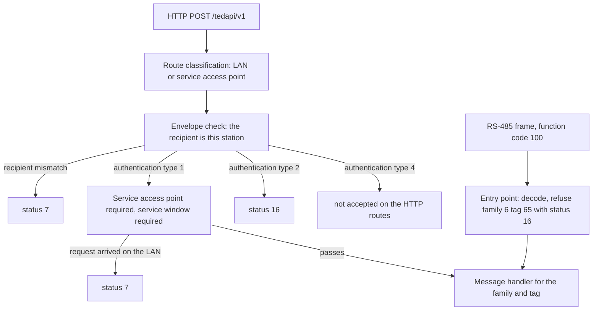
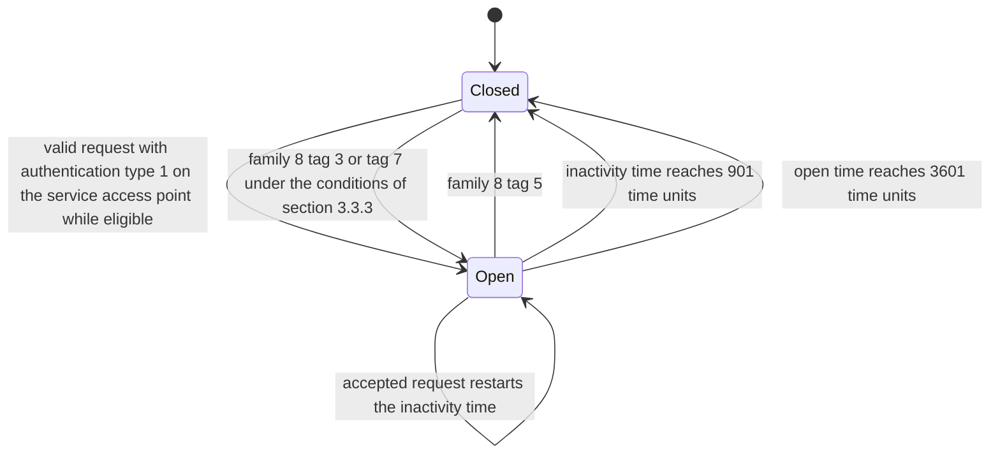
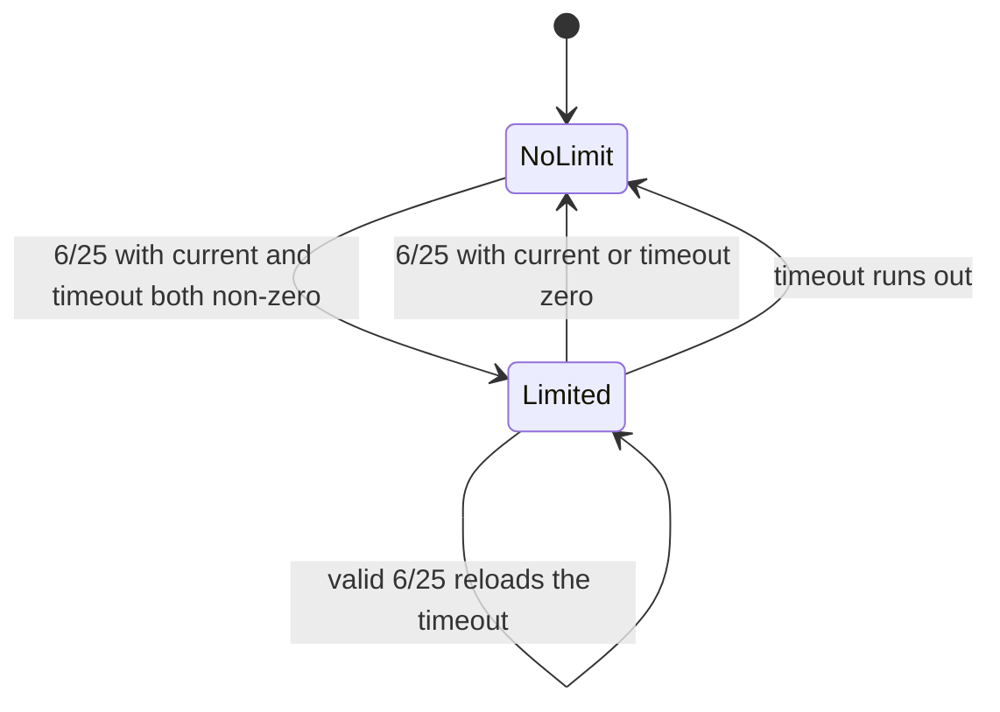
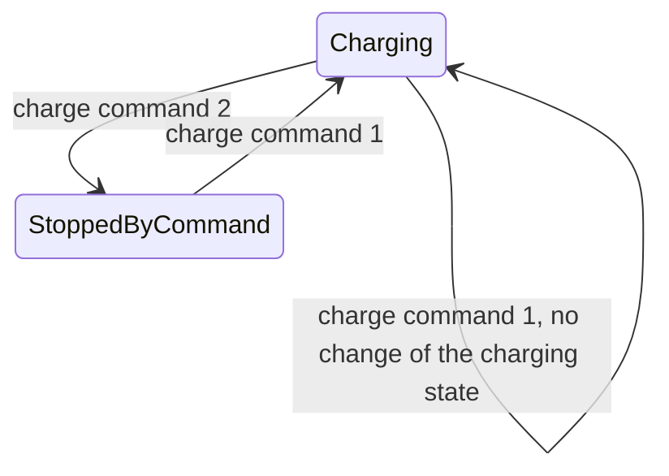
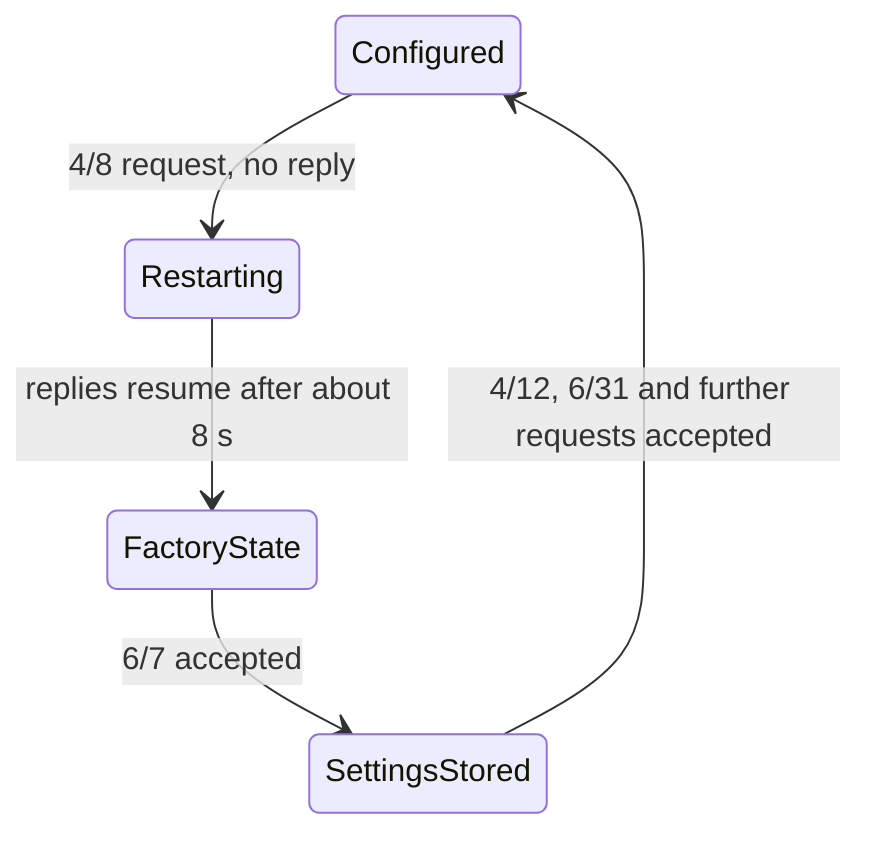
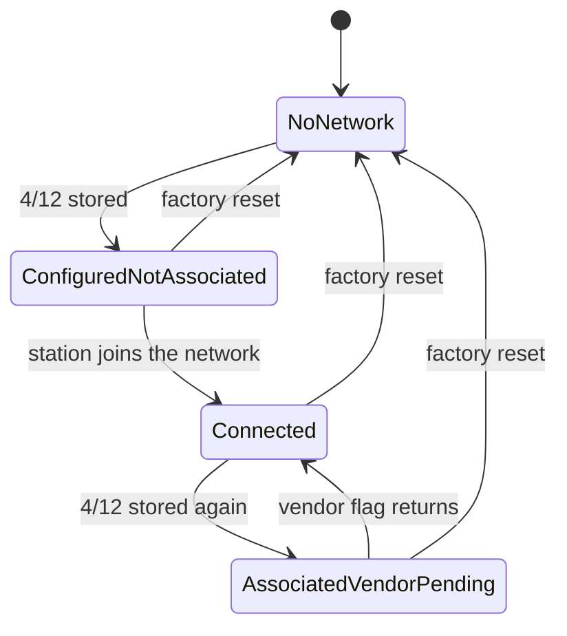
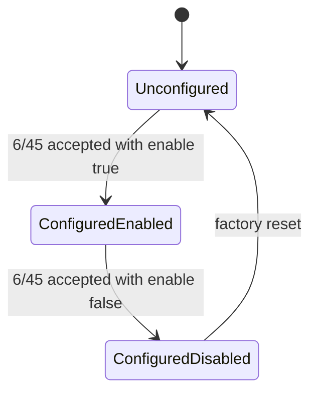

# TEDAPI on the Wall Connector Gen 3: transports, access control and message specification

## 1. Scope and conventions

### 1.1 Scope

TEDAPI is the protobuf request/response interface of the Wall Connector Gen 3 ("the station"). This document specifies:

- the two transports that carry TEDAPI (HTTP `/tedapi/v1`, and Modbus function code 100 on the external RS-485 port) and their envelopes;
- the access control that the station applies on each of three routes (HTTP on the LAN, HTTP on the service access point, RS-485 function code 100), and the checks that message handlers make themselves;
- an access matrix with one row per request message;
- the request and response messages of message family 4 (Common) and family 6 (Wall Connector): fields, enumerations, behavioural rules and state machines;
- the message schema definitions.

Families 8, 9, 10 and 11 are described only where they bear on access control. The RS-485 frame, its addressing and the start-up exchange of the port are specified in a separate document, the [RS-485 site-controller protocol specification](rs485-site-controller-protocol.md). Function codes 101 to 105 of the same port are outside the scope of this document.

Firmware versions covered:

| Firmware | Coverage in this document |
|---|---|
| 26.34.0 | Reference version: all sections. |
| 26.42.0 | RS-485 route: access matrix and message behaviour. |
| 24.44.3 | HTTP access control, service window, selected handler rules, message families on the RS-485 route. |
| 26.18.0, and 25.2.2 for the MID hardware variant | Sequence of the HTTP access-control checks only. |
| 24.28.3 | Existence of the RS-485 route only. |

### 1.2 Terms

| Term | Meaning |
|---|---|
| Station | The Wall Connector Gen 3. |
| Family | The number that selects a message container: 4 = Common (`CommonMessages`), 6 = Wall Connector (`WCMessages`). |
| Tag | The field number, inside a family container, that selects one request or response message. |
| family/tag | Shorthand such as 6/25: family 6, tag 25. |
| Typed reply | A reply that carries the response message paired with the request (request tag plus one). |
| Status reply | A reply that carries family 4, tag 1 (`ErrorResponse`) with a numeric status code (section 5). |
| Route | One of the three ways a request reaches the station: HTTP on the LAN, HTTP on the service access point, RS-485 function code 100. |
| LAN | The network that the station joins as a Wi-Fi client. |
| Service access point | The Wi-Fi network that the station itself provides for commissioning. |
| Service window | The temporary state in which the station accepts requests on the service access point (section 3.3). |
| Device identifier | The station's identifier string, returned by `/tedapi/din` and in `CommonAPIGetSystemInfoResponse.din`. |
| Message schema | The protobuf definitions of section 9. |

### 1.3 Certainty and applicability

- **Applicability.** Unless a statement names firmware versions, it applies to firmware 26.34.0. A statement that names versions applies to those versions. For a version that is not named, the behaviour is Not specified.
- **Provisional.** Described to the best of current knowledge; may be revised. A client may use a Provisional statement as guidance and must tolerate different behaviour. The provisional operational parameters of messages 6/25 to 6/28 (section 7.1) take their name from the message schema and have nothing to do with this mark.
- **Not specified.** This revision does not define the behaviour; clients must not rely on it.
- **Message schema and device support.** The message schema defines more messages, fields and enumeration values than the Wall Connector is specified to support. A message, field or value is specified for the Wall Connector only where this document describes its behaviour. For everything else that the schema defines, support and semantics on the Wall Connector are Not specified.

### 1.4 Reading rules

- **Field names, numbers and types** are those of the message schema. In the schema, enumeration-valued fields are declared as `int32`; section 8 gives the enumeration that applies to each such field.
- **Units** in field tables follow the field name suffix (`...S` seconds, `...Amps`, `...C`, `...Wh`, and so on) unless the table states otherwise.
- **Absent fields.** A field that holds its default value (zero, `false`, empty) is not encoded. The station omits `false` booleans and zero-valued integers from its replies. A client must treat an absent scalar as its default value, except for wrapper-typed fields (`FloatValue`, `Int32Value` and similar), whose absence means "no value".
- **Unknown fields.** Replies can contain fields that the message schema does not define. A client must ignore fields it does not know and must not reject the message.
- **Reply kinds.** A request ends in a typed reply, a status reply or, in the cases stated, no reply. A typed reply does not prove that the request took effect; a client that needs certainty must read the state back.
- **Telemetry.** Contactor state, power, current and voltage in this document are the values that the station reports about itself.

## 2. Transports and envelopes

### 2.1 Message model

A TEDAPI message is one request or one response inside a family container. The station selects the handler by family number and tag.

| Family | Container in the message schema | Use on the Wall Connector |
|---|---|---|
| 4 | `CommonMessages` | Common requests, such as system information, factory reset and Wi-Fi configuration. |
| 6 | `WCMessages` | Wall Connector requests. The station implements 30 request tags: 1, 3, 5, 7, 9, 11, 17, 19, 21, 23, 25, 27, 29, 31, 33, 35, 37, 39, 41, 43, 45, 47, 49, 51, 53, 55, 59, 61, 63, 65. The message schema names 28 of them; tags 59 and 65 have no definition in the schema. |
| 8 | none | Service-window control: request tags 1, 3, 5, 7 with response tags 2, 4, 6, 8 (section 3.3.3). Message names: Not specified. |
| 9 | Provisional: `NeurioMeterMessages` | Provisional: meter configuration. On the RS-485 route only request tag 5 is accepted (firmware 24.44.3; Provisional for firmware 26.34.0). |
| 10 | Provisional: `EnergySiteNetMessages` | Provisional: management of a network of stations. The station implements request tag 1 on the HTTP routes and answers a 10/5 request on the service access point with 10/6. |
| 11 | none | Join exchange between stations over a separate TLS connection; not part of the routes described here. |

Rules common to families 4 and 6:

1. For the request types that section 4 marks Accepted, a request with tag N is answered by the response with tag N+1 of the same family, with the one exception in rule 3. For the other request types this pairing is that of the message schema.
2. A refusal or failure is answered with family 4, tag 1: `ErrorResponse { Status status = 1; }`, of which `status.code` carries the status code (section 5). Whether `status.message` and `status.details` are populated is Not specified. A status reply does not identify the request it answers.
3. `WCAPISetProvisionalOperationalParamsRequest` (6/25) is answered on RS-485 with a message that carries tag 25 (section 7.1). Firmware 26.34.0 and 26.42.0.
4. Two requests take effect on RS-485 without any reply: `CommonAPIFactoryResetRequest` (4/8) and `CommonAPIConfigureWifiRequest` (4/12). Firmware 26.34.0 and 26.42.0.
5. A family container carries exactly one member. It has no request identifier: a reply is matched to its request by order only.

### 2.2 HTTP

#### 2.2.1 Server, paths and companion pages

The station serves TEDAPI over plain HTTP on TCP port 80. Provisional: the station offers no HTTPS listener; a client should not attempt TLS.

| Path | Method | Function |
|---|---|---|
| `/tedapi/v1` | POST | TEDAPI request and reply (sections 2.2.2 and 2.2.3). |
| `/tedapi/din` | GET | Returns the station's device identifier. |
| `/api/1/...` | GET | Read-only JSON status pages; not TEDAPI. |
| `/update` | POST | Software upload; not TEDAPI. |

- The paths are matched exactly, except `/`, which is matched as a prefix for the status pages. The method POST is specified for `/tedapi/v1`; the methods of the other entries, including GET for `/tedapi/din`, are Provisional on firmware 26.34.0.
- **`/tedapi/din`** is answered on the LAN and on the service access point; on the LAN the station answers it while it rejects TEDAPI requests. Firmware 24.44.3 applies no route check to this path; for firmware 26.34.0 this is Not specified. A client needs the device identifier to fill the recipient of the request envelope (section 2.2.2). The exact format of the response body is Not specified.
- **Status pages.** Firmware 24.44.3 serves `/api/1/version`, `/api/1/wifi_status`, `/api/1/safety_crc`, `/api/1/vitals` and `/api/1/lifetime`. Firmware 26.34.0 serves the version page and the Wi-Fi status page on the LAN; whether it serves the other pages is Not specified. These pages are not specified further here.
- **`/update`** is answered with HTTP 403 on a route from which the station does not accept an upload. It is not specified further here.
- **Listener.** Firmware 24.44.3: one listener serves the LAN and the service access point with the same paths, and keeps a connection only if the client address lies in a private range (RFC 1918) or in the shared range of RFC 6598. For firmware 26.34.0 the listener binding and the client-address rule are Not specified.

#### 2.2.2 Request envelope

The body of a `POST /tedapi/v1` request is one serialized `AuthEnvelope`. A client should send it with the content type `application/octet-stream` (Provisional).

| Message | Field | No. | Type | Content |
|---|---|---|---|---|
| `AuthEnvelope` | `payload` | 1 | bytes | A serialized `MessageEnvelope`. |
| `AuthEnvelope` | `externalAuth` | 2 | `ExternalAuth` | The authentication type. |
| `ExternalAuth` | `type` | 1 | int32 | Authentication type (section 3). A local client sends 1. |
| `MessageEnvelope` | `deliveryChannel` | 1 | int32 | A local client sends 1. Firmware 24.44.3: the station does not use this field for access control; it determines the route itself (section 3.2). |
| `MessageEnvelope` | `sender` | 2 | `Participant` | The sender. A local client uses the `local` member. Provisional: the station requires `local` with the value 1 or 2. |
| `MessageEnvelope` | `recipient` | 3 | `Participant` | The recipient. A client must set the `din` member to the station's device identifier. |
| `MessageEnvelope` | family member | 4, 6, ... | family container | The field number is the family; the value is the family container holding exactly one request. |

`MessageEnvelope` is not part of the message schema; its field names are names used in this specification (section 2.2.4).

#### 2.2.3 Reply envelope

- The HTTP status is 200 for a typed reply and for a status reply alike. The HTTP status therefore says nothing about access; a client must decode the protobuf reply.
- The reply body is an `AuthEnvelope` whose `payload` holds a `MessageEnvelope` with the family container of the reply: the typed reply, or family 4 with tag 1 for a status reply.
- Provisional: in the reply envelope, sender and recipient are exchanged.
- The reply is returned in the HTTP response to the request that caused it. Typical response times are 20 to 117 ms.

#### 2.2.4 Envelope definitions

Messages and enumerations of the message schema:

```proto
message AuthEnvelope {
  bytes payload = 1;
  ExternalAuth externalAuth = 2;
}

message ExternalAuth {
  int32 type = 1;
}

message Participant {
  string din = 1;
  int32 teslaService = 2;
  int32 local = 3;
  int32 authorizedClient = 4;
  ProxiedDevice proxiedDevice = 5;
}

message ProxiedDevice {
  string proxyDin = 1;
  string targetDin = 2;
}

enum ExternalAuthType {
  EXTERNALAUTHTYPE_EXTERNAL_AUTH_TYPE_INVALID = 0;
  EXTERNALAUTHTYPE_EXTERNAL_AUTH_TYPE_PRESENCE = 1;
  EXTERNALAUTHTYPE_EXTERNAL_AUTH_TYPE_MTLS = 2;
  EXTERNALAUTHTYPE_EXTERNAL_AUTH_TYPE_HERMES_COMMAND = 4;
}

enum DeliveryChannel {
  DELIVERYCHANNEL_DELIVERY_CHANNEL_INVALID = 0;
  DELIVERYCHANNEL_DELIVERY_CHANNEL_LOCAL_HTTPS = 1;
  DELIVERYCHANNEL_DELIVERY_CHANNEL_HERMES_COMMAND = 2;
  DELIVERYCHANNEL_DELIVERY_CHANNEL_BLE = 3;
}

enum LocalParticipant {
  LOCALPARTICIPANT_LOCAL_PARTICIPANT_INVALID = 0;
  LOCALPARTICIPANT_LOCAL_PARTICIPANT_INSTALLER = 1;
  LOCALPARTICIPANT_LOCAL_PARTICIPANT_CUSTOMER = 2;
}
```

The message envelope:

```proto
// Field names used in this specification.
message MessageEnvelope {
  int32 deliveryChannel = 1;
  Participant sender = 2;
  Participant recipient = 3;
  CommonMessages common = 4;
  WCMessages wc = 6;
  // Further families use their own number as field number.
}
```

The association of `ExternalAuth.type` with `ExternalAuthType`, of `deliveryChannel` with `DeliveryChannel` and of `Participant.local` with `LocalParticipant` is Provisional (section 8). The station's treatment of the numeric authentication types 1, 2 and 4 is specified in section 3.

### 2.3 RS-485, function code 100

The frame (station address, function code, length, check value) and the start-up exchange are specified in the RS-485 site-controller protocol specification. This section specifies only what the frame carries.

- The payload of a function-code-100 request is one protobuf message with a single field: the field number is the family (4 or 6), the wire type is length-delimited, and the value is the family container holding exactly one request. It is the family member of `MessageEnvelope` on its own: there is no delivery channel, no sender, no recipient and no `AuthEnvelope`.
- The request therefore carries no device identifier, no credential and no authentication type.
- The reply has the same form: one family field holding the response or, for a refusal, family 4 with tag 1.
- The station encodes a reply into at most 252 bytes; there is no fragmentation. If the station cannot decode a request it answers with Modbus exception 4; if it cannot encode the reply it answers with Modbus exception 3. These are not TEDAPI status replies.
- The station processes a request asynchronously and sends no immediate acknowledgement. Firmware 24.44.3: the reply path holds a single pending reply, which a later reply can overwrite; there is no retry.
- Typical reply times after the end of the request are 6 to 340 ms on firmware 26.34.0 and 6 to 376 ms on firmware 26.42.0. A reply can be lost.
- A client must send one request at a time, must match the reply by order and by the expected tag, and must treat a missing reply as an unknown outcome, not as a refusal.

## 3. Access control

### 3.1 Overview

The three routes end in the same message handlers. They differ in the checks that a request must pass before it reaches a handler.



| Property | HTTP on the LAN | HTTP on the service access point | RS-485 function code 100 |
|---|---|---|---|
| Recipient compared with the station's device identifier | yes | yes | no |
| Authentication type evaluated | yes | yes | no |
| Service window required (authentication type 1) | not reached: rejected because of the route | yes | no |
| Handler-level checks (section 3.5) | not reached for authentication type 1 | apply | apply |

The RS-485 route performs no identification or authentication of the peer and applies none of the checks of the HTTP routes. A peer that can exchange function-code-100 frames with the station reaches the message handlers of family 6 and of the family 4 requests for which section 4 states a result (Provisional: also those of the other family 4 requests), subject only to the handler-level checks of section 3.5 and to the one exclusion of section 3.4.2.

### 3.2 HTTP on the LAN

A request to `/tedapi/v1` that arrives on the station's LAN address passes these checks in order.

| Step | Check | Result when the check fails |
|---|---|---|
| 1 | The path is `/tedapi/v1` and the method is POST. | Not specified. |
| 2 | Route classification. The route is determined by the interface on which the request arrives: a request that arrives on the station's LAN interface is on the LAN route. | No refusal at this step. |
| 3 | The recipient of the envelope is the station's own device identifier. | status 7 PERMISSION_DENIED |
| 4 | Provisional: the `externalAuth` member is present. | Firmware 24.44.3: status 16 UNAUTHENTICATED. Firmware 26.34.0: Not specified. |
| 5a | Authentication type 1: the request must have arrived on the service access point. | On the LAN: **status 7 PERMISSION_DENIED**. The message handler is not reached. |
| 5b | Authentication type 2. | status 16 UNAUTHENTICATED |
| 5c | Authentication type 4: accepted only on a route that an HTTP request never has. Firmware 24.44.3: that route is the station's own connection to the vendor's cloud service, over which the service relays requests. | Firmware 24.44.3: status 16 UNAUTHENTICATED. Firmware 26.34.0: the status value is Not specified. |
| 5d | Any other authentication type. | Firmware 24.44.3: status 16 UNAUTHENTICATED. Firmware 26.34.0: Not specified. |

Consequences:

- With authentication type 1, every family 4 and family 6 request on the LAN is answered with HTTP 200 and status 7 PERMISSION_DENIED, before any message handler runs. This holds whether or not a service window is open.
- HTTP Basic credentials have no effect on the result.
- The route is determined by the interface on which the request arrives, not by the client's address. Address translation between client and station does not change the route. Firmware 24.44.3.
- The same sequence of checks applies to firmware 24.44.3, 26.18.0 and 25.2.2 (MID).
- Whether a LAN client has any other way to authenticate is Not specified.

### 3.3 HTTP on the service access point

#### 3.3.1 Checks

| Step | Check | Result when the check fails |
|---|---|---|
| 1 | As step 1 of section 3.2. | — |
| 2 | Route classification. A request is on the service-access-point route when the access point is active and the request arrives on the access-point interface. | The request is treated as arriving on another route and fails step 5. |
| 3 | The recipient of the envelope is the station's own device identifier. | status 7 PERMISSION_DENIED |
| 4 | Provisional: the `externalAuth` member is present. | as section 3.2 |
| 5 | Authentication type 1. Provisional: the sender is the `local` member with the value 1 or 2. The service window is open, or this request opens it (section 3.3.2). | Firmware 24.44.3: status 16 UNAUTHENTICATED for a wrong sender; with the service window closed, status 16 for every family except family 8. Firmware 26.34.0: the status values are Not specified. |
| 6 | The request is passed to the message handler for its family and tag. Family 8 is the service-window control family (section 3.3.3). | — |
| 7 | Handler-level checks (section 3.5). | per handler |

What a client needs on this route:

- association with the service access point, whose passphrase is printed on the label of the station;
- the station's device identifier for the recipient, readable from `/tedapi/din` on the same route;
- an open service window, or the conditions to open one.

With these, the station answers the requests that section 4 marks Accepted on this route, and a request 10/5 of family 10.

#### 3.3.2 Service window

The state machine below is specified for firmware 24.44.3. Firmware 26.34.0 also requires the service-access-point route for authentication type 1, and it uses the thresholds 900, 901 and 3601 and has an exception for family 8. Provisional: on firmware 26.34.0 these thresholds and this exception have the roles they have on firmware 24.44.3. The remaining details are Not specified for firmware 26.34.0.

Times are counted in time units. Firmware 24.44.3: one time unit is nominally one second (Provisional), so that 900 time units are nominally 15 minutes and 3601 time units nominally one hour. For firmware 26.34.0 the duration of a time unit is Not specified.

| Quantity | Meaning |
|---|---|
| Uptime | Time units since the station started. |
| Eligibility time | Time units since the last eligibility event. |
| Inactivity time | Time units since the last accepted request with authentication type 1. |
| Open time | Time units since the service window opened. |

**Opening the service window at the station.** Provisional, firmware 26.34.0: a press of about five seconds on the station's button opens the service window. How the press relates to the eligibility event of the table below is Not specified. Firmware 24.44.3 also makes the station eligible during the first 900 time units after it starts, without any action at the station; for firmware 26.34.0 this is Not specified.



| State | Event | Condition | Next state and action |
|---|---|---|---|
| Closed | Request with authentication type 1 on the service access point, with a valid sender | uptime below 900 time units, or eligibility time below 900 time units | Open; inactivity time and open time restart; the request is processed. |
| Closed | Same request | neither condition holds | Closed; a family 8 request is processed, a request of any other family is rejected with status 16. |
| Open | Accepted request with authentication type 1 | — | Open; the inactivity time restarts. |
| Open | Expiry | inactivity time of 901 time units or more, or open time of 3601 time units or more | Closed. |
| Open | Family 8, tag 5 | — | Closed. |
| any | Eligibility event | — | The eligibility time restarts. |

- Firmware 24.44.3: the station evaluates expiry when it processes a request with authentication type 1 and when its access-point policy reads the state of the window.
- Firmware 24.44.3: each accepted request with authentication type 1 restarts the inactivity time. An accepted request does not restart the open time.
- The service window does not open the LAN route: a request on the LAN is rejected while the window is open (section 3.2).

**Availability of the service access point.** Firmware 24.44.3: whether the station offers the service access point is a decision of its own, to which these are inputs: the service window is open, the station is eligible, or the station is within the first 900 time units after it starts. An accepted `WCAPIConfigureSettingsRequest` (6/7) makes the station request the access point again. Starting and stopping the access point does not change the service window. For firmware 26.34.0 the conditions are Not specified.

#### 3.3.3 Family 8: service-window control

Family 8 has request tags 1, 3, 5, 7 and response tags 2, 4, 6, 8; tag 3 stores an installer e-mail value and tag 5 closes the service window. Firmware 24.44.3 behaves as follows; for firmware 26.34.0 the details beyond the preceding sentence are Not specified.

| Request tag | Response tag | Behaviour (firmware 24.44.3) |
|---|---|---|
| 1 | 2 | Reports whether the service window is closed. |
| 3 | 4 | Takes a string and stores it as the installer e-mail value. While the window is closed and uptime is below 900 time units it opens the window; otherwise it returns state value 4 and restarts the inactivity time. |
| 5 | 6 | Closes the service window. |
| 7 | 8 | Window open: returns state value 1 and restarts the inactivity time. Window closed with uptime below 900 time units: returns state value 2 without opening. Otherwise it opens the window if the eligibility time is below 900 time units and the inactivity time is at most 900 time units; if not, it returns state value 4. |
| other | — | status 5 NOT_FOUND |

The message names of family 8 and the meaning of the state values 1, 2 and 4 are Not specified. Family 8 is not available on the RS-485 route: firmware 24.44.3 answers status 5 NOT_FOUND; Provisional for firmware 26.34.0.

### 3.4 RS-485, function code 100

#### 3.4.1 Conditions under which the route is active

| No. | Condition |
|---|---|
| 1 | The hardware variant of the station is one of 0, 1, 5, 7, 20, 22, 23, 24. The variant identifier is reported in `WCGenealogy.subUsageId` (section 6.4.5). |
| 2 | Dry-contact mode is not enabled. With dry-contact mode enabled the station does not receive on the RS-485 port. |
| 3 | The start-up exchange of the port has completed (RS-485 site-controller protocol specification). The exchange carries no secret, no key, no nonce and no identity of the peer. |
| 4 | The request frame is addressed to the station's node address: the address of a stored Home Site Controller configuration, or the default address 16. |

- A stored Home Site Controller configuration is not required: without one the station answers on the default address 16. Firmware 26.34.0 and 26.42.0.
- Provisional: the station starts the start-up exchange once after it starts and does not repeat it while its configuration is unchanged.
- After a factory reset the station restarts. It typically issues its start-up probe about 6 s after the reset request and answers function-code-100 requests again about 8 s after the reset request. Firmware 26.34.0 and 26.42.0. Whether the route resumes after a restart without a completed start-up exchange is Not specified.

#### 3.4.2 Checks

| Step | Check | Result when the check fails |
|---|---|---|
| 1 | The frame is valid, addressed to the station's node address and carries function code 100. | See the RS-485 site-controller protocol specification. |
| 2 | The station decodes the nested message. | Modbus exception 4 |
| 3 | Exclusion: a request of family 6, tag 65 is refused. This is the only request that the entry point of the route refuses. | status 16 UNAUTHENTICATED |
| 4 | A request of family 6, and a request of family 4 for which section 4 states a result, is passed directly to its message handler. Provisional: the same holds for the other requests of family 4. | — |
| 5 | Other families. Firmware 24.44.3: family 9 is accepted for request tag 5 only, and every other family is answered with status 5 NOT_FOUND. Provisional for firmware 26.34.0: the same, with status 12 UNIMPLEMENTED for other tags of family 9. | status 5 or status 12 |
| 6 | Handler-level checks (section 3.5). | per handler |
| 7 | The reply is encoded into at most 252 bytes. | Modbus exception 3 |

#### 3.4.3 Properties of the route

- The route performs no identification and no authentication of the peer. A request contains nothing that identifies its sender (section 2.3), and the station asks for nothing.
- None of the checks of the HTTP routes is applied: there is no recipient to compare with the device identifier, no authentication type, no route classification and no service window.
- The station does not reject for lack of permission any read request for which section 4 states a result on this route. Firmware 26.34.0 and 26.42.0.
- Message handlers that restrict the routes on which they act (section 3.5.1) treat this route as stated there.

For firmware 26.18.0 and for firmware 25.2.2 (MID) the behaviour of this route is Not specified. Firmware 24.28.3 has the route; the set of message handlers it reaches is Not specified.

### 3.5 Checks made by message handlers

These checks run after the route checks and apply on every route that reaches the handler.

#### 3.5.1 Route restrictions

Some handlers accept a request only on certain routes. In this table "cloud relay" means a request that the station receives through its own connection to the vendor's cloud service.

| Request | Restriction | RS-485 route |
|---|---|---|
| 6/7 `ConfigureSettings` | Provisional: rejected with status 7 on the cloud relay. | Accepted. Firmware 26.34.0 and 26.42.0. |
| 6/21 `ConfigurePpuSettings` | Provisional, firmware 26.34.0: rejected with status 7 on the LAN and on the service access point. | Firmware 26.42.0: rejected with status 7 PERMISSION_DENIED. Firmware 26.34.0: Not specified; Provisional: not rejected by this restriction. |
| 6/35 `PushPpuAuthorizationState` | Firmware 24.44.3: accepted only on the cloud relay. Provisional: the same on firmware 26.34.0. | Rejected with status 7 PERMISSION_DENIED. Firmware 26.34.0 and 26.42.0. |
| 6/51 `ConfigureOperationalSettings` | Provisional, firmware 26.34.0: rejected with status 7 on the LAN and on the service access point. | Firmware 26.34.0: accepted. Firmware 26.42.0: rejected with status 7 PERMISSION_DENIED. |
| 6/65 (no name in the message schema) | Provisional: rejected with status 7 on the LAN and on the cloud relay. | Refused at the entry point with status 16 UNAUTHENTICATED (section 3.4.2). |
| 6/25, 6/43 | No route restriction. | Handled as on any other route. |
| 6/31, 6/45, 6/47, 6/49 | Provisional: no route restriction. | Handled as on any other route. |

On the RS-485 route firmware 26.42.0 rejects 6/21 and 6/51, and firmware 26.34.0 accepts 6/51. The complete list of handlers with a route restriction is Not specified.

#### 3.5.2 State preconditions and input checks

| Request | Checks, in order | Status when a check fails |
|---|---|---|
| 6/1 `GetVitals` | The telemetry must be ready. | 14 UNAVAILABLE |
| 6/3 `GetLifetimeStats` | The data must be ready. | 14 UNAVAILABLE |
| 6/11 `GetLoadSharingNetworkState` | The data must be ready. | 14 UNAVAILABLE |
| 6/5, 6/9, 6/23, 6/27, 6/29, 6/33, 6/53 (read requests) | None. | — |
| 6/25 `SetProvisionalOperationalParams` | (1) The station must hold a non-zero stored capacity. (2) The requested current must not exceed it. (3) The timeout must not exceed 86399. (4) The station must be able to queue the command. | (1) 9 FAILED_PRECONDITION, (2) 3 INVALID_ARGUMENT, (3) 3 INVALID_ARGUMENT, (4) 13 INTERNAL |
| 6/31 `ConfigureAccessControlSettings` | Add: the vehicle identification number must be acceptable to the station (rule Not specified). Remove: the number must be in the list. | 3 INVALID_ARGUMENT for add, 5 NOT_FOUND for remove. Firmware 26.34.0 and 26.42.0. |
| 6/43 `ConfigureHomeSiteController` | (1) Two device identity values provisioned in the station must be present and valid (section 3.5.3). (2) A state precondition; its conditions are Not specified. (3) The identifier string must not be empty and the node address must be 1 to 255. (4) The station must be able to store the configuration. | (1) 13 INTERNAL, (2) 9 FAILED_PRECONDITION, (3) 3 INVALID_ARGUMENT, (4) 13 INTERNAL |
| 6/45 `ConfigureOcppSettings`, 6/47 `SetOcppSecurityParameter` | (1) A state precondition. Firmware 24.44.3: no Home Site Controller configuration is stored, pay-per-use reporting is inactive, the station has no role in a station-to-station network, and no vehicle is connected. Firmware 26.34.0: the conditions are Not specified. (2) Input validation (section 7.5). (3) The station must be able to store the value. | (1) 9 FAILED_PRECONDITION, (2) 3 INVALID_ARGUMENT, (3) 13 INTERNAL |
| 6/49 `GetOcppSecurityParameter` | (1) A state precondition; its conditions are Not specified. (2) A parameter type must be given; types 0 and 3 are rejected. | (1) 9 FAILED_PRECONDITION, (2) 3 INVALID_ARGUMENT |
| 6/63 `GetOcppLocalAuthList` | A state precondition; its conditions are Not specified. | 9 FAILED_PRECONDITION. Firmware 26.34.0 and 26.42.0. |
| 4/12 `ConfigureWifi` | Network name and passphrase must both be non-empty; the name is at most 30 bytes; the passphrase is 8 to 63 bytes and passes a character check. The members `enabled` and `securityType` are not evaluated. | A status reply; the status value is Not specified. |
| 4/20, 4/22 | Not implemented. | 12 UNIMPLEMENTED |

Handlers of requests that this table does not list have no specified precondition.

#### 3.5.3 Identity values checked by 6/43

Before anything else, the handler of `WCAPIConfigureHomeSiteControllerRequest` checks two device identity values provisioned in the station. If either value is missing or blank, the handler answers status 13 INTERNAL. The check uses no field of the request and does not depend on the route or on the peer. Status 13 is also the answer when the configuration cannot be stored, so the status alone does not tell the two cases apart. A station on which the identity values are absent rejects every request of this type on every route, including a request with an invalid node address, which would otherwise be answered with status 3.

### 3.6 Comparison of the routes

For the same read request and the same write request (`WCAPIConfigureThirdPartyVehicleModeRequest`), firmware 26.34.0:

| Route | What the client needs | Read requests | Write request |
|---|---|---|---|
| HTTP on the LAN | network access; the device identifier | status 7 PERMISSION_DENIED | status 7 PERMISSION_DENIED |
| HTTP on the service access point | the passphrase of the access point; the device identifier; an open service window | typed replies | typed reply (accepted) |
| RS-485 function code 100 | a connection to the RS-485 port and a completed start-up exchange | typed replies | typed reply (accepted) |

## 4. Access matrix

One row per request message of `CommonMessages` (family 4) and `WCMessages` (family 6), followed by the two family-6 request tags that the station implements without a name in the message schema (59 and 65).

Columns:

- **Changes state** classifies the request by the purpose of the message: "yes" for a request meant to change the state of the station, "no" for a read request. The classification is Provisional.
- **RS-485, firmware 26.34.0** and **RS-485, firmware 26.42.0**: the result of the request on the RS-485 route, on a station to which no Home Site Controller is configured.
- **Service access point**: the result on firmware 26.34.0 for a request with authentication type 1 while the service window is open.
- **LAN**: the result on firmware 26.34.0 for a request with authentication type 1. It is the same for every row, because the route check precedes the message handlers (section 3.2).
- **Notes**: handler-level rules and references.

Cell values:

| Value | Meaning |
|---|---|
| Accepted | The request reaches its handler, and the station answers with the typed reply. Input and state errors of the handler remain possible (section 3.5.2). |
| Rejected: status N NAME | The station answers with the status reply shown. A text in parentheses names the state or the check to which the result belongs. |
| Not implemented: status 12 UNIMPLEMENTED | The station has no handler for the request. |
| No reply (takes effect) | The station carries out the request and sends no reply (sections 7.3 and 7.4). |
| Provisional: ... | The result is Provisional (section 1.3). |
| Not specified | This revision does not define the result (section 1.3). Where the result is Not specified both on RS-485 and on the service access point, support for the message on the Wall Connector is Not specified, unless the Notes column or the RS-485 cell states that the request is dispatched to a handler. |

| Family/tag | Request | Changes state | RS-485, firmware 26.34.0 | RS-485, firmware 26.42.0 | Service access point | LAN | Notes |
|---|---|---|---|---|---|---|---|
| 4/2 | GetSystemInfoRequest | no | Accepted | Accepted | Accepted | Rejected: status 7 PERMISSION_DENIED | — |
| 4/4 | SetLocalSiteConfigRequest | yes | Not specified | Not specified | Not specified | Rejected: status 7 PERMISSION_DENIED | Provisional: not implemented by firmware 26.34.0. |
| 4/6 | PerformUpdateRequest | yes | Not specified | Not specified | Not specified | Rejected: status 7 PERMISSION_DENIED | Provisional: implemented by firmware 26.34.0. Provisional: no route restriction. |
| 4/8 | FactoryResetRequest | yes | No reply (takes effect) | No reply (takes effect) | Not specified | Rejected: status 7 PERMISSION_DENIED | Section 7.3. Provisional: no route restriction. |
| 4/10 | WifiScanRequest | no | Accepted | Accepted | Not specified | Rejected: status 7 PERMISSION_DENIED | — |
| 4/12 | ConfigureWifiRequest | yes | No reply (takes effect) | No reply (takes effect) | Not specified | Rejected: status 7 PERMISSION_DENIED | Section 7.4. The handler produces response 4/13 on success; on RS-485 no reply is delivered. |
| 4/14 | CheckForUpdateRequest | yes | Not specified | Not specified | Not specified | Rejected: status 7 PERMISSION_DENIED | Provisional: implemented by firmware 26.34.0. Provisional: no route restriction. |
| 4/16 | ClearUpdateRequest | yes | Not specified | Not specified | Not specified | Rejected: status 7 PERMISSION_DENIED | Provisional: implemented by firmware 26.34.0. Provisional: no route restriction. |
| 4/18 | DeviceCertRequest | no | Not specified | Not specified | Not specified | Rejected: status 7 PERMISSION_DENIED | Provisional: not implemented by firmware 26.34.0. |
| 4/20 | ConfigureWifiWithEncryptedPasswordRequest | yes | Not implemented: status 12 UNIMPLEMENTED | Not implemented: status 12 UNIMPLEMENTED | Not specified | Rejected: status 7 PERMISSION_DENIED | — |
| 4/22 | GetNetworkingStatusRequest | no | Not implemented: status 12 UNIMPLEMENTED | Not implemented: status 12 UNIMPLEMENTED | Not specified | Rejected: status 7 PERMISSION_DENIED | — |
| 4/24 | GetCellularInfoRequest | no | Not implemented: status 12 UNIMPLEMENTED | Not implemented: status 12 UNIMPLEMENTED | Not specified | Rejected: status 7 PERMISSION_DENIED | — |
| 4/26 | ConfigureEthernetRequest | yes | Not specified | Not specified | Not specified | Rejected: status 7 PERMISSION_DENIED | Provisional: not implemented by firmware 26.34.0. |
| 4/28 | ForgetWifiNetworkRequest | yes | Not implemented: status 12 UNIMPLEMENTED | Not specified | Not specified | Rejected: status 7 PERMISSION_DENIED | — |
| 4/30 | CheckInternetRequest | Not specified | Not specified | Not specified | Not specified | Rejected: status 7 PERMISSION_DENIED | Provisional: not implemented by firmware 26.34.0. |
| 4/32 | CheckForUpdateUrgencyRequest | Not specified | Not specified | Not specified | Not specified | Rejected: status 7 PERMISSION_DENIED | Provisional: not implemented by firmware 26.34.0. |
| 4/34 | NegotiateUpdateWithLocallyAvailablePackagesRequest | Not specified | Not specified | Not specified | Not specified | Rejected: status 7 PERMISSION_DENIED | Provisional: not implemented by firmware 26.34.0. |
| 4/36 | PrepareRegistrationPayloadRequest | Not specified | Not specified | Not specified | Not specified | Rejected: status 7 PERMISSION_DENIED | Provisional: implemented by firmware 26.34.0. |
| 4/38 | PerformUpdateFromLocallyAvailablePackagesRequest | yes | Not specified | Not specified | Not specified | Rejected: status 7 PERMISSION_DENIED | Provisional: not implemented by firmware 26.34.0. |
| 4/40 | RegisterRequest | yes | Not specified | Not specified | Not specified | Rejected: status 7 PERMISSION_DENIED | Provisional: implemented by firmware 26.34.0. |
| 4/42 | RetrieveSiteUuidRequest | Not specified | Not specified | Not specified | Not specified | Rejected: status 7 PERMISSION_DENIED | Provisional: implemented by firmware 26.34.0. |
| 4/44 | RetrieveSiteSuggestionRequest | Not specified | Not specified | Not specified | Not specified | Rejected: status 7 PERMISSION_DENIED | Provisional: implemented by firmware 26.34.0. |
| 4/46 | StartTcpdumpRequest | yes | Not specified | Not specified | Not specified | Rejected: status 7 PERMISSION_DENIED | Provisional: not implemented by firmware 26.34.0. |
| 4/48 | StopTcpdumpRequest | yes | Not specified | Not specified | Not specified | Rejected: status 7 PERMISSION_DENIED | Provisional: not implemented by firmware 26.34.0. |
| 4/50 | GetTcpdumpInfoRequest | no | Not specified | Not specified | Not specified | Rejected: status 7 PERMISSION_DENIED | Provisional: not implemented by firmware 26.34.0. |
| 6/1 | GetVitalsRequest | no | Accepted | Accepted | Accepted | Rejected: status 7 PERMISSION_DENIED | Status 14 UNAVAILABLE while the telemetry is not ready. |
| 6/3 | GetLifetimeStatsRequest | no | Accepted | Accepted | Not specified | Rejected: status 7 PERMISSION_DENIED | Status 14 UNAVAILABLE while the data is not ready. |
| 6/5 | GetConfigRequest | no | Accepted | Accepted | Accepted | Rejected: status 7 PERMISSION_DENIED | — |
| 6/7 | ConfigureSettingsRequest | yes | Accepted | Accepted | Not specified | Rejected: status 7 PERMISSION_DENIED | Section 7.8. Provisional: rejected with status 7 when relayed by the vendor's cloud service. |
| 6/9 | GetSystemInfoRequest | no | Accepted | Accepted | Accepted | Rejected: status 7 PERMISSION_DENIED | — |
| 6/11 | GetLoadSharingNetworkStateRequest | no | Accepted | Accepted | Accepted | Rejected: status 7 PERMISSION_DENIED | Status 14 UNAVAILABLE while the data is not ready. |
| 6/17 | SetLoadSharingNetworkOperationRequest | yes | Accepted | Accepted | Not specified | Rejected: status 7 PERMISSION_DENIED | Provisional: subject to a state precondition. |
| 6/19 | ConfigureLoadSharingSettingsRequest | yes | Not specified (the request is dispatched to its handler) | Not specified | Not specified | Rejected: status 7 PERMISSION_DENIED | Provisional: subject to a state precondition. |
| 6/21 | ConfigurePpuSettingsRequest | yes | Not specified (the request is dispatched to its handler). Provisional: not rejected by the route restriction | Rejected: status 7 PERMISSION_DENIED | Not specified. Provisional: Rejected: status 7 PERMISSION_DENIED | Rejected: status 7 PERMISSION_DENIED | Provisional, firmware 26.34.0: the handler rejects the request with status 7 on the LAN and on the service access point. |
| 6/23 | GetPpuSettingsRequest | no | Accepted | Accepted | Not specified | Rejected: status 7 PERMISSION_DENIED | — |
| 6/25 | SetProvisionalOperationalParamsRequest | yes | Accepted (the reply carries tag 25, section 7.1) | Accepted (the reply carries tag 25, section 7.1) | Not specified | Rejected: status 7 PERMISSION_DENIED | Statuses 9, 3 and 13 for state and input errors (section 3.5.2). |
| 6/27 | GetProvisionalOperationalParamsRequest | no | Accepted | Accepted | Accepted | Rejected: status 7 PERMISSION_DENIED | — |
| 6/29 | GetAccessControlSettingsRequest | no | Accepted | Accepted | Accepted | Rejected: status 7 PERMISSION_DENIED | — |
| 6/31 | ConfigureAccessControlSettingsRequest | yes | Accepted; status 3 INVALID_ARGUMENT or status 5 NOT_FOUND for input errors (section 7.6) | Accepted; status 3 INVALID_ARGUMENT or status 5 NOT_FOUND for input errors (section 7.6) | Not specified | Rejected: status 7 PERMISSION_DENIED | Provisional: no route restriction. |
| 6/33 | GetRecentVehiclesRequest | no | Accepted | Accepted | Not specified | Rejected: status 7 PERMISSION_DENIED | — |
| 6/35 | PushPpuAuthorizationStateRequest | yes | Rejected: status 7 PERMISSION_DENIED | Rejected: status 7 PERMISSION_DENIED | Not specified. Provisional: Rejected: status 7 PERMISSION_DENIED | Rejected: status 7 PERMISSION_DENIED | Firmware 24.44.3: accepted only when relayed by the vendor's cloud service. Provisional: the same on firmware 26.34.0. |
| 6/37 | ConfigureChargeScheduleRequest | yes | Accepted | Accepted | Not specified | Rejected: status 7 PERMISSION_DENIED | Section 7.7. The reply carries `error` = 4. |
| 6/39 | PushChargeCommandRequest | yes | Accepted | Accepted | Not specified | Rejected: status 7 PERMISSION_DENIED | Section 7.2. |
| 6/41 | ConfigureThirdPartyVehicleModeRequest | yes | Accepted | Accepted | Accepted | Rejected: status 7 PERMISSION_DENIED | Specified for a request that carries the value already stored (section 6.4.18). |
| 6/43 | ConfigureHomeSiteControllerRequest | yes | Rejected: status 13 INTERNAL | Rejected: status 13 INTERNAL | Not specified | Rejected: status 7 PERMISSION_DENIED | Firmware 26.34.0: status 13 comes either from the identity check of section 3.5.3 or from a storage failure; which one is Not specified. |
| 6/45 | ConfigureOcppSettingsRequest | yes | Accepted (in operating mode 2) | Rejected: status 9 FAILED_PRECONDITION (in operating mode 3) | Not specified | Rejected: status 7 PERMISSION_DENIED | State precondition and input checks (sections 3.5.2 and 7.5). |
| 6/47 | SetOcppSecurityParameterRequest | yes | Accepted (in operating mode 2) | Rejected: status 9 FAILED_PRECONDITION (in operating mode 3) | Not specified | Rejected: status 7 PERMISSION_DENIED | State precondition and input checks (sections 3.5.2 and 7.5). |
| 6/49 | GetOcppSecurityParameterRequest | no | Accepted for type 1 (in operating mode 2); status 3 INVALID_ARGUMENT without a parameter type | Rejected: status 3 INVALID_ARGUMENT without a parameter type; status 13 INTERNAL for type 1 (in operating mode 3) | Not specified | Rejected: status 7 PERMISSION_DENIED | State precondition and type check (sections 3.5.2 and 7.5). |
| 6/51 | ConfigureOperationalSettingsRequest | yes | Accepted | Rejected: status 7 PERMISSION_DENIED | Not specified. Provisional: Rejected: status 7 PERMISSION_DENIED | Rejected: status 7 PERMISSION_DENIED | Section 7.5. Provisional, firmware 26.34.0: the handler rejects the request with status 7 on the LAN and on the service access point. |
| 6/53 | GetOperationalSettingsRequest | no | Accepted | Accepted | Accepted | Rejected: status 7 PERMISSION_DENIED | — |
| 6/55 | ConfigureCountryCodeSettingsRequest | yes | Not specified (the request is dispatched to its handler) | Not specified | Not specified | Rejected: status 7 PERMISSION_DENIED | — |
| 6/61 | RegisterCommercialRequest | yes | Accepted | Accepted | Not specified | Rejected: status 7 PERMISSION_DENIED | Specified for a minimal request (section 6.4.25). |
| 6/63 | GetOcppLocalAuthListRequest | no | Rejected: status 9 FAILED_PRECONDITION (state precondition, section 3.5.2) | Rejected: status 9 FAILED_PRECONDITION (state precondition, section 3.5.2) | Not specified | Rejected: status 7 PERMISSION_DENIED | — |
| 6/59 | (no name in the message schema) | yes | Not specified (the request is dispatched to its handler) | Not specified | Not specified | Rejected: status 7 PERMISSION_DENIED | The handler takes a type, a value and an expiry from the request; what it sets is not persistent. Message layout and purpose: Not specified. |
| 6/65 | (no name in the message schema) | Not specified | Rejected: status 16 UNAUTHENTICATED (refused at the entry point of the route) | Not specified | Not specified | Rejected: status 7 PERMISSION_DENIED | Provisional: a powershare command; the handler rejects the request with status 7 on the LAN and when relayed by the vendor's cloud service. Message layout: Not specified. |

## 5. Status codes

A status reply carries `Status.code` in family 4, tag 1. The numeric values follow the numbering of gRPC status codes; the names below are those of the enumeration `Code` of the message schema, whose association with `Status.code` is Provisional.

| Code | Name | Returned when |
|---|---|---|
| 0 | `OK` | Never carried in a status reply; success is a typed reply. |
| 3 | `INVALID_ARGUMENT` | 6/25: the requested current exceeds the stored capacity, or the timeout exceeds 86399. 6/43: the identifier is empty or the node address is outside 1 to 255. 6/45: the settings fail validation. 6/47: the parameter type is 0 or 3, or the parameter is empty. 6/31: an add with a vehicle identification number that the station does not accept (firmware 26.34.0 and 26.42.0). 6/49: no parameter type is given (firmware 26.34.0 and 26.42.0). |
| 5 | `NOT_FOUND` | 6/31: a remove of a vehicle identification number that is not in the list (firmware 26.34.0 and 26.42.0). RS-485: a family other than 4, 6 and 9 (firmware 24.44.3; Provisional for firmware 26.34.0). Family 8: a request tag other than 1, 3, 5, 7 (firmware 24.44.3). |
| 7 | `PERMISSION_DENIED` | HTTP: the recipient is not the station's device identifier; authentication type 1 on a route other than the service access point, which includes every such request on the LAN. Handler route restrictions (section 3.5.1): on RS-485, 6/35 (firmware 26.34.0 and 26.42.0), and 6/51 and 6/21 (firmware 26.42.0). |
| 9 | `FAILED_PRECONDITION` | 6/25: the station holds no stored capacity. 6/43: its state precondition fails. 6/45, 6/47, 6/49: their state precondition fails. 6/63: its state precondition fails (firmware 26.34.0 and 26.42.0). Firmware 26.42.0: 6/45 and 6/47 in operating mode 3. |
| 12 | `UNIMPLEMENTED` | The request has no handler: 4/20, 4/22, 4/24, 4/28. Firmware 26.42.0: 4/20, 4/22, 4/24. Provisional: on RS-485, family 9 with a request tag other than 5. |
| 13 | `INTERNAL` | 6/43: an identity value of the station is missing or blank, or the configuration cannot be stored (section 3.5.3). Firmware 26.34.0 and 26.42.0 answer 6/43 on RS-485 with status 13; which cause applies is Not specified. 6/25: the command cannot be queued. 6/45: the settings cannot be stored. Firmware 26.42.0: 6/49 for type 1 in operating mode 3. |
| 14 | `UNAVAILABLE` | 6/1, 6/3, 6/11: the data is not ready. |
| 16 | `UNAUTHENTICATED` | RS-485: a request of family 6, tag 65. HTTP: authentication type 2. Firmware 24.44.3, HTTP: also an envelope that fails step 4 of section 3.2, a sender that is not valid for authentication type 1, a closed service window, authentication type 4 on an HTTP route, and any other authentication type. |
| 1, 2, 4, 6, 8, 10, 11, 15 | `CANCELLED`, `UNKNOWN`, `DEADLINE_EXCEEDED`, `ALREADY_EXISTS`, `RESOURCE_EXHAUSTED`, `ABORTED`, `OUT_OF_RANGE`, `DATA_LOSS` | Not specified. |

Results that are not status replies:

| Result | Where |
|---|---|
| HTTP 200 with a status reply in the body | A rejected TEDAPI request on the HTTP routes. |
| HTTP 403 | `/update` on a route from which the station accepts no upload (not TEDAPI). |
| Modbus exception 4 | RS-485: the station cannot decode the nested message. |
| Modbus exception 3 | RS-485: the station cannot encode the reply into 252 bytes. |
| Reply with the tag of the request | RS-485: 6/25 (section 7.1). |
| No reply | RS-485: 4/8 and 4/12 (sections 7.3 and 7.4). A reply to any request can also be lost in transit (section 2.3). |

A status value identifies the failed check only together with section 3.5: status 13 for 6/43 has two possible causes, and status 7 can come from a route check or from a handler.

## 6. Message catalogue

### 6.1 Conventions

- One entry per request/response pair. An entry gives the purpose, the request, the response, the preconditions and the effects.
- **Applies to** names the firmware versions for which the entry is specified, per route. Section 4 gives the result of each request per route.
- Field tables list every field of the message schema. Number, name and type are those of the schema. A description of "Not specified." means that the schema defines the field and that its use by the Wall Connector is Not specified. A description of "Reported." means that the station populates the field and that this revision defines no meaning beyond the field name.
- The Values column names the enumeration of an enumeration-valued field; "(Provisional)" after an enumeration name marks a Provisional association (section 8).
- Value limits and handler rules in an entry are those of firmware 26.34.0 unless the entry states otherwise. For firmware 26.42.0 an entry specifies the result of the request on RS-485 and the content of the replies.
- Message types used by several pairs are tabulated once in section 6.6. Complete definitions are in section 9.
- Pairs listed in sections 6.3 and 6.5 are defined in the message schema; their support and semantics on the Wall Connector are Not specified.

### 6.2 Family 4 (Common)

#### 6.2.1 4/2 → 4/3: `CommonAPIGetSystemInfoRequest` → `CommonAPIGetSystemInfoResponse`

- **Purpose.** Device identity, firmware version and software-update state.
- **Applies to.** RS-485: firmware 26.34.0 and 26.42.0. HTTP: firmware 26.34.0.
- **Request.** No fields.
- **Response.**

| No. | Field | Type | Unit | Values | Description |
|---|---|---|---|---|---|
| 1 | `deviceId` | `EcuId` | — | — | Part number and serial number of the station (`EcuId`). |
| 2 | `din` | `string` | — | — | The station's device identifier. HTTP clients place this value in the recipient of the request envelope. |
| 3 | `firmwareVersion` | `FirmwareVersion` | — | — | Firmware version string and build identifier (`FirmwareVersion`). |
| 5 | `systemUpdate` | `SystemUpdate` | — | — | Software-update state (`SystemUpdate`). |
| 6 | `deviceType` | `int32` | — | `DeviceType` (Provisional); 1 = `GEN3WC` | Device type. The Wall Connector reports 1. |
| 7 | `complianceInformation` | `ComplianceInformation` | — | — | Not specified. |
| 8 | `installedFirmwareSignature` | `bytes` | — | — | Not specified. |
| 9 | `offlineFirmwareSignature` | `bytes` | — | — | Not specified. |

`EcuId`:

| No. | Field | Type | Unit | Values | Description |
|---|---|---|---|---|---|
| 1 | `partNumber` | `string` | — | — | Part number of the station. |
| 2 | `serialNumber` | `string` | — | — | Serial number of the station. |

`FirmwareVersion`:

| No. | Field | Type | Unit | Values | Description |
|---|---|---|---|---|---|
| 1 | `version` | `string` | — | — | Firmware version string, for example `26.34.0`. |
| 2 | `githash` | `bytes` | — | — | Build identifier, 7 bytes. |

`SystemUpdate`:

| No. | Field | Type | Unit | Values | Description |
|---|---|---|---|---|---|
| 1 | `handshakeResult` | `int32` | — | `UpdateHandshakeResult` (Provisional) | Present only while the station has a network connection. |
| 2 | `updateStatus` | `int32` | — | `UpdateStatus` (Provisional) | Reported. |
| 3 | `serverStagedVersion` | `FirmwareVersion` | — | — | Not specified. |
| 4 | `totalBytes` | `uint64` | bytes | — | Not specified. |
| 5 | `bytesOffset` | `uint64` | — | — | Not specified. |
| 6 | `estimatedBytesPerSecond` | `uint64` | — | — | Not specified. |
| 7 | `lastHandshakeTimestamp` | `uint64` | s (Provisional) | — | Present together with `handshakeResult`. Provisional: Unix time in seconds. |
| 8 | `lastUpdateResult` | `int32` | — | `LastUpdateResult` (Provisional) | Reported. |
| 9 | `serverStagedPackages` | repeated `ServerStagedPackage` | — | — | Not specified. |
| 10 | `isSideloading` | `bool` | — | — | Not specified. |

- **Preconditions.** None specified.
- **Effects.** None specified.

#### 6.2.2 4/8 → 4/9: `CommonAPIFactoryResetRequest` → `CommonAPIFactoryResetResponse`

- **Purpose.** Return the station to factory state.
- **Applies to.** RS-485: firmware 26.34.0 and 26.42.0. HTTP: Not specified.
- **Request.** No fields.
- **Response.** `CommonAPIFactoryResetResponse` has no fields. On RS-485 the station sends no reply to this request.
- **Preconditions.** None specified. The station carries out the request while a vehicle is charging.
- **Effects.** The station deletes the installation settings, the Home Site Controller configuration, the OCPP state and the stored Wi-Fi name and passphrase; it keeps the identity values of section 3.5.3. The station restarts. Section 7.3 specifies the resulting state.

#### 6.2.3 4/10 → 4/11: `CommonAPIWifiScanRequest` → `CommonAPIWifiScanResponse`

- **Purpose.** List Wi-Fi networks.
- **Applies to.** RS-485: firmware 26.34.0 and 26.42.0.
- **Request.**

| No. | Field | Type | Unit | Values | Description |
|---|---|---|---|---|---|
| 1 | `maxScanDurationS` | `uint32` | s | — | Optional. Effect: Not specified. |
| 3 | `maximumTotalAps` | `uint32` | — | — | Optional. Effect: Not specified. |

- **Response.**

| No. | Field | Type | Unit | Values | Description |
|---|---|---|---|---|---|
| 1 | `wifiNetworks` | repeated `WifiNetwork` | — | — | List of networks (`WifiNetwork`). The list can be empty. |

- **Preconditions and effects.** Not specified. Whether the request starts a scan or returns stored results is Not specified.
- **Notes.** A request without fields is answered after typically 9 ms; the list can be empty. `WifiNetwork` is defined in section 9.

#### 6.2.4 4/12 → 4/13: `CommonAPIConfigureWifiRequest` → `CommonAPIConfigureWifiResponse`

- **Purpose.** Store the Wi-Fi network that the station joins as a client.
- **Applies to.** RS-485: firmware 26.34.0 and 26.42.0. HTTP: Not specified.
- **Request.**

| No. | Field | Type | Unit | Values | Description |
|---|---|---|---|---|---|
| 1 | `enabled` | `bool` | — | — | Clients should send `true`. The station does not evaluate this field when it stores the configuration. |
| 2 | `wifiConfig` | `WifiConfig` | — | — | Network name and passphrase to store (`WifiConfig`). |

- **Response.**

| No. | Field | Type | Unit | Values | Description |
|---|---|---|---|---|---|
| 1 | `wifiConfig` | `WifiConfig` | — | — | Not specified. On RS-485 no reply is delivered for this request (section 7.4). |
| 2 | `wifi` | `NetworkInterface` | — | — | Not specified. |

- **Preconditions.** Input checks only: name and passphrase non-empty, name at most 30 bytes, passphrase 8 to 63 bytes with a character check. No state precondition is specified.
- **Effects.** The station stores the network name and the passphrase; the two are not guaranteed to change together, so a failure can leave a new name with the old passphrase. The station then reconfigures its network connection. Section 7.4 specifies the resulting states. Whether the stored configuration survives a restart is Not specified.
- **Notes.** On success the handler produces response 4/13. On RS-485 no reply is delivered; a client must read the configuration (6/5) to see the result.

#### 6.2.5 Common requests that are not implemented

| Pair | Request fields | Result on RS-485 |
|---|---|---|
| 4/20 → 4/21 `CommonAPIConfigureWifiWithEncryptedPasswordRequest` | 1 `enabled` bool; 2 `wifiConfig` `WifiConfig`; 3 `encryptedPassword` `EncryptedMessage` | status 12 UNIMPLEMENTED. Firmware 26.34.0 and 26.42.0. |
| 4/22 → 4/23 `CommonAPIGetNetworkingStatusRequest` | none | status 12 UNIMPLEMENTED. Firmware 26.34.0 and 26.42.0. |
| 4/24 → 4/25 `CommonAPIGetCellularInfoRequest` | none | status 12 UNIMPLEMENTED. Firmware 26.34.0 and 26.42.0. |
| 4/28 → 4/29 `CommonAPIForgetWifiNetworkRequest` | 1 `ssid` string | status 12 UNIMPLEMENTED; the stored configuration is unchanged. Firmware 26.34.0. Firmware 26.42.0: Not specified. |

The response messages of these four pairs are defined in section 9; whether the station ever sends them is Not specified.

### 6.3 Family 4 (Common): pairs defined in the message schema only

| Request → response | Request fields | Response fields | Status on the Wall Connector |
|---|---|---|---|
| 4/4 `CommonAPISetLocalSiteConfigRequest` → 4/5 `CommonAPISetLocalSiteConfigResponse` | (no fields) | (no fields) | Support and semantics on the Wall Connector: Not specified. Provisional: not implemented by firmware 26.34.0. |
| 4/6 `CommonAPIPerformUpdateRequest` → 4/7 `CommonAPIPerformUpdateResponse` | (no fields) | (no fields) | Support and semantics on the Wall Connector: Not specified. Firmware 24.44.3 implements the pair. Provisional: implemented by firmware 26.34.0. The request has no fields and carries no software. |
| 4/14 `CommonAPICheckForUpdateRequest` → 4/15 `CommonAPICheckForUpdateResponse` | 1 `downloadIfAvailable` `bool` | (no fields) | Support and semantics on the Wall Connector: Not specified. Firmware 24.44.3 implements the pair. Provisional: on firmware 24.44.3 the request starts the station's software-update check. Provisional: implemented by firmware 26.34.0. |
| 4/16 `CommonAPIClearUpdateRequest` → 4/17 `CommonAPIClearUpdateResponse` | (no fields) | (no fields) | Support and semantics on the Wall Connector: Not specified. Firmware 24.44.3 implements the pair. Provisional: implemented by firmware 26.34.0. |
| 4/18 `CommonAPIDeviceCertRequest` → 4/19 `CommonAPIDeviceCertResponse` | (no fields) | 1 `format` `int32`; 2 `deviceCert` `bytes` | Support and semantics on the Wall Connector: Not specified. Provisional: not implemented by firmware 26.34.0. |
| 4/26 `CommonAPIConfigureEthernetRequest` → 4/27 `CommonAPIConfigureEthernetResponse` | 1 `ipv4Config` `NetworkInterfaceIPv4Config` | 1 `eth` `NetworkInterface` | Support and semantics on the Wall Connector: Not specified. Provisional: not implemented by firmware 26.34.0. |
| 4/30 `CommonAPICheckInternetRequest` → 4/31 `CommonAPICheckInternetResponse` | (no fields) | 1 `wifi` `NetworkInterface`; 2 `eth` `NetworkInterface`; 3 `gsm` `NetworkInterface` | Support and semantics on the Wall Connector: Not specified. Provisional: not implemented by firmware 26.34.0. |
| 4/32 `CommonAPICheckForUpdateUrgencyRequest` → 4/33 `CommonAPICheckForUpdateUrgencyResponse` | (no fields) | (no fields) | Support and semantics on the Wall Connector: Not specified. Provisional: not implemented by firmware 26.34.0. |
| 4/34 `CommonAPINegotiateUpdateWithLocallyAvailablePackagesRequest` → 4/35 `CommonAPINegotiateUpdateWithLocallyAvailablePackagesResponse` | 1 `locallyAvailablePackages` repeated `LocallyAvailablePackage` | 1 `acceptedPackages` repeated `AcceptedPackage` | Support and semantics on the Wall Connector: Not specified. Provisional: not implemented by firmware 26.34.0. |
| 4/36 `CommonAPIPrepareRegistrationPayloadRequest` → 4/37 `CommonAPIPrepareRegistrationPayloadResponse` | 1 `customerRegistrationInfo` `bytes` | 1 `signedRegistrationPayload` `DeviceSignedPayload` | Support and semantics on the Wall Connector: Not specified. Provisional: implemented by firmware 26.34.0. |
| 4/38 `CommonAPIPerformUpdateFromLocallyAvailablePackagesRequest` → 4/39 `CommonAPIPerformUpdateFromLocallyAvailablePackagesResponse` | 1 `locallyAvailablePackages` repeated `LocallyAvailablePackage` | 1 `acceptedPackages` repeated `AcceptedPackage` | Support and semantics on the Wall Connector: Not specified. Provisional: not implemented by firmware 26.34.0. |
| 4/40 `CommonAPIRegisterRequest` → 4/41 `CommonAPIRegisterResponse` | 1 `request` `RegistrationRequest` | 1 `failure` `int32`; 2 `response` `RegistrationResponse` | Support and semantics on the Wall Connector: Not specified. Provisional: implemented by firmware 26.34.0. |
| 4/42 `CommonAPIRetrieveSiteUuidRequest` → 4/43 `CommonAPIRetrieveSiteUuidResponse` | (no fields) | 1 `response` `AssetSiteUuidOfDeviceResponse` | Support and semantics on the Wall Connector: Not specified. Provisional: implemented by firmware 26.34.0. |
| 4/44 `CommonAPIRetrieveSiteSuggestionRequest` → 4/45 `CommonAPIRetrieveSiteSuggestionResponse` | 1 `request` `SiteSuggestionRequest` | 1 `response` `SiteSuggestionResponse` | Support and semantics on the Wall Connector: Not specified. Provisional: implemented by firmware 26.34.0. |
| 4/46 `CommonAPIStartTcpdumpRequest` → 4/47 `CommonAPIStartTcpdumpResponse` | 1 `name` `string`; 2 `interface` `string`; 3 `expression` `string`; 4 `maxDuration` `Duration`; 5 `maxSize` `uint64` | (no fields) | Support and semantics on the Wall Connector: Not specified. Provisional: not implemented by firmware 26.34.0. |
| 4/48 `CommonAPIStopTcpdumpRequest` → 4/49 `CommonAPIStopTcpdumpResponse` | 1 `name` `string`; 2 `remove` `bool` | (no fields) | Support and semantics on the Wall Connector: Not specified. Provisional: not implemented by firmware 26.34.0. |
| 4/50 `CommonAPIGetTcpdumpInfoRequest` → 4/51 `CommonAPIGetTcpdumpInfoResponse` | (no fields) | 1 `list` repeated `TcpdumpInfo`; 2 `diskQuota` `int64` | Support and semantics on the Wall Connector: Not specified. Provisional: not implemented by firmware 26.34.0. |

### 6.4 Family 6 (Wall Connector)

#### 6.4.1 6/1 → 6/2: `WCAPIGetVitalsRequest` → `WCAPIGetVitalsResponse`

- **Purpose.** Telemetry: contactor and vehicle state, electrical measurements, the identification number of the connected vehicle, OCPP state.
- **Applies to.** RS-485: firmware 26.34.0 and 26.42.0. HTTP: firmware 26.34.0.
- **Request.** No fields.
- **Response.** One member, `vitals` (field 1), of type `WCVitals` (section 6.6.1).
- **Preconditions.** The telemetry must be ready; otherwise status 14 UNAVAILABLE.
- **Effects.** None specified.
- **Notes.** While a vehicle is connected, the reply contains its vehicle identification number. A client can typically request it once per second; about 2 % of such requests go unanswered.

#### 6.4.2 6/3 → 6/4: `WCAPIGetLifetimeStatsRequest` → `WCAPIGetLifetimeStatsResponse`

- **Purpose.** Lifetime counters.
- **Applies to.** RS-485: firmware 26.34.0 and 26.42.0.
- **Request.** No fields.
- **Response.** One member, `lifetimeStats`, with field number 3, of type `WCLifetimeStats`:

| No. | Field | Type | Unit | Values | Description |
|---|---|---|---|---|---|
| 1 | `uptimeS` | `uint64` | s | — | Accumulated operating time. Firmware 26.42.0: a factory reset does not clear it. |
| 2 | `alertCount` | `uint32` | — | — | Reported. |
| 3 | `contactorCycles` | `uint32` | — | — | Reported. |
| 4 | `contactorCyclesLoaded` | `uint32` | — | — | Reported. |
| 5 | `connectorCycles` | `uint32` | — | — | Not specified. |
| 6 | `thermalFoldbacks` | `uint32` | — | — | Reported when non-zero. |
| 7 | `avgStartupTempC` | `float` | °C | — | Reported. |
| 8 | `chargeStarts` | `uint32` | — | — | Reported. |
| 9 | `chargingTimeS` | `uint64` | s | — | Reported. |
| 10 | `chargingEnergy` | `AccumulatedEnergy` | — | — | Reported: `energyWh`, and `accumulationType` = 1. |
| 11 | `dischargingEnergy` | `AccumulatedEnergy` | — | — | Reported: `accumulationType` = 1, and `energyWh` when non-zero. |

`AccumulatedEnergy`:

| No. | Field | Type | Unit | Values | Description |
|---|---|---|---|---|---|
| 1 | `energyWh` | `float` | Wh | — | Energy. |
| 2 | `accumulationType` | `int32` | — | `EnergyAccumulationType` (Provisional) | 1 in lifetime statistics. |
| 3 | `periodS` | `UInt64Value` | — | — | Not specified. |

- **Preconditions.** The data must be ready; otherwise status 14 UNAVAILABLE.
- **Effects.** None specified.

#### 6.4.3 6/5 → 6/6: `WCAPIGetConfigRequest` → `WCAPIGetConfigResponse`

- **Purpose.** The configuration of the station: installation settings, Wi-Fi configuration and state, charge schedule, OCPP settings, Home Site Controller configuration.
- **Applies to.** RS-485: firmware 26.34.0 and 26.42.0. HTTP: firmware 26.34.0.
- **Request.** No fields.
- **Response.**

| No. | Field | Type | Unit | Values | Description |
|---|---|---|---|---|---|
| 1 | `settings` | `WCSettings` | — | — | Installation settings (`WCSettings`). Absent in factory state, until a 6/7 request is accepted. |
| 2 | `wifiConfig` | `WifiConfig` | — | — | Stored Wi-Fi configuration (`WifiConfig`); only `ssid` is returned. Absent while no network is configured. |
| 3 | `wifi` | `NetworkInterface` | — | — | State of the Wi-Fi interface (`NetworkInterface`). Present in replies. |
| 4 | `meters` | repeated `WCMeterInterface` | — | — | Meter interfaces (`WCMeterInterface`). The conditions under which the station includes them are Not specified. |
| 5 | `chargeSchedule` | `WCChargeScheduleConfigStatus` | — | — | Charge-schedule state (`WCChargeScheduleConfigStatus`). Present in replies; its `config` member is present while a schedule is stored. |
| 6 | `ocppSettings` | `WCOcppSettings` | — | — | Stored OCPP settings (`WCOcppSettings`). Present once a 6/45 request has been accepted, also while OCPP is disabled; removed by a factory reset. |
| 7 | `vehicleToHome` | `WCVehicleToHomeConfig` | — | — | Home Site Controller configuration (`WCVehicleToHomeConfig`). Present while one is stored. |
| 8 | `timeSource` | `int32` | — | `WCTimeSource` (Provisional) | 4 while the station has a network connection; 2 or 3 otherwise. |

The member types are in section 6.6.

- **Preconditions.** None.
- **Effects.** None specified.
- **Notes.** The reply contains neither the Wi-Fi passphrase nor the OCPP authorization key. In factory state the reply consists of `wifi`, `chargeSchedule` and `timeSource` only.

#### 6.4.4 6/7 → 6/8: `WCAPIConfigureSettingsRequest` → `WCAPIConfigureSettingsResponse`

- **Purpose.** Write the installation settings.
- **Applies to.** RS-485: firmware 26.34.0 and 26.42.0. HTTP: Not specified.
- **Request.** One member, `settings` (field 1), of type `WCSettings` (section 6.6.2).
- **Response.** One member, `settings` (field 1): the settings of the request.
- **Preconditions.** Provisional: the handler rejects the request with status 7 when it arrives over the cloud relay (section 3.5.1). The station accepts the request in factory state. Whether it accepts the request while settings are already stored is Not specified.
- **Effects.** The station stores the settings and returns them in the configuration (6/5). Firmware 24.44.3: an accepted request also makes the station offer the service access point again (section 3.3.2). Section 7.8 specifies the rules.
- **Notes.** The typical reply time is 252 to 331 ms.

#### 6.4.5 6/9 → 6/10: `WCAPIGetSystemInfoRequest` → `WCAPIGetSystemInfoResponse`

- **Purpose.** Hardware description and compliance check values.
- **Applies to.** RS-485: firmware 26.34.0 and 26.42.0. HTTP: firmware 26.34.0.
- **Request.** No fields.
- **Response.**

| No. | Field | Type | Unit | Values | Description |
|---|---|---|---|---|---|
| 1 | `genealogy` | `WCGenealogy` | — | — | Hardware description (`WCGenealogy`). |
| 2 | `complianceCrcs` | repeated `ComplianceCRC32` | — | — | Compliance check values (`ComplianceCRC32`); three entries. |

`WCGenealogy`:

| No. | Field | Type | Unit | Values | Description |
|---|---|---|---|---|---|
| 1 | `region` | `uint32` | — | — | Reported. Meaning: Not specified. |
| 2 | `handleType` | `uint32` | — | — | Reported. Meaning: Not specified. |
| 3 | `hardwareFeatures` | `uint32` | — | bit mask | Feature bits derived from the hardware variant. Bit `0x01` is set for variants 1, 5, 7, 23 and 24; bit `0x02` for variants 7, 20, 22, 23 and 24. Other bits: Not specified. |
| 4 | `subUsageId` | `uint32` | — | — | Hardware variant identifier (section 3.4.1); 0 when the station holds no valid value. |

`ComplianceCRC32`:

| No. | Field | Type | Unit | Values | Description |
|---|---|---|---|---|---|
| 1 | `name` | `string` | — | — | Reported. Meaning: Not specified. |
| 2 | `crc32` | `uint32` | — | — | Reported. Meaning: Not specified. |

- **Preconditions.** None.
- **Effects.** None specified.

#### 6.4.6 6/11 → 6/12: `WCAPIGetLoadSharingNetworkStateRequest` → `WCAPIGetLoadSharingNetworkStateResponse`

- **Purpose.** State of the load-sharing network between stations.
- **Applies to.** RS-485: firmware 26.34.0 and 26.42.0. HTTP: firmware 26.34.0.
- **Request.** No fields.
- **Response.** One member, `networkState` (field 1), of type `WCLoadSharingNetworkState`:

| No. | Field | Type | Unit | Values | Description |
|---|---|---|---|---|---|
| 1 | `devices` | repeated `WCLoadSharingDeviceEntry` | — | — | Not specified. |
| 2 | `leaderState` | `WCLoadSharingLeaderState` | — | — | Not specified. |
| 3 | `settings` | `WCLoadSharingSettings` | — | — | Not specified. |
| 4 | `status` | `WCLoadSharingNetworkStatus` | — | — | Present in replies. The message schema defines `WCLoadSharingNetworkStatus` without members; replies can contain an undefined field 1, which clients must ignore. |
| 5 | `limits` | `WCLoadSharingLimits` | — | — | Present in replies (`WCLoadSharingLimits`): `maxParticipants` = 6. |

- **Preconditions.** The data must be ready; otherwise status 14 UNAVAILABLE.
- **Effects.** None specified.

#### 6.4.7 6/17 → 6/18: `WCAPISetLoadSharingNetworkOperationRequest` → `WCAPISetLoadSharingNetworkOperationResponse`

- **Purpose.** Not specified beyond the names of the message and of its field.
- **Applies to.** RS-485: firmware 26.34.0 and 26.42.0.
- **Request.**

| No. | Field | Type | Unit | Values | Description |
|---|---|---|---|---|---|
| 1 | `chargingEnabled` | `bool` | — | — | Accepted with either value. Effect: Not specified. |

- **Response.** No fields.
- **Preconditions.** Provisional: a state precondition.
- **Effects.** Not specified. Firmware 26.34.0: on a single station the request changes neither the load-sharing state (6/11) nor charging.

#### 6.4.8 6/21 → 6/22: `WCAPIConfigurePpuSettingsRequest` → `WCAPIConfigurePpuSettingsResponse`

- **Purpose.** Write the pay-per-use configuration.
- **Applies to.** RS-485: firmware 26.42.0 (rejected). Firmware 26.34.0: Not specified.
- **Request.** One member, `ppuConfig` (field 1), of type `WCPpuConfig` (section 6.4.9).
- **Response.** One member, `ppuConfig` (field 1). Its use is Not specified.
- **Preconditions.** Firmware 26.42.0 rejects the request on RS-485 with status 7 PERMISSION_DENIED. Provisional, firmware 26.34.0: the handler rejects the request with status 7 on the LAN and on the service access point (section 3.5.1).
- **Effects.** Not specified.

#### 6.4.9 6/23 → 6/24: `WCAPIGetPpuSettingsRequest` → `WCAPIGetPpuSettingsResponse`

- **Purpose.** Read the pay-per-use configuration.
- **Applies to.** RS-485: firmware 26.34.0 and 26.42.0.
- **Request.** No fields.
- **Response.** One member, `ppuConfig` (field 1), of type `WCPpuConfig`:

| No. | Field | Type | Unit | Values | Description |
|---|---|---|---|---|---|
| 1 | `sessionReportingMode` | `int32` | — | `WCPpuSessionReportingMode` (Provisional) | Pay-per-use reporting mode. Firmware 24.44.3: value 2 selects pay-per-use handling of card taps. |

- **Preconditions.** None.
- **Effects.** None specified.

#### 6.4.10 6/25 → 6/26: `WCAPISetProvisionalOperationalParamsRequest` → `WCAPISetProvisionalOperationalParamsResponse`

- **Purpose.** Set a temporary current limit with a lifetime, and the inhibit flag.
- **Applies to.** RS-485: firmware 26.34.0 and 26.42.0. HTTP: Not specified.
- **Request.** One member, `provOpParams` (field 1), of type `WCProvisionalOperationalParams`:

| No. | Field | Type | Unit | Values | Description |
|---|---|---|---|---|---|
| 1 | `limitCurrentMaxAmps` | `uint32` | A | request: up to the station's stored capacity | Provisional current limit. In a 6/28 reply: the limit in force, which is the default of the hardware variant (32 A on variant 5) when no provisional limit is set. |
| 2 | `limitTimeoutS` | `uint32` | s | 0 to 86399 | Lifetime of the limit. In a 6/28 reply: the remaining time; absent when no limit is set. |
| 3 | `inhibitCharging` | `bool` | — | — | Inhibit flag (section 7.1). In a 6/28 reply: `true` after a factory reset until it clears; absent otherwise. |

- **Response.** `WCAPISetProvisionalOperationalParamsResponse` has no fields. On RS-485 the station answers with a message that carries tag 25 (section 7.1); a reply with tag 26 is Not specified.
- **Preconditions.** Section 3.5.2: a non-zero stored capacity (status 9), a current not above it (status 3), a timeout of at most 86399 (status 3), and the command queued (status 13). The handler has no route restriction; no further precondition is specified.
- **Effects.** The parameters are not part of the installation settings, which the request does not change. Section 7.1 specifies the rules.

#### 6.4.11 6/27 → 6/28: `WCAPIGetProvisionalOperationalParamsRequest` → `WCAPIGetProvisionalOperationalParamsResponse`

- **Purpose.** Read the provisional parameters in force.
- **Applies to.** RS-485: firmware 26.34.0 and 26.42.0. HTTP: firmware 26.34.0.
- **Request.** No fields.
- **Response.**

| No. | Field | Type | Unit | Values | Description |
|---|---|---|---|---|---|
| 1 | `provOpParams` | `WCProvisionalOperationalParams` | — | — | The provisional parameters in force (`WCProvisionalOperationalParams`). |
| 2 | `configuredCurrentLimitAmps` | `uint32` | A | — | The station reports 32 irrespective of `WCSettings.maxOutputCurrentAmps` and of a provisional limit. Meaning: Not specified. |

- **Preconditions.** None.
- **Effects.** None specified.
- **Notes.** The reply takes these forms: `{limitCurrentMaxAmps}` alone, carrying the default limit, with no provisional limit; `{limitCurrentMaxAmps, limitTimeoutS}` with a limit in force and the seconds remaining; `{limitCurrentMaxAmps, inhibitCharging=true}` after a factory reset. Each is accompanied by `configuredCurrentLimitAmps`.

#### 6.4.12 6/29 → 6/30: `WCAPIGetAccessControlSettingsRequest` → `WCAPIGetAccessControlSettingsResponse`

- **Purpose.** Read the vehicle access list.
- **Applies to.** RS-485: firmware 26.34.0 and 26.42.0. HTTP: firmware 26.34.0.
- **Request.** No fields.
- **Response.**

| No. | Field | Type | Unit | Values | Description |
|---|---|---|---|---|---|
| 1 | `entries` | repeated `WCAccessControlEntry` | — | — | The vehicle access list; absent when the list is empty. Firmware 24.44.3: at most ten entries. Capacity on firmware 26.34.0: Not specified. |

`WCAccessControlEntry`:

| No. | Field | Type | Unit | Values | Description |
|---|---|---|---|---|---|
| 1 | `vin` | `VIN` | — | — | Vehicle identification number. |
| 2 | `name` | `string` | — | — | Vehicle name as given when the entry was added. |
| 3 | `model` | `int32` | — | `WCTeslaVehicleModel` (Provisional) | Set by the station; a request does not carry it. |
| 4 | `modelYear` | `uint32` | — | — | Set by the station; a request does not carry it. |
| 5 | `driveType` | `int32` | — | `WCTeslaVehicleDriveType` (Provisional) | Set by the station, which may leave it absent; a request does not carry it. |

- **Preconditions.** None.
- **Effects.** None specified.
- **Notes.** The reply contains vehicle identification numbers and vehicle names.

#### 6.4.13 6/31 → 6/32: `WCAPIConfigureAccessControlSettingsRequest` → `WCAPIConfigureAccessControlSettingsResponse`

- **Purpose.** Change the vehicle access list.
- **Applies to.** RS-485: firmware 26.34.0 and 26.42.0 (add, and remove of a number that is not in the list); firmware 26.34.0 (remove of a listed number). HTTP: Not specified.
- **Request.**

| No. | Field | Type | Unit | Values | Description |
|---|---|---|---|---|---|
| 1 | `operation` | `int32` | — | `WCConfigureAccessControlOperation` | Operation: 1 adds the vehicle, 2 removes it. Values 3 and 4: Not specified. |
| 2 | `vin` | `VIN` | — | — | Vehicle identification number (`VIN.value`). The station checks it before adding; the acceptance rule is Not specified. |
| 3 | `name` | `string` | — | — | Vehicle name, used with operation 1. |

- **Response.**

| No. | Field | Type | Unit | Values | Description |
|---|---|---|---|---|---|
| 1 | `entries` | repeated `WCAccessControlEntry` | — | — | The complete list after the change; absent when the list is then empty. |

- **Preconditions.** Input checks: status 3 INVALID_ARGUMENT for an add with a vehicle identification number that the station does not accept; status 5 NOT_FOUND for a remove of a number that is not in the list (both on firmware 26.34.0 and 26.42.0). Provisional: no route restriction.
- **Effects.** The station changes the list; a following 6/29 returns the same list as the 6/32 reply. Whether the list survives a restart is Not specified. Section 7.6 specifies the rules.

#### 6.4.14 6/33 → 6/34: `WCAPIGetRecentVehiclesRequest` → `WCAPIGetRecentVehiclesResponse`

- **Purpose.** Identification numbers of recently connected vehicles.
- **Applies to.** RS-485: firmware 26.34.0 and 26.42.0.
- **Request.** No fields.
- **Response.**

| No. | Field | Type | Unit | Values | Description |
|---|---|---|---|---|---|
| 1 | `recentVehicles` | repeated `VIN` | — | — | Vehicle identification numbers of recently connected vehicles. Number of entries and retention: Not specified. |

- **Preconditions.** None.
- **Effects.** None specified.

#### 6.4.15 6/35 → 6/36: `WCAPIPushPpuAuthorizationStateRequest` → `WCAPIPushPpuAuthorizationStateResponse`

- **Purpose.** Firmware 24.44.3: deliver the authorization decision for a pending pay-per-use charge that a card tap has started.
- **Applies to.** RS-485: firmware 26.34.0 and 26.42.0 (rejected). Firmware 24.44.3: route restriction.
- **Request.**

| No. | Field | Type | Unit | Values | Description |
|---|---|---|---|---|---|
| 1 | `authorized` | `bool` | — | — | Firmware 24.44.3: the authorization decision for a pending pay-per-use charge. |
| 2 | `authUuid` | `UUIDv4Bytes` | — | — | Firmware 24.44.3: authorization identifier, 16 bytes in `UUIDv4Bytes.value`. |

- **Response.** No fields.
- **Preconditions.** Firmware 24.44.3: the handler accepts the request only over the cloud relay (section 3.5.1); Provisional for firmware 26.34.0. On RS-485 the station rejects the request with status 7 PERMISSION_DENIED and changes nothing.
- **Effects.** Not specified for firmware 26.34.0.

#### 6.4.16 6/37 → 6/38: `WCAPIConfigureChargeScheduleRequest` → `WCAPIConfigureChargeScheduleResponse`

- **Purpose.** Store a charge schedule.
- **Applies to.** RS-485: firmware 26.34.0 and 26.42.0. HTTP: Not specified.
- **Request.**

| No. | Field | Type | Unit | Values | Description |
|---|---|---|---|---|---|
| 1 | `config` | `WCChargeScheduleConfig` | — | — | Schedule to store (`WCChargeScheduleConfig`). |
| 2 | `timeZone` | `WCTimeZone` | — | — | Time zone (`WCTimeZone`). Optional. Use by the station: Not specified. |

- **Response.**

| No. | Field | Type | Unit | Values | Description |
|---|---|---|---|---|---|
| 1 | `error` | `int32` | — | Not specified: `WCChargeScheduleConfigError` (4 = `INVALID_PARAMETERS`) or `WCChargeScheduleError` (4 = `INTERNAL`) | The station returns 4 (section 7.7). |

- **Preconditions.** Not specified.
- **Effects.** Section 7.7.

#### 6.4.17 6/39 → 6/40: `WCAPIPushChargeCommandRequest` → `WCAPIPushChargeCommandResponse`

- **Purpose.** Start or stop charging.
- **Applies to.** RS-485: firmware 26.34.0 and 26.42.0. HTTP: Not specified.
- **Request.** One member, `chargeCommand` (field 1), of type `WCChargeCommand`:

| No. | Field | Type | Unit | Values | Description |
|---|---|---|---|---|---|
| 1 | `chargingCommand` | `int32` | — | `WCChargingCommand` (Provisional) | 1 starts charging, 2 stops charging (section 7.2). |

- **Response.** No fields. The station sends the reply after typically 6 to 10 ms, whether or not the command changes the charging state.
- **Preconditions.** Not specified.
- **Effects.** Section 7.2.

#### 6.4.18 6/41 → 6/42: `WCAPIConfigureThirdPartyVehicleModeRequest` → `WCAPIConfigureThirdPartyVehicleModeResponse`

- **Purpose.** Set the vehicle mode, the same value as `WCSettings.thirdPartyVehicleMode`.
- **Applies to.** RS-485: firmware 26.34.0 and 26.42.0. Service access point: firmware 26.34.0.
- **Request.**

| No. | Field | Type | Unit | Values | Description |
|---|---|---|---|---|---|
| 1 | `thirdPartyVehicleMode` | `int32` | — | `WCThirdPartyVehicleMode` | Vehicle mode to set. |

- **Response.** No fields.
- **Preconditions.** Not specified.
- **Effects.** A request that carries the value already stored is accepted and leaves the configuration unchanged. The effect of a request that carries a different value is Not specified.

#### 6.4.19 6/43 → 6/44: `WCAPIConfigureHomeSiteControllerRequest` → `WCAPIConfigureHomeSiteControllerResponse`

- **Purpose.** Store the identifier and the RS-485 node address of a Home Site Controller.
- **Applies to.** Firmware 26.34.0 (all rules below). RS-485: firmware 26.34.0 and 26.42.0 (rejected with status 13 INTERNAL; on firmware 26.34.0 the status comes either from the identity check or from a storage failure, and which one is Not specified).
- **Request.**

| No. | Field | Type | Unit | Values | Description |
|---|---|---|---|---|---|
| 1 | `din` | `Din` | — | — | Identifier of the site controller (`Din.value`); used when `config` is absent. |
| 2 | `modbusNodeId` | `uint32` | — | 1 to 255 | Node address; used when `config` is absent. |
| 3 | `config` | `WCVehicleToHomeConfig` | — | — | Identifier and node address (`WCVehicleToHomeConfig`). When present it takes precedence over fields 1 and 2. |

`WCVehicleToHomeConfig`:

| No. | Field | Type | Unit | Values | Description |
|---|---|---|---|---|---|
| 1 | `siteControllerDin` | `Din` | — | 1 to 49 bytes | Device identifier of the site controller. It must not be empty; the station applies no format check and keeps at most 49 bytes. |
| 2 | `modbusNodeId` | `uint32` | — | 1 to 255 | RS-485 node address on which the station then answers. |

- **Response.**

| No. | Field | Type | Unit | Values | Description |
|---|---|---|---|---|---|
| 1 | `config` | `WCVehicleToHomeConfig` | — | — | Not specified. |

- **Preconditions.** Section 3.5.2, in this order: the two device identity values provisioned in the station (status 13), a state precondition (status 9), a non-empty identifier and a node address of 1 to 255 (status 3), and storage of the configuration (status 13). The request carries no certificate, key or other trust material, and the handler uses none.
- **Effects.** On success the station stores the configuration persistently and applies it at once and at every start: it answers on the configured node address, it arms the site-controller watchdog described in the RS-485 site-controller protocol specification, and its regular meter polling stops. A factory reset removes the configuration. The behaviour of a station with a stored configuration is otherwise Not specified in this revision.

#### 6.4.20 6/45 → 6/46: `WCAPIConfigureOcppSettingsRequest` → `WCAPIConfigureOcppSettingsResponse`

- **Purpose.** Store the settings of the OCPP client and enable or disable the client.
- **Applies to.** RS-485: firmware 26.34.0 (accepted in operating mode 2) and 26.42.0 (rejected in operating mode 3). HTTP: Not specified.
- **Request.** One member, `settings` (field 1), of type `WCOcppSettings`:

| No. | Field | Type | Unit | Values | Description |
|---|---|---|---|---|---|
| 1 | `connectionUrl` | `string` | — | at least 7 characters | Address of the OCPP server. A request with an empty address is handled as a reset of the OCPP configuration; details Not specified. |
| 2 | `chargepointId` | `string` | — | — | Charge point identity. |
| 3 | `version` | `int32` | — | `WCOcppVersion` (Provisional) | OCPP protocol version. The station accepts 1 and rejects 0 and 2. |
| 4 | `securityProfile` | `int32` | — | `WCOcppSecurityProfile` (Provisional) | Security profile. The station accepts 1 and 2 and rejects 3. |
| 5 | `enable` | `bool` | — | — | Enables the OCPP client. A request that changes only this member is stored without validation of the other members. |
| 6 | `providerName` | `string` | — | — | Provider name. Use by the station: Not specified. |
| 7 | `scope` | `int32` | — | `WCOcppScope` (Provisional) | Stored and returned as sent. Meaning: Not specified. |

- **Response.**

| No. | Field | Type | Unit | Values | Description |
|---|---|---|---|---|---|
| 1 | `settings` | `WCOcppSettings` | — | — | The settings as stored; `enable` is absent when false. |
| 2 | `status` | `int32` | — | `WCOcppStatus` | Resulting OCPP state: 4 after enabling, 3 after disabling. |

- **Preconditions.** A state precondition (status 9), input validation (status 3) and storage (status 13); sections 3.5.2 and 7.5.
- **Effects.** The station stores the settings persistently before it applies them, and returns them in the configuration (6/5). Section 7.5 specifies the resulting OCPP states.

#### 6.4.21 6/47 → 6/48: `WCAPISetOcppSecurityParameterRequest` → `WCAPISetOcppSecurityParameterResponse`

- **Purpose.** Write one OCPP security object, such as the authorization key.
- **Applies to.** RS-485: firmware 26.34.0 (accepted in operating mode 2) and 26.42.0 (rejected in operating mode 3). HTTP: Not specified.
- **Request.**

| No. | Field | Type | Unit | Values | Description |
|---|---|---|---|---|---|
| 1 | `securityParameterType` | `int32` | — | `WCOcppSecurityParameterType` (Provisional) | Object to write. The station accepts 1, 2 and 4 and rejects 0 and 3. Provisional: 1 is the authorization key, 2 the server CA certificate, 3 the charge-point certificate, 4 the alternate server CA certificate. |
| 2 | `securityParameter` | `bytes` | — | — | The value. It must not be empty; for types 2 and 4 at most 2048 bytes. |

- **Response.**

| No. | Field | Type | Unit | Values | Description |
|---|---|---|---|---|---|
| 1 | `status` | `int32` | — | Not specified | The station returns 1 after it stores a parameter while OCPP is not configured. Other values: Not specified. |

- **Preconditions.** The same state precondition as 6/45 (status 9). A parameter type of 0 or 3 and an empty parameter are rejected with status 3.
- **Effects.** The station stores the value in the object selected by the type.

#### 6.4.22 6/49 → 6/50: `WCAPIGetOcppSecurityParameterRequest` → `WCAPIGetOcppSecurityParameterResponse`

- **Purpose.** Read one OCPP security object.
- **Applies to.** RS-485: firmware 26.34.0 and 26.42.0. HTTP: Not specified.
- **Request.**

| No. | Field | Type | Unit | Values | Description |
|---|---|---|---|---|---|
| 1 | `securityParameterType` | `int32` | — | `WCOcppSecurityParameterType` (Provisional) | Object to read. Required: a request without a type is rejected with status 3. Types 0 and 3 are rejected. |

- **Response.**

| No. | Field | Type | Unit | Values | Description |
|---|---|---|---|---|---|
| 1 | `securityParameterType` | `int32` | — | `WCOcppSecurityParameterType` (Provisional) | The requested type. |
| 2 | `securityParameter` | `bytes` | — | — | The stored value, unencrypted. |

- **Preconditions.** A state precondition (status 9) and a valid parameter type (status 3); section 3.5.2.
- **Effects.** None specified.
- **Notes.** Firmware 26.34.0, in operating mode 2: a request for type 1 returns the stored authorization key unencrypted, byte for byte as it was written with 6/47. Firmware 26.42.0, in operating mode 3: a request for type 1 is answered with status 13 INTERNAL. On both versions a request without a type is answered with status 3 INVALID_ARGUMENT.

#### 6.4.23 6/51 → 6/52: `WCAPIConfigureOperationalSettingsRequest` → `WCAPIConfigureOperationalSettingsResponse`

- **Purpose.** Set the operating mode: commercial or not, pay-per-use or not.
- **Applies to.** RS-485: firmware 26.34.0 (accepted) and 26.42.0 (rejected). HTTP: Not specified.
- **Request.** One member, `operationalSettingsConfig` (field 1), of type `WCOperationalSettingsConfig`:

| No. | Field | Type | Unit | Values | Description |
|---|---|---|---|---|---|
| 1 | `operationalMode` | `int32` | — | `WCOperationalMode` (Provisional) | Operating mode (section 7.5). |
| 2 | `emitIncreasedTelemetry` | `bool` | — | — | Not specified. |

- **Response.** One member, `operationalSettingsConfig` (field 1): the configuration as set.
- **Preconditions.** Firmware 26.42.0 rejects the request on RS-485 with status 7 PERMISSION_DENIED. Provisional, firmware 26.34.0: the handler rejects the request with status 7 on the LAN and on the service access point (section 3.5.1).
- **Effects.** Firmware 26.34.0: the station changes the operating mode; 6/53 returns the new value. Section 7.5.
- **Notes.** The typical reply time is 280 ms.

#### 6.4.24 6/53 → 6/54: `WCAPIGetOperationalSettingsRequest` → `WCAPIGetOperationalSettingsResponse`

- **Purpose.** Read the operating mode.
- **Applies to.** RS-485: firmware 26.34.0 and 26.42.0. HTTP: firmware 26.34.0.
- **Request.** No fields.
- **Response.** One member, `operationalSettingsConfig` (field 1), of type `WCOperationalSettingsConfig` (section 6.4.23).
- **Preconditions.** None.
- **Effects.** None specified.
- **Notes.** A factory reset leaves operating mode 3 unchanged.

#### 6.4.25 6/61 → 6/62: `WCAPIRegisterCommercialRequest` → `WCAPIRegisterCommercialResponse`

- **Purpose.** Commercial registration of the station. Behaviour: Not specified.
- **Applies to.** RS-485: firmware 26.34.0 and 26.42.0 (typed reply to a minimal request).
- **Request.** One member, `request` (field 1), of type `WCCommercialRegistrationRequest`: 1 `deviceProperties`, 2 `assetSiteId`, 3 `siteInfo`, 4 `installerInfo`, 5 `installationCompleted` bool, 6 `siteOwnerEmail` (definitions in section 9).
- **Response.**

| No. | Field | Type | Unit | Values | Description |
|---|---|---|---|---|---|
| 1 | `failure` | `int32` | — | `RegistrationFailure` (Provisional) | Not specified. Absent in the reply to a request that carries only `installationCompleted` = false. |
| 2 | `response` | `RegistrationResponse` | — | — | Not specified. Absent in the reply to a request that carries only `installationCompleted` = false. |

- **Preconditions and effects.** Not specified.
- **Notes.** A request that carries only `installationCompleted` = false is answered with an empty response after typically 340 ms on firmware 26.34.0 and 376 ms on firmware 26.42.0, and changes nothing that the read requests return.

#### 6.4.26 6/63 → 6/64: `WCAPIGetOcppLocalAuthListRequest` → `WCAPIGetOcppLocalAuthListResponse`

- **Purpose.** Read the OCPP local authorization list.
- **Applies to.** RS-485: firmware 26.34.0 and 26.42.0 (rejected while OCPP is not configured).
- **Request.** No fields.
- **Response.** One member, `authList` (field 1), of type `WCOcppAuthorizationList` (repeated `WCOcppAuthorizationData` with 1 `idTag` string). Its content is Not specified.
- **Preconditions.** A state precondition (status 9 FAILED_PRECONDITION); its conditions are Not specified. In operating mode 3 with OCPP not configured the station answers status 9.
- **Effects.** None specified.

### 6.5 Family 6 (Wall Connector): further request tags

Pairs defined in the message schema:

| Request → response | Request fields | Response fields | Status on the Wall Connector |
|---|---|---|---|
| 6/19 `WCAPIConfigureLoadSharingSettingsRequest` → 6/20 `WCAPIConfigureLoadSharingSettingsResponse` | 1 `settings` `WCLoadSharingSettings` | 1 `settings` `WCLoadSharingSettings` | Firmware 26.34.0 dispatches the request to a handler. Behaviour: Not specified. |
| 6/55 `WCAPIConfigureCountryCodeSettingsRequest` → 6/56 `WCAPIConfigureCountryCodeSettingsResponse` | 1 `country` `string` | (no fields) | Firmware 26.34.0 dispatches the request to a handler. Behaviour: Not specified. |

Request tags that the station implements without a definition in the message schema:

| Tag | Specified behaviour |
|---|---|
| 6/59 | The handler takes a type, a value and an expiry from the request; what it sets is not persistent. Message layout and purpose: Not specified. |
| 6/65 | On RS-485 the request is refused with status 16 UNAUTHENTICATED before it reaches a handler. Provisional: the request is a powershare command, and its handler rejects it with status 7 on the LAN and on the cloud relay. Message layout: Not specified. |

### 6.6 Shared message types

The tables of this section describe the content of replies on firmware 26.34.0 and 26.42.0 unless a row names a version; value limits are those of firmware 26.34.0.

#### 6.6.1 `WCVitals`

| No. | Field | Type | Unit | Values | Description |
|---|---|---|---|---|---|
| 1 | `uptimeS` | `uint32` | s | — | Time since the station started. Restarts from 0 after a factory reset. |
| 3 | `contactorClosed` | `bool` | — | — | Contactor state. Absent (false) while the contactor is open. |
| 4 | `vehicleConnected` | `bool` | — | — | A vehicle is connected. Absent (false) otherwise. |
| 5 | `pcbaTempC` | `float` | °C | — | Not specified. |
| 6 | `handleTempC` | `float` | °C | — | Not specified. |
| 7 | `mcuTempC` | `float` | °C | — | Not specified. |
| 8 | `inputThermopileV` | `float` | V | — | Not specified. |
| 9 | `proxV` | `float` | V | — | Not specified. |
| 10 | `pilotHighV` | `float` | V | — | Not specified. |
| 11 | `pilotLowV` | `float` | V | — | Not specified. |
| 12 | `sessionDurationS` | `uint32` | s | — | Not specified. |
| 13 | `sessionEnergy` | `AccumulatedEnergy` | — | — | Not specified. |
| 14 | `acMeasurementGrid` | `InstACMeasurement` | — | — | Not specified. |
| 15 | `acMeasurementVehicle` | `InstACMeasurement` | — | — | AC measurement on the vehicle side (`InstACMeasurement`). Typical values of `voltageVrms` are 227 to 231 V while charging and 0 to 11 V with the contactor open. Other members: Not specified. |
| 16 | `groundResistanceOhms` | `float` | Ω | — | Not specified. |
| 17 | `line1EarthVrms` | `float` | V (rms) | — | Not specified. |
| 18 | `neutralEarthVrms` | `float` | V (rms) | — | Not specified. |
| 19 | `faultStatus` | `int32` | — | Not specified | Not specified. |
| 20 | `recentFaultStatusLatchedAlerts` | repeated `WCFaultStatusLatchedAlert` | — | — | Not specified. |
| 21 | `vin` | `VIN` | — | — | Vehicle identification number of the connected vehicle (`VIN.value`). Present while `vehicleConnected` is true, absent otherwise. |
| 22 | `instantaneousPowerWatts` | `FloatValue` | W | — | Charging power (`FloatValue`). Absent while no vehicle is connected; about 0 with a vehicle connected and the contactor open. |
| 23 | `scheduledChargingStatus` | `int32` | — | Not specified | Not specified. |
| 24 | `instantaneousLineCurrent` | `FloatValue` | A (Provisional) | — | Line current (`FloatValue`). Absent while no vehicle is connected. It follows a provisional current limit (section 7.1). |
| 25 | `ocppStatus` | `int32` | — | `WCOcppStatus` | State of the OCPP client (section 7.5). |
| 27 | `powershareSessionState` | `int32` | — | `WCPowershareSessionState` (Provisional) | Firmware 26.34.0: reported. |
| 28 | `dryContactControlState` | `int32` | — | `WCDryContactControlState` (Provisional) | Not specified. |
| 29 | `smartChargingReason` | `int32` | — | `WCSmartChargingReason` (Provisional) | Not specified. |

`InstACMeasurement` has the members 1 `voltageVrms` float, 2 `frequencyHz` float, 3 `currentArms`, 4 `realPowerW`, 5 `reactivePowerVar`, 6 `apparentPowerVa` (the last four of type `FloatValue`).

#### 6.6.2 `WCSettings`

| No. | Field | Type | Unit | Values | Description |
|---|---|---|---|---|---|
| 1 | `maxOutputCurrentAmps` | `int32` | A | bounds Not specified | Maximum output current set at installation for the supply circuit. |
| 2 | `gmiMode` | `int32` | — | Not specified | Stored and returned as sent. Meaning: Not specified. |
| 3 | `country` | `string` | — | — | Country code. Format: Not specified. |
| 4 | `thirdPartyVehicleMode` | `int32` | — | `WCThirdPartyVehicleMode` | Vehicle mode (section 7.6). |
| 5 | `loadSharingConfig` | `WCLoadSharingConfig` | — | — | Not specified. |
| 6 | `dryContact` | `WCDryContactConfig` | — | — | Dry-contact configuration (`WCDryContactConfig`). Firmware 24.44.3: its `enabled` member selects dry-contact mode, in which the RS-485 route is inactive (section 3.4.1); Provisional for firmware 26.34.0. Other members: Not specified. |
| 7 | `midConfig` | `WCMIDConfig` | — | — | Not specified. |

`WCDryContactConfig` (1 `enabled` bool, 2 `defaultState` int32, 3 `disableCharging` bool, 4 `maxCurrentAmps` uint32, 5 `germany14a` bool), `WCLoadSharingConfig` and `WCMIDConfig` are defined in section 9.

#### 6.6.3 `WifiConfig`

| No. | Field | Type | Unit | Values | Description |
|---|---|---|---|---|---|
| 1 | `ssid` | `string` | — | 1 to 30 bytes | Network name. In a 4/12 request it must be non-empty. In configuration replies it is the stored name. |
| 2 | `password` | `WifiPassword` | — | 8 to 63 bytes | Passphrase (`WifiPassword.value`). In a 4/12 request it must be 8 to 63 bytes and pass a character check. No read request returns it. |
| 3 | `securityType` | `int32` | — | `WifiNetworkSecurityType` (Provisional) | Clients should send 3. The station does not evaluate this field when it stores the configuration and does not return it in configuration replies. |

#### 6.6.4 `NetworkInterface`, `NetworkInterfaceIPv4Config`, `NetworkConnectivityStatus`

`NetworkInterface`:

| No. | Field | Type | Unit | Values | Description |
|---|---|---|---|---|---|
| 1 | `macAddress` | `bytes` | — | — | Hardware address of the interface. |
| 2 | `enabled` | `bool` | — | — | `true` while a Wi-Fi configuration is stored; absent otherwise. |
| 3 | `activeRoute` | `bool` | — | — | Reported as `true`. Meaning: Not specified. |
| 4 | `ipv4Config` | `NetworkInterfaceIPv4Config` | — | — | Address configuration (`NetworkInterfaceIPv4Config`). Present in replies. |
| 5 | `connectivityStatus` | `NetworkConnectivityStatus` | — | — | Connectivity flags and signal values (`NetworkConnectivityStatus`). Present in replies. |
| 6 | `deviceState` | `int32` | — | `NetworkDeviceState` (Provisional) | Not specified. |
| 7 | `deviceStateReason` | `int32` | — | `NetworkDeviceStateReason` (Provisional) | Not specified. |

`NetworkInterfaceIPv4Config`:

| No. | Field | Type | Unit | Values | Description |
|---|---|---|---|---|---|
| 2 | `dhcpEnabled` | `bool` | — | — | Reported as `true`. |
| 3 | `address` | `fixed32` | — | — | IPv4 address. Present only while the station holds an address. Byte order: Not specified. |
| 4 | `subnetMask` | `fixed32` | — | — | Present together with `address`. |
| 5 | `gateway` | `fixed32` | — | — | Present together with `address`. |

While the station holds an address, `ipv4Config` in replies can contain an undefined field 6; clients must ignore it.

`NetworkConnectivityStatus`:

| No. | Field | Type | Unit | Values | Description |
|---|---|---|---|---|---|
| 1 | `connectedPhysical` | `bool` | — | — | `true` while the station holds an address on the configured network; absent otherwise. |
| 2 | `connectedInternet` | `bool` | — | — | `true` together with `connectedPhysical` in normal operation. Meaning beyond the name: Not specified. |
| 3 | `connectedTesla` | `bool` | — | — | Connection to the vendor's service. After a change of network it becomes true later than the other two flags (section 7.4). |
| 4 | `rssi` | `Rssi` | — | — | Signal value (`Rssi.value`). Unit: Not specified. |
| 5 | `snr` | `Int32Value` | — | — | Signal-to-noise value (`Int32Value`). Unit: Not specified. |

#### 6.6.5 Charge schedule types

`WCChargeScheduleConfigStatus`:

| No. | Field | Type | Unit | Values | Description |
|---|---|---|---|---|---|
| 1 | `config` | `WCChargeScheduleConfig` | — | — | Stored schedule (`WCChargeScheduleConfig`). Present while a schedule is stored, enabled or not. |
| 2 | `error` | `int32` | — | Not specified: `WCChargeScheduleConfigError` or `WCChargeScheduleError`; 1 is `NONE` in both | 1 in normal operation (no error). |

`WCChargeScheduleConfig`:

| No. | Field | Type | Unit | Values | Description |
|---|---|---|---|---|---|
| 1 | `enableSchedule` | `bool` | — | — | The schedule is enabled. Absent (false) for a stored schedule that is not enabled. |
| 2 | `schedule` | `WCChargeSchedule` | — | — | Time periods (`WCChargeSchedule`). |
| 3 | `delay` | `WCChargeScheduleDelay` | — | — | Not specified. |

`WCChargeScheduleDayTimePeriods`:

| No. | Field | Type | Unit | Values | Description |
|---|---|---|---|---|---|
| 1 | `timePeriods` | repeated `WCChargeScheduleTimePeriod` | — | — | Time periods of the entry. |
| 2 | `dayBitmask` | `uint32` | — | Provisional: sum of `WCChargeScheduleDay` values; 127 = every day | Days to which the periods apply. |

`WCChargeScheduleTimePeriod`:

| No. | Field | Type | Unit | Values | Description |
|---|---|---|---|---|---|
| 1 | `startSeconds` | `uint32` | s | bounds Not specified | Start of the period. Provisional: seconds from the start of the local day. |
| 2 | `endSeconds` | `uint32` | s | bounds Not specified | End of the period. Provisional: seconds from the start of the local day; 86400 is the end of the day. |

`WCTimeZone`:

| No. | Field | Type | Unit | Values | Description |
|---|---|---|---|---|---|
| 1 | `timeZoneId` | `string` | — | — | Time-zone identifier. Optional. Use by the station: Not specified. |
| 2 | `timeZoneInfo` | `WCTimeZoneInfo` | — | — | Not specified. |

`WCChargeScheduleDelay` has one member, 1 `maxDelaySeconds` uint32; its use is Not specified.

## 7. Behavioural rules and state machines

The rules of this section apply to the RS-485 route unless a rule says otherwise. Whether any state written through a request survives a restart of the station is Not specified, except where a rule states that the station stores the state persistently.

### 7.1 Provisional operational parameters (6/25, 6/27)

#### 7.1.1 Rules

The provisional parameters are a current limit with a lifetime, and an inhibit flag. They are not part of the installation settings, which a 6/25 request does not change.

| Rule | Statement | Firmware |
|---|---|---|
| P1 | A request with a non-zero current and a non-zero timeout sets the limit to the requested current for the requested number of seconds. | 26.34.0 |
| P2 | A request in which the current or the timeout is zero removes the limit: the station returns to the default limit of its hardware variant (32 A on variant 5). A zero timeout therefore means neither "no expiry" nor "stop charging". | 26.34.0 |
| P3 | While a limit is in force its remaining time counts down by one per second. The limit ends when its time runs out, and the station returns to the default limit. A client should not treat the expiry as an exact deadline. | 26.34.0 |
| P4 | `limitTimeoutS` in a 6/28 reply is the remaining time in seconds. | 26.34.0 |
| P5 | Repeating a valid request reloads the timeout. | 26.34.0 |
| P6 | Inhibit. A request with a non-zero current, a non-zero timeout and `inhibitCharging` = true activates the inhibit for the requested time. Every other request clears an inhibit that was set in this way. | 26.34.0 |
| P7 | While an inhibit is active the station does not charge and reports a fault; the inhibit ends when its time runs out. | 26.34.0 |
| P8 | The limit is one of several limits; the current that the station offers is not determined by it alone. | 26.34.0 |
| P9 | A limit in force is not affected by a Wi-Fi configuration request or by a rejected 6/43 request. | 26.34.0 |



| State | Event | Next state | Effect |
|---|---|---|---|
| NoLimit | 6/25 with current I and timeout T, both non-zero | Limited | 6/28 returns `{limitCurrentMaxAmps=I, limitTimeoutS}` with the remaining time. The line current of a charging vehicle follows the limit within about one second, for example from 16 A to 6 A. The contactor stays closed. |
| Limited | Time passes | Limited | The remaining time decreases by one per second. |
| Limited | Valid 6/25 | Limited | The timeout is reloaded with the new value. |
| Limited | 6/25 with current or timeout zero | NoLimit | 6/28 returns the default limit without a timeout. The installation settings are unchanged. |
| Limited | The remaining time runs out | NoLimit | The default limit applies again. |

Limits of this revision: the behaviour of a current limit on firmware 26.42.0 is Not specified.

#### 7.1.2 The reply to 6/25

On RS-485 the station answers a 6/25 request with a message that carries tag 25 and the parameters of the request in canonical encoding: members that the request encoded with a default value (an explicit `false`, a zero timeout) are omitted. Firmware 26.34.0 and 26.42.0.

- The reply is identical to the request when the request contains no default-valued member.
- The reply does not tell the resulting state. For example, the reply to a request that carries only `inhibitCharging` = true repeats that member, while 6/28 afterwards returns the flag not set (rule P6); the reply to a request with limit 6 and timeout 0 carries the limit 6, while 6/28 afterwards returns the default limit.
- A client must use 6/27 to learn the state.
- The station answers with tag 25; a reply with tag 26 is Not specified.

#### 7.1.3 Inhibit flag

| Situation | Behaviour | Firmware |
|---|---|---|
| Request with `inhibitCharging` = true and no current or no timeout | The inhibit is not set: 6/28 afterwards returns no `inhibitCharging`. | 26.34.0 |
| Request with `inhibitCharging` = true, a non-zero current and a non-zero timeout | Rules P6 and P7. The electrical response of the station and of a connected vehicle to an inhibit set in this way is Not specified. | 26.34.0 |
| Request with `inhibitCharging` = false | 6/28 afterwards returns no `inhibitCharging`. | 26.34.0 |
| After a factory reset | 6/28 returns `inhibitCharging` = true after the restart, and the contactor is open with a vehicle connected. | 26.34.0 and 26.42.0 |
| Clearing of the flag after a factory reset | The flag does not stay set. Firmware 26.42.0: it clears without any 6/25 request, and the station charges again; the time until then is Not specified. Provisional, firmware 26.34.0: a 6/25 request that carries only `inhibitCharging` = true clears it, and the contactor closes within two seconds. What sets the flag after a reset and what clears it is otherwise Not specified. | as stated |

### 7.2 Charge command (6/39)

`WCChargeCommand.chargingCommand` = 1 starts charging and 2 stops charging. The station answers a charge command with the empty response 6/40, whether or not the command changes the charging state.



| State | Command | Next state | Effect | Firmware |
|---|---|---|---|---|
| Charging (contactor closed, vehicle drawing power) | 2 | Stopped by command | The line current falls within the next second, the contactor opens within two seconds; power is 0; the vehicle stays connected. | 26.34.0 and 26.42.0 |
| Charging | 1 | Charging | No change of the charging state. | 26.42.0 |
| Stopped by command (contactor open, vehicle connected) | none | Stopped by command | The contactor stays open. How long a stop lasts without a start command is Not specified. | 26.34.0 and 26.42.0 |
| Stopped by command | 1 | Charging | The contactor closes within about three seconds; the vehicle is back at its previous power after typically 30 s. | 26.34.0 |
| Contactor open after a factory reset, with `inhibitCharging` = true in 6/28 | 2, then 1 | unchanged | None: charging does not start. | 26.34.0 |

Not specified: what else ends a stop (the vehicle, a timer, another request); the interaction of a start command with other reasons for not charging; the relation between charge commands and the `WCVitals` member `smartChargingReason`.

### 7.3 Factory reset and restart (4/8)

Sequence, with typical times counted from the request. Firmware 26.34.0 and 26.42.0.

| Time | Event |
|---|---|
| 0 | 4/8 request. The station sends no reply. |
| about 6 s | The station typically issues its start-up probe on the RS-485 port (RS-485 site-controller protocol specification). |
| about 8 s | The station answers function-code-100 requests again. `WCVitals`: `uptimeS` restarted from 0, contactor open, power 0; a connected vehicle is still reported as connected. |

State after the reset:

| Item | After the reset | Firmware |
|---|---|---|
| `WCAPIGetConfigResponse.settings` | absent | 26.34.0 and 26.42.0 |
| `wifiConfig`, address, connectivity flags | absent | 26.34.0 |
| `ocppSettings` | absent | 26.34.0 |
| stored charge schedule | absent | 26.34.0 and 26.42.0 |
| vehicle access list | empty | 26.34.0 |
| provisional parameters | default limit, `inhibitCharging` = true | 26.34.0 and 26.42.0 |
| `WCVitals.uptimeS` | restarts from 0 | 26.34.0 and 26.42.0 |
| contactor | open; a charge in progress is interrupted | 26.34.0 and 26.42.0 |
| `WCVitals.ocppStatus` | 1 | 26.34.0 |
| `operationalMode` | 3 remains 3 | 26.34.0 and 26.42.0 |
| hardware description (6/10) | unchanged | 26.42.0 |
| lifetime statistics (6/4) | kept | 26.42.0 |
| identity values of section 3.5.3 | kept | 26.34.0 |



| State | Event | Next state |
|---|---|---|
| Configured | 4/8 | Restarting, then FactoryState |
| FactoryState | 6/7 accepted | SettingsStored |
| SettingsStored | 4/12, 6/31 and further configuration requests accepted | Configured |

In factory state the station accepts configuration requests on RS-485 (6/7, 4/12, 6/31): a peer on the RS-485 port can reset the station and configure it again.

Charging after a reset:

- In factory state, with a vehicle connected, the contactor is open.
- Provisional: a 6/25 request that clears the inhibit flag (section 7.1.3), or an accepted 6/7 request sent some minutes after the reset, is followed by the contactor closing within about three seconds. The effect of a 6/7 request on the contactor after a reset is Not specified beyond this Provisional statement.
- Firmware 26.42.0: the station charges again after a reset without any 6/25 request; the time until then is Not specified.
- Charging does not depend on a network connection: a station that has settings stored and no network connection charges a connected vehicle.
- The conditions under which charging resumes after a factory reset are otherwise Not specified.

### 7.4 Wi-Fi configuration and connectivity flags (4/12)

The Wi-Fi state is read from `WCAPIGetConfigResponse` (`wifiConfig`, `wifi`, `timeSource`).

| State | `wifiConfig` | `wifi.enabled` | address | `connectedPhysical` | `connectedInternet` | `connectedTesla` | `timeSource` |
|---|---|---|---|---|---|---|---|
| NoNetwork | absent | absent | absent | absent | absent | absent | 2 or 3 |
| Configured, not associated | `ssid` | true | absent | absent | absent | absent | 2 or 3 |
| Associated, vendor connection pending | `ssid` | true | present | true | true | absent | 4 |
| Connected | `ssid` | true | present | true | true | true | 4 |

Firmware 26.34.0 and 26.42.0; the third state is specified for firmware 26.34.0.



| Transition | Typical timing after the 4/12 request |
|---|---|
| NoNetwork → Configured, not associated | The stored name is returned by a configuration read a few seconds later. |
| Configured, not associated → Connected | Typically 20 to 90 s, when the station can join the network. |
| Connected → Associated, vendor connection pending | Within about 20 s after a 4/12 request, whether it names the same network or another one: the station re-associates, holds an address, and `connectedTesla` is absent. |
| Associated, vendor connection pending → Connected | `connectedTesla` returns typically about 20 s after the network is joined; Not specified beyond that. |
| Configured, not associated (no change) | While the station cannot join the network, the name stays stored and the station holds no address. |
| any → NoNetwork | Factory reset (section 7.3). |

Rules:

- A 4/12 request replaces the stored network. On RS-485 the station sends no reply (section 6.2.4).
- The station does not evaluate `enabled`. Removing or disabling the Wi-Fi configuration through 4/12 is Not specified. `CommonAPIForgetWifiNetworkRequest` (4/28) is not implemented.
- No read request returns the stored passphrase.
- The meaning of the three connectivity flags beyond their names is Not specified.
- Charging does not depend on connectivity: the station charges while it reports no address and no connectivity flag.

### 7.5 Operating mode and OCPP (6/51, 6/53, 6/45, 6/47, 6/49, 6/63)

#### 7.5.1 Operating mode

`WCOperationalSettingsConfig.operationalMode` takes the values of `WCOperationalMode` (Provisional association): 1 commercial pay-per-use, 2 commercial not pay-per-use, 3 not commercial, 4 commercial pay-per-use with access control, 5 commercial with access control.

| Firmware | Request on RS-485 | Result |
|---|---|---|
| 26.34.0 | 6/51 with `operationalMode` = 2, in mode 3 | Accepted: typed reply with the new mode; 6/53 returns 2. |
| 26.34.0 | 6/51 with `operationalMode` = 3, in mode 2 | Accepted: typed reply; 6/53 returns 3. |
| 26.42.0 | 6/51 with `operationalMode` = 2 or 3, in mode 3 | Rejected: status 7 PERMISSION_DENIED; the mode stays 3. |

Firmware 26.42.0 also rejects `WCAPIConfigurePpuSettingsRequest` (6/21) on RS-485 with status 7 PERMISSION_DENIED. Requests for the modes 1, 4 and 5 are Not specified.

#### 7.5.2 OCPP rules

| Rule | Statement | Firmware |
|---|---|---|
| C1 | 6/45 and 6/47 require a state precondition; when it fails the station answers status 9. Its conditions are: no Home Site Controller configuration stored, pay-per-use reporting inactive, no role in a network of stations, and no vehicle connected. | 24.44.3 |
| C2 | 6/45, 6/47, 6/49 and 6/63 require a state precondition and answer status 9 when it fails; its conditions are Not specified. | 26.34.0 |
| C3 | Validation of 6/45: the server address has at least 7 characters; `version` is 1 (0 and 2 are rejected); `securityProfile` is 1 or 2 (3 is rejected). A failure gives status 3. | 26.34.0 |
| C4 | A 6/45 request that changes only `enable`, with the other members unchanged, is stored without the validation of C3. A request with an empty server address resets the OCPP configuration; details Not specified. | 26.34.0 |
| C5 | The station stores the settings persistently before it applies them; if it cannot store them it answers status 13. | 26.34.0 |
| C6 | 6/47: parameter types 0 and 3 are rejected; an empty value is rejected; types 2 and 4 accept at most 2048 bytes. A charge-point certificate (type 3) can therefore not be written with this request. | 26.34.0 |
| C7 | A material change of the OCPP settings first deletes the stored security objects. The accepted protocol is OCPP 1.6 with security profile 1 or 2. | 24.44.3 |
| C8 | In operating mode 2 the station accepts 6/47, 6/49 with a type, and 6/45. | 26.34.0 |
| C9 | In operating mode 3 the station answers 6/45 and 6/47 with status 9 and 6/49 for type 1 with status 13. | 26.42.0 |

The relation between the state precondition of rule C2 and the operating mode is Not specified. Whether firmware 26.34.0 accepts 6/45 and 6/47 in operating mode 3 is Not specified.

#### 7.5.3 OCPP states

`WCVitals.ocppStatus` and `WCAPIConfigureOcppSettingsResponse.status` take the values of `WCOcppStatus`. Firmware 26.34.0, in operating mode 2 with no vehicle connected:



| State (`WCOcppStatus`) | Event | Next state | Effect |
|---|---|---|---|
| 1 `UNCONFIGURED` | 6/47 with type 1 | 1 | The key is stored; the reply carries `status` = 1. 6/49 with type 1 returns the key. |
| 1 `UNCONFIGURED` | 6/45 with valid settings and `enable` = true | 4 `CONFIGURED_ENABLED` | The reply returns the settings and `status` = 4. `WCVitals.ocppStatus` is 4. The configuration (6/5) contains `ocppSettings`. |
| 4 `CONFIGURED_ENABLED` | 6/45 with the same settings and `enable` = false | 3 `CONFIGURED_DISABLED` | The reply returns the settings without `enable` and `status` = 3. `WCVitals.ocppStatus` is 3. |
| 3 `CONFIGURED_DISABLED` | 6/51 back to mode 3 | 3 | The OCPP settings stay stored and the status stays 3. |
| 3 `CONFIGURED_DISABLED` | 4/8 | 1 `UNCONFIGURED` | The OCPP settings are deleted. |

| `WCOcppStatus` value | Specified use |
|---|---|
| 1 `UNCONFIGURED` | No OCPP settings stored. Firmware 26.34.0 and 26.42.0. |
| 2 `INCOMPLETE_CONFIGURATION` | Not specified. |
| 3 `CONFIGURED_DISABLED` | Settings stored, client disabled. |
| 4 `CONFIGURED_ENABLED` | Settings stored, client enabled. |
| 5 `CONFIGURED_ENABLED_CONNECTED` | Not specified. |
| 6 `CONFIGURED_ENABLED_INVALID_CONFIGURATION` | Not specified. |

Not specified: the behaviour of the OCPP client once enabled, including its connection to the server and the transition to status 5; the behaviour of these requests while a vehicle is connected; the behaviour of 6/49 for a key that another party has stored (Provisional: the station returns it in the same way).

### 7.6 Vehicle access list and vehicle mode (6/29, 6/31, 6/41, 6/7)

#### 7.6.1 List operations

| Operation (`WCConfigureAccessControlOperation`) | Request | Result | List afterwards | Firmware |
|---|---|---|---|---|
| 1 `ADD` | `vin`, `name` | 6/32 with the complete list | The entry is appended at the end. The station fills `model` and `modelYear`; it may leave `driveType` absent. | 26.34.0 and 26.42.0 |
| 1 `ADD` with a vehicle identification number that the station does not accept | `vin`, `name` | status 3 INVALID_ARGUMENT | unchanged | 26.34.0 and 26.42.0 |
| 2 `REMOVE` of a listed number | `vin` | 6/32 with the remaining list; an empty message when none remains | The entry is removed. | 26.34.0 |
| 2 `REMOVE` of a number that is not in the list | `vin` | status 5 NOT_FOUND | unchanged | 26.34.0 and 26.42.0 |
| 3 `CLEAR_ALL`, 4 `RENAME` | — | Not specified | Not specified | — |
| factory reset (4/8) | — | — | empty | 26.34.0 |

- The rule by which the station accepts or rejects a vehicle identification number is Not specified. Provisional: the station derives `model`, `modelYear` and `driveType` from the number.
- Firmware 24.44.3: the list holds at most ten entries. The capacity on firmware 26.34.0 and the status returned when it is exceeded are Not specified.

#### 7.6.2 Vehicle mode

`thirdPartyVehicleMode` takes the values of `WCThirdPartyVehicleMode`: 1 enabled, 2 disabled, 3 disabled (no Roadster), 4 allow list of vehicle identification numbers, 5 compatibility. The behaviour of the station is specified for the values 1 and 4 only, as far as this section states it.

| Way of setting | Behaviour |
|---|---|
| 6/7, member `settings.thirdPartyVehicleMode` | The station stores the value together with the other settings (section 7.8). |
| 6/41 | A request with the value already stored is accepted and changes nothing. A change of value through 6/41 is Not specified. |

#### 7.6.3 Effect on charging

- Firmware 24.44.3: in mode 4 the station requires the identification number of the connected vehicle, which it receives over its power-line link to the vehicle, and an exact match with a stored entry; without a number or without a match the station does not charge.
- Firmware 26.42.0: with mode 4 stored and an empty list, the station charges a connected vehicle. Provisional: the same on firmware 26.34.0.
- Any effect of the access list or of the vehicle mode on charging on firmware 26.34.0 and 26.42.0 is Not specified. A client must not rely on the list to prevent charging.

### 7.7 Charge schedule (6/37)

Firmware 26.34.0 and 26.42.0.

| State | Request | Reply | State afterwards |
|---|---|---|---|
| No schedule stored | `config` with `enableSchedule` = true and a time period | 6/38 with `error` = 4 | The schedule is stored and enabled: `chargeSchedule.config` in the configuration (6/5) returns it, and `chargeSchedule.error` is 1. |
| Schedule stored and enabled | `config` with `enableSchedule` = false and nothing else | 6/38 with `error` = 4 | unchanged: the schedule stays stored and enabled. |
| Schedule stored (enabled or not) | 4/8 | — | No schedule stored. |

Rules:

- The station stores and enables a schedule although the reply carries `error` = 4. A client must read the configuration to learn the result and must not take `error` = 4 as a failure to store.
- A request that carries only `enableSchedule` = false does not disable or remove the stored schedule. How a schedule is disabled or removed, other than by a factory reset, is Not specified.
- The enumeration of `error` is Not specified: the value 4 is `INVALID_PARAMETERS` in `WCChargeScheduleConfigError` and `INTERNAL` in `WCChargeScheduleError`; the value 1 is `NONE` in both.
- A schedule can be stored without being enabled; the configuration then returns `chargeSchedule.config` without `enableSchedule`.
- Provisional: `startSeconds` and `endSeconds` count seconds from the start of the local day, and `dayBitmask` is the sum of the `WCChargeScheduleDay` values of the days to which the periods apply (127 for every day).
- The effect of a schedule on charging, and the use of the `timeZone` and `delay` members, are Not specified.

### 7.8 Installation settings (6/7)

Firmware 26.34.0 and 26.42.0.

| State | Event | Next state | Effect |
|---|---|---|---|
| No settings stored (factory state) | 6/7 with `maxOutputCurrentAmps`, `gmiMode`, `country` and `thirdPartyVehicleMode` | Settings stored | The reply 6/8 returns the settings of the request; the configuration (6/5) contains them. |
| Settings stored | 6/7 | Not specified | Not specified. |
| Settings stored | 4/8 | No settings stored | Section 7.3. |

Rules:

- `maxOutputCurrentAmps` is the maximum current set at installation for the supply circuit. The station accepts and returns the values 20 and 32; its bounds, and any check against the hardware, are Not specified.
- `WCAPIGetProvisionalOperationalParamsResponse.configuredCurrentLimitAmps` does not follow `maxOutputCurrentAmps` (section 6.4.11).
- Whether members that a request omits are kept or cleared is Not specified. A client should send all four members listed above.
- The enumeration and the effect of `gmiMode` are Not specified.
- Enabling dry-contact mode through `dryContact` makes the RS-485 route inactive (section 3.4.1): firmware 24.44.3; Provisional for firmware 26.34.0.
- Provisional: on a station in factory state with a vehicle connected, an accepted 6/7 request can be followed by the contactor closing (section 7.3).
- `WCAPIConfigureCountryCodeSettingsRequest` (6/55) and `WCAPIConfigureThirdPartyVehicleModeRequest` (6/41) address single members of the same settings; 6/55 is Not specified (section 6.5).

## 8. Enumerations

In the message schema, enumeration-valued fields are declared as `int32`. This section states which enumeration applies to which field.

- **Specified**: the station uses the values of the enumeration in this field as this document describes.
- **Provisional**: the enumeration applies by its name; the association may be revised.
- **Not specified (candidate)**: the enumeration of the field is Not specified; the named enumeration is a candidate only, and a client must not interpret the field with it.

### 8.1 Field to enumeration associations

| Field | Enumeration | Association |
|---|---|---|
| `MessageEnvelope.deliveryChannel` | `DeliveryChannel` | Provisional |
| `ExternalAuth.type` | `ExternalAuthType` | Provisional |
| `Participant.local` | `LocalParticipant` | Provisional |
| `Participant.teslaService` | `TeslaService` | Provisional |
| `Status.code` | `Code` | Provisional |
| `CommonAPIGetSystemInfoResponse.deviceType` | `DeviceType` | Provisional |
| `SystemUpdate.handshakeResult` | `UpdateHandshakeResult` | Provisional |
| `SystemUpdate.updateStatus` | `UpdateStatus` | Provisional |
| `SystemUpdate.lastUpdateResult` | `LastUpdateResult` | Provisional |
| `WifiConfig.securityType` | `WifiNetworkSecurityType` | Provisional |
| `WifiNetwork.securityType` | `WifiNetworkSecurityType` | Provisional |
| `NetworkInterface.deviceState` | `NetworkDeviceState` | Provisional |
| `NetworkInterface.deviceStateReason` | `NetworkDeviceStateReason` | Provisional |
| `CommonAPIDeviceCertResponse.format` | `DeviceCertFormat` | Provisional |
| `DeviceSignedPayload.deviceSignatureType` | `DeviceSignatureType` | Provisional |
| `DeviceSignedPayload.deviceCertFormat` | `DeviceCertFormat` | Provisional |
| `EncryptedMessage.cipher` | `Cipher` | Provisional |
| `CommonAPIConfigureWifiWithEncryptedPasswordResponse.result` | `WifiConfigureResult` | Provisional |
| `RegistrationRequest.registrationSource` | `RegistrationSource` | Provisional |
| `RegistrationRequest.marketType` | `MarketType` | Provisional |
| `RegistrationResponse.status` | `RegistrationStatus` | Provisional |
| `CommonAPIRegisterResponse.failure` | `RegistrationFailure` | Provisional |
| `WCAPIRegisterCommercialResponse.failure` | `RegistrationFailure` | Provisional |
| `CommercialChargingDetails.propertyType` | `PropertyType` | Provisional |
| `CommercialChargingDetails.projectAccessType` | `ProjectAccessType` | Provisional |
| `AccumulatedEnergy.accumulationType` | `EnergyAccumulationType` | Provisional |
| `WCSettings.thirdPartyVehicleMode` | `WCThirdPartyVehicleMode` | Specified |
| `WCAPIConfigureThirdPartyVehicleModeRequest.thirdPartyVehicleMode` | `WCThirdPartyVehicleMode` | Specified |
| `WCDryContactConfig.defaultState` | `WCDryContactDefaultState` | Provisional |
| `WCAPIGetConfigResponse.timeSource` | `WCTimeSource` | Provisional |
| `WCOcppSettings.version` | `WCOcppVersion` | Provisional |
| `WCOcppSettings.securityProfile` | `WCOcppSecurityProfile` | Provisional |
| `WCOcppSettings.scope` | `WCOcppScope` | Provisional |
| `WCAPIConfigureOcppSettingsResponse.status` | `WCOcppStatus` | Specified |
| `WCVitals.ocppStatus` | `WCOcppStatus` | Specified |
| `WCAPISetOcppSecurityParameterRequest.securityParameterType` | `WCOcppSecurityParameterType` | Provisional |
| `WCAPIGetOcppSecurityParameterRequest.securityParameterType` | `WCOcppSecurityParameterType` | Provisional |
| `WCAPIGetOcppSecurityParameterResponse.securityParameterType` | `WCOcppSecurityParameterType` | Provisional |
| `WCOperationalSettingsConfig.operationalMode` | `WCOperationalMode` | Provisional |
| `WCPpuConfig.sessionReportingMode` | `WCPpuSessionReportingMode` | Provisional |
| `WCAPIConfigureAccessControlSettingsRequest.operation` | `WCConfigureAccessControlOperation` | Specified |
| `WCAccessControlEntry.model` | `WCTeslaVehicleModel` | Provisional |
| `WCAccessControlEntry.driveType` | `WCTeslaVehicleDriveType` | Provisional |
| `WCChargeCommand.chargingCommand` | `WCChargingCommand` | Provisional |
| `WCVitals.powershareSessionState` | `WCPowershareSessionState` | Provisional |
| `WCVitals.dryContactControlState` | `WCDryContactControlState` | Provisional |
| `WCVitals.smartChargingReason` | `WCSmartChargingReason` | Provisional |
| `WCChargeScheduleDayTimePeriods.dayBitmask` | `WCChargeScheduleDay` | Provisional |
| `NeurioMeterConfig.meterType` | `NeurioCompatibleMeterType` | Provisional |
| `NeurioMeterConnection.connectionStatus` | `NeurioConnectionStatus` | Provisional |
| `NeurioMeterConnection.connectionError` | `NeurioConnectionError` | Provisional |
| `DeviceDetail.tegDeviceType` | `TEGDeviceType` | Provisional |
| `WCAPIConfigureChargeScheduleResponse.error` | `WCChargeScheduleConfigError` or `WCChargeScheduleError` | Not specified (candidate) |
| `WCChargeScheduleConfigStatus.error` | `WCChargeScheduleConfigError` or `WCChargeScheduleError` | Not specified (candidate) |
| `WCSettings.gmiMode` | `WCGroundMonitorMode` | Not specified (candidate) |
| `WCVitals.faultStatus` | `WCFaultStatusState` | Not specified (candidate) |
| `WCVitals.scheduledChargingStatus` | `WCChargeScheduleChargingStatus` | Not specified (candidate) |
| `WCAPISetOcppSecurityParameterResponse.status` | `WCOcppStatus` | Not specified (candidate) |
| `CommercialChargingDeviceProperties.loadSharingType` | `WCLoadSharingType` | Not specified (candidate) |
| `DeviceDetail.deviceType` | `DeviceType` or `RegistrationDeviceType` | Not specified (candidate) |

`WCEvseNotReadyReason` and `WCLoadSharingNetworkChargingInhibitor` are Wall Connector enumerations of the message schema for which the field that uses them is Not specified.

### 8.2 Values

The names are shown without the prefix that all values of an enumeration share; the full definitions are in section 9.4.

| Enumeration | Values (number and name, without the prefix common to the enumeration) |
|---|---|
| `DeliveryChannel` | 0 `INVALID`, 1 `LOCAL_HTTPS`, 2 `HERMES_COMMAND`, 3 `BLE` |
| `ExternalAuthType` | 0 `INVALID`, 1 `PRESENCE`, 2 `MTLS`, 4 `HERMES_COMMAND` |
| `LocalParticipant` | 0 `INVALID`, 1 `INSTALLER`, 2 `CUSTOMER` |
| `TeslaService` | 0 `INVALID`, 1 `COMMAND` |
| `Code` | 0 `OK`, 1 `CANCELLED`, 2 `UNKNOWN`, 3 `INVALID_ARGUMENT`, 4 `DEADLINE_EXCEEDED`, 5 `NOT_FOUND`, 6 `ALREADY_EXISTS`, 7 `PERMISSION_DENIED`, 8 `RESOURCE_EXHAUSTED`, 9 `FAILED_PRECONDITION`, 10 `ABORTED`, 11 `OUT_OF_RANGE`, 12 `UNIMPLEMENTED`, 13 `INTERNAL`, 14 `UNAVAILABLE`, 15 `DATA_LOSS`, 16 `UNAUTHENTICATED` |
| `DeviceType` | 0 `INVALID`, 1 `GEN3WC`, 2 `PVCOM`, 3 `MSA`, 4 `SITECONTROLLER`, 5 `MEGAPUTER`, 6 `IPM` |
| `UpdateHandshakeResult` | 0 `INVALID`, 1 `UNDERWAY`, 2 `FAILED`, 3 `NON_ACTIONABLE`, 4 `UPDATE_STAGED` |
| `UpdateStatus` | 0 `INVALID`, 1 `IDLE`, 2 `DOWNLOADING`, 3 `DOWNLOADED`, 4 `STAGED`, 5 `COMMITTING`, 6 `CHECKING` |
| `LastUpdateResult` | 0 `INVALID`, 1 `FAILED`, 2 `SUCCEEDED` |
| `WifiNetworkSecurityType` | 0 `INVALID`, 1 `NONE`, 2 `DYNAMIC_WEP`, 3 `WPA2_PERSONAL`, 4 `WPA2_ENTERPRISE` |
| `NetworkDeviceState` | 0 `INVALID`, 1 `UNMANAGED`, 2 `UNAVAILABLE`, 3 `IDLE`, 4 `ASSOCIATION`, 5 `CONFIGURATION`, 6 `READY`, 7 `DISCONNECT`, 8 `FAILURE` |
| `NetworkDeviceStateReason` | 0 `INVALID`, 1 `NONE`, 2 `CONFIG_FAILED`, 3 `DHCP_FAILED`, 4 `IP_ADDRESS_DUPLICATE`, 5 `IP_CONFIG_EXPIRED`, 6 `IP_CONFIG_UNAVAILABLE`, 7 `IP_METHOD_UNSUPPORTED`, 8 `NEW_ACTIVATION`, 9 `NO_SECRETS`, 10 `PPP_FAILED`, 11 `SSID_NOT_FOUND`, 12 `SIM_PIN_INCORRECT`, 13 `SUPPLICANT_FAILED`, 14 `REMOVED`, 15 `MODEM_FAILED` |
| `DeviceCertFormat` | 0 `INVALID`, 1 `DER`, 2 `PEM` |
| `DeviceSignatureType` | 0 `INVALID`, 1 `SHA256_ECDSA_ASN1` |
| `Cipher` | 0 `INVALID`, 2 `RSA_OAEP_SHA256` |
| `WifiConfigureResult` | 0 `INVALID`, 1 `SUCCESS`, 2 `FAILURE_GENERIC`, 3 `FAILED_WITH_INVALID_CONFIG`, 4 `FAILED_TO_CONNECT` |
| `RegistrationSource` | 0 `INVALID`, 1 `AUTOCONFIG`, 2 `INSTALLER`, 3 `CUSTOMER` |
| `MarketType` | 0 `INVALID`, 1 `COMMERCIAL`, 2 `RESIDENTIAL` |
| `RegistrationStatus` | 0 `INVALID`, 1 `MISSING_INFO`, 2 `UNDERWAY`, 3 `ALREADY_REGISTERED`, 4 `FAILED`, 5 `RETRY_WITH_NO_FURTHER_ACTION` |
| `RegistrationFailure` | 0 `INVALID`, 1 `DEVICES`, 2 `NETWORK` |
| `PropertyType` | 0 `INVALID`, 1 `SHOPPING_MALL_CENTER`, 2 `RESTAURANT`, 3 `GAS_STATION`, 4 `SERVICE_PLAZA_REST_AREA`, 5 `HOTEL_RESORT_TOURIST_COMPLEX`, 6 `GROCERY_STORE`, 7 `TESLA_STORE_SERVICE_CENTER`, 8 `OFFICE`, 9 `RESIDENTIAL_BUILDING`, 10 `PARKING_GARAGE_PUBLIC_PARKING_LOT`, 11 `BANK`, 12 `AIRPORT`, 13 `CITY_VISITOR_CENTER_CITY_PROPERTY`, 14 `MUSEUM_AMUSEMENT_ATTRACTION`, 15 `UNIVERSITY_SCHOOL`, 16 `WINERY`, 17 `AUTOMOTIVE`, 18 `MIXED_USE`, 19 `RECREATION`, 20 `RENTAL_PROPERTY`, 21 `WORKPLACE` |
| `ProjectAccessType` | 0 `INVALID`, 1 `SERVICE`, 2 `MANUFACTURING`, 3 `ENGINEERING`, 4 `PRIVATE`, 5 `PUBLIC` |
| `EnergyAccumulationType` | 0 `INVALID`, 1 `LIFETIME`, 2 `TODAY`, 3 `SESSION` |
| `WCThirdPartyVehicleMode` | 0 `INVALID`, 1 `ENABLED`, 2 `DISABLED`, 3 `DISABLED_NO_ROADSTER`, 4 `VIN_ALLOW_LIST`, 5 `COMPATIBILITY` |
| `WCDryContactDefaultState` | 0 `INVALID`, 1 `NORMALLY_OPEN`, 2 `NORMALLY_CLOSED` |
| `WCTimeSource` | 0 `INVALID`, 1 `BUILD`, 2 `SAVED`, 3 `STALE`, 4 `SYNCED` |
| `WCOcppVersion` | 0 `INVALID`, 1 `1_6`, 2 `2_0_1` |
| `WCOcppSecurityProfile` | 0 `INVALID`, 1 `UNSECURED_BASIC_AUTH`, 2 `TLS_BASIC_AUTH`, 3 `TLS_CLIENT_CERTS` |
| `WCOcppScope` | 0 `INVALID`, 1 `REIMBURSEMENT`, 2 `FULL` |
| `WCOcppStatus` | 0 `INVALID`, 1 `UNCONFIGURED`, 2 `INCOMPLETE_CONFIGURATION`, 3 `CONFIGURED_DISABLED`, 4 `CONFIGURED_ENABLED`, 5 `CONFIGURED_ENABLED_CONNECTED`, 6 `CONFIGURED_ENABLED_INVALID_CONFIGURATION` |
| `WCOcppSecurityParameterType` | 0 `INVALID`, 1 `CP_AUTH_KEY`, 2 `CS_CA_CERT`, 3 `CP_CERT`, 4 `ALTERNATE_CS_CA_CERT` |
| `WCOperationalMode` | 0 `INVALID`, 1 `COMMERCIAL_PAY_PER_USE`, 2 `COMMERCIAL_NOT_PAY_PER_USE`, 3 `NOT_COMMERCIAL`, 4 `COMMERCIAL_PAY_PER_USE_WITH_ACCESS_CONTROL`, 5 `COMMERCIAL_WITH_ACCESS_CONTROL` |
| `WCPpuSessionReportingMode` | 0 `INVALID`, 1 `NONE`, 2 `ALL_INFO` |
| `WCConfigureAccessControlOperation` | 0 `INVALID`, 1 `ADD`, 2 `REMOVE`, 3 `CLEAR_ALL`, 4 `RENAME` |
| `WCTeslaVehicleModel` | 0 `INVALID`, 1 `S`, 2 `X`, 3 `3`, 4 `Y` |
| `WCTeslaVehicleDriveType` | 0 `INVALID`, 1 `SINGLE_MOTOR_STANDARD`, 2 `SINGLE_MOTOR_PERFORMANCE`, 3 `DUAL_MOTOR_STANDARD`, 4 `DUAL_MOTOR_PERFORMANCE` |
| `WCChargingCommand` | 0 `INVALID`, 1 `START`, 2 `STOP` |
| `WCPowershareSessionState` | 0 `INVALID`, 1 `NONE`, 2 `IN_PROGRESS` |
| `WCDryContactControlState` | 0 `INVALID`, 1 `INACTIVE`, 2 `ACTIVE` |
| `WCSmartChargingReason` | 0 `INVALID`, 1 `DISABLED_BY_SCHEDULE`, 2 `ENABLED_BY_SCHEDULE`, 3 `EXPLICITLY_STOPPED`, 4 `EXPLICITLY_STARTED`, 5 `SMART_CHARGING_ALLOWED`, 6 `SMART_CHARGING_DISALLOWED`, 7 `SMART_CHARGING_TARGET_POWER`, 8 `SMART_CHARGING_LOW_VOLTAGE`, 9 `SMART_CHARGING_TARGET_POWER_BELOW_MINIMUM` |
| `WCChargeScheduleDay` | 0 `INVALID`, 1 `SUNDAY`, 2 `MONDAY`, 4 `TUESDAY`, 8 `WEDNESDAY`, 16 `THURSDAY`, 32 `FRIDAY`, 64 `SATURDAY` |
| `NeurioCompatibleMeterType` | 0 `INVALID`, 1 `NEURIO`, 2 `TRM` |
| `NeurioConnectionStatus` | 0 `INVALID`, 1 `NO_COMMS`, 2 `PAIRING`, 3 `CONNECTED`, 4 `CONFIG_CHANGE_UNDERWAY` |
| `NeurioConnectionError` | 0 `INVALID`, 1 `NONE`, 2 `UNKNOWN`, 3 `WIFI_AP`, 4 `PAIRING_COMMAND`, 5 `REBOOT_COMMAND` |
| `TEGDeviceType` | 0 `INVALID`, 1 `SMC`, 2 `HEC_GATEWAY1`, 3 `TEG_GATEWAY2`, 4 `TEG_POWERWALLPLUS`, 5 `TEG_MP1`, 6 `TEG_SUPERCHARGER`, 7 `TACO_POWERWALL3`, 8 `TEG_PVI`, 9 `TACO_GATEWAY3V`, 10 `TACO_WALLBOX`, 11 `TULIP`, 12 `DYNAMO`, 13 `SMC_SUPERCHARGER` |
| `WCChargeScheduleConfigError` | 0 `INVALID`, 1 `NONE`, 2 `NO_SITE_WIFI`, 3 `NO_INTERNET`, 4 `INVALID_PARAMETERS`, 5 `INTERNAL_ERROR` |
| `WCChargeScheduleError` | 0 `INVALID`, 1 `NONE`, 2 `NO_INTERNET`, 3 `NON_VOLATILE_DATA_READ_WRITE_FAIL`, 4 `INTERNAL` |
| `WCGroundMonitorMode` | 0 `INVALID`, 1 `DISABLED`, 2 `INFORMATIONAL`, 3 `ENABLED` |
| `WCFaultStatusState` | 0 `INVALID`, 1 `STARTUP`, 2 `READY`, 3 `CRITICAL_FAULT`, 4 `NON_CRITICAL_FAULT`, 5 `RETRY_PENDING`, 6 `LOCKOUT`, 7 `FOLDBACK`, 8 `CHARGING`, 9 `CONFIGURATION_REQUIRED` |
| `WCChargeScheduleChargingStatus` | 0 `INVALID`, 1 `UNCONFIGURED_DISABLED`, 2 `CHARGE_BLOCKED`, 3 `DELAYED_CHARGE_BLOCKED`, 4 `CHARGE_ALLOWED`, 5 `DELAYED_CHARGE_ALLOWED`, 6 `VEHICLE_OVERRIDDEN` |
| `WCLoadSharingType` | 0 `INVALID`, 1 `LEADER`, 2 `FOLLOWER` |
| `RegistrationDeviceType` | 0 `INVALID`, 1 `POWERWALL`, 2 `POWERWALL_EXPANSION`, 3 `PV_INVERTER`, 4 `WALL_CONNECTOR`, 5 `POWERWALL_3`, 6 `POWERWALL_3_EXPANSION` |
| `WCEvseNotReadyReason` | 0 `INVALID`, 1 `COLD_LOAD_PICKUP`, 2 `HANDLE_BUTTON`, 3 `SESSION_AUTH`, 4 `FAULT_NO_CHARGE`, 5 `FAULT_STARTUP`, 6 `GMI_NO_CHARGE`, 7 `PILOT_NOT_CONN`, 8 `CONFIG_NOT_RECV`, 9 `LOAD_SHARE_NO_CHARGE`, 10 `OCPP_NO_CHARGE`, 11 `ACCESS_CONTROL_LIST`, 12 `PAY_PER_USE`, 13 `THIRD_PARTY_VEHICLE`, 14 `VF_TRIPPED`, 15 `V2G`, 16 `V2HPW` |
| `WCLoadSharingNetworkChargingInhibitor` | 0 `INVALID`, 1 `INSUFFICIENT_CURRENT`, 2 `INSUFFICIENT_DEVICES`, 3 `DEVICES_MIA` |

Values that the Wall Connector uses, as specified in this document:

| Enumeration | Firmware 26.34.0 and 26.42.0 | Firmware 26.34.0 only |
|---|---|---|
| `Code` | 3, 5, 7, 9, 12, 13 | 14, 16 |
| `DeviceType` | 1 | — |
| `UpdateHandshakeResult` | 3 | — |
| `UpdateStatus` | 1, 4 | — |
| `LastUpdateResult` | 2 | — |
| `WifiNetworkSecurityType` | 3 (in requests) | — |
| `EnergyAccumulationType` | 1 | — |
| `WCThirdPartyVehicleMode` | 1, 4 | — |
| `WCTimeSource` | 2, 3, 4 | — |
| `WCOcppVersion` | — | 1 |
| `WCOcppSecurityProfile` | — | 1 |
| `WCOcppScope` | — | 2 |
| `WCOcppStatus` | 1 | 3, 4 |
| `WCOcppSecurityParameterType` | — | 1 |
| `WCOperationalMode` | 3 | 2 |
| `WCPpuSessionReportingMode` | 1 | — |
| `WCConfigureAccessControlOperation` | 1, 2 | — |
| `WCChargingCommand` | 1, 2 | — |
| `WCPowershareSessionState` | — | 1 |
| `DeliveryChannel` | — | 1 (HTTP requests) |
| `ExternalAuthType` | — | 1, 2, 4 (HTTP requests) |

For every other value, and for a listed value on a firmware version under which it is not listed, the behaviour of the station is Not specified.

## 9. Message schema definitions

This section contains the message schema for the envelope, for family 4 and for family 6: every message that `CommonMessages` and `WCMessages` use, directly or through other messages, and the enumerations of section 8. The definitions are in `proto3` syntax.

- The members of `CommonMessages` and `WCMessages` are alternatives: a message carries exactly one of them. Provisional: the same holds for the members of `Participant`.
- Enumeration-valued fields are declared as `int32` (section 8).
- `MessageEnvelope` is not part of the message schema (section 2.2.4). Request tags 59 and 65 of family 6 have no definition in the schema (section 6.5).
- Replies can contain two fields that the schema does not define: field 6 of `NetworkInterfaceIPv4Config` and field 1 of `WCLoadSharingNetworkStatus`. Clients must ignore them.
- A definition in this section does not mean that the Wall Connector supports the message or the field (section 1.3).

### 9.1 Envelope messages

```proto
message AuthEnvelope {
  bytes payload = 1;
  ExternalAuth externalAuth = 2;
}

message ExternalAuth {
  int32 type = 1;
}

message Participant {
  string din = 1;
  int32 teslaService = 2;
  int32 local = 3;
  int32 authorizedClient = 4;
  ProxiedDevice proxiedDevice = 5;
}

message ProxiedDevice {
  string proxyDin = 1;
  string targetDin = 2;
}
```

### 9.2 Family 4: `CommonMessages` and the messages it uses

```proto
message CommonMessages {
  ErrorResponse errorResponse = 1;
  CommonAPIGetSystemInfoRequest getSystemInfoRequest = 2;
  CommonAPIGetSystemInfoResponse getSystemInfoResponse = 3;
  CommonAPISetLocalSiteConfigRequest setLocalSiteConfigRequest = 4;
  CommonAPISetLocalSiteConfigResponse setLocalSiteConfigResponse = 5;
  CommonAPIPerformUpdateRequest performUpdateRequest = 6;
  CommonAPIPerformUpdateResponse performUpdateResponse = 7;
  CommonAPIFactoryResetRequest factoryResetRequest = 8;
  CommonAPIFactoryResetResponse factoryResetResponse = 9;
  CommonAPIWifiScanRequest wifiScanRequest = 10;
  CommonAPIWifiScanResponse wifiScanResponse = 11;
  CommonAPIConfigureWifiRequest configureWifiRequest = 12;
  CommonAPIConfigureWifiResponse configureWifiResponse = 13;
  CommonAPICheckForUpdateRequest checkForUpdateRequest = 14;
  CommonAPICheckForUpdateResponse checkForUpdateResponse = 15;
  CommonAPIClearUpdateRequest clearUpdateRequest = 16;
  CommonAPIClearUpdateResponse clearUpdateResponse = 17;
  CommonAPIDeviceCertRequest deviceCertRequest = 18;
  CommonAPIDeviceCertResponse deviceCertResponse = 19;
  CommonAPIConfigureWifiWithEncryptedPasswordRequest configureWifiWithEncryptedPasswordRequest = 20;
  CommonAPIConfigureWifiWithEncryptedPasswordResponse configureWifiWithEncryptedPasswordResponse = 21;
  CommonAPIGetNetworkingStatusRequest getNetworkingStatusRequest = 22;
  CommonAPIGetNetworkingStatusResponse getNetworkingStatusResponse = 23;
  CommonAPIGetCellularInfoRequest getCellularInfoRequest = 24;
  CommonAPIGetCellularInfoResponse getCellularInfoResponse = 25;
  CommonAPIConfigureEthernetRequest configureEthernetRequest = 26;
  CommonAPIConfigureEthernetResponse configureEthernetResponse = 27;
  CommonAPIForgetWifiNetworkRequest forgetWifiNetworkRequest = 28;
  CommonAPIForgetWifiNetworkResponse forgetWifiNetworkResponse = 29;
  CommonAPICheckInternetRequest checkInternetRequest = 30;
  CommonAPICheckInternetResponse checkInternetResponse = 31;
  CommonAPICheckForUpdateUrgencyRequest checkForUpdateUrgencyRequest = 32;
  CommonAPICheckForUpdateUrgencyResponse checkForUpdateUrgencyResponse = 33;
  CommonAPINegotiateUpdateWithLocallyAvailablePackagesRequest negotiateUpdateWithLocallyAvailablePackagesRequest = 34;
  CommonAPINegotiateUpdateWithLocallyAvailablePackagesResponse negotiateUpdateWithLocallyAvailablePackagesResponse = 35;
  CommonAPIPrepareRegistrationPayloadRequest prepareRegistrationPayloadRequest = 36;
  CommonAPIPrepareRegistrationPayloadResponse prepareRegistrationPayloadResponse = 37;
  CommonAPIPerformUpdateFromLocallyAvailablePackagesRequest performUpdateFromLocallyAvailablePackagesRequest = 38;
  CommonAPIPerformUpdateFromLocallyAvailablePackagesResponse performUpdateFromLocallyAvailablePackagesResponse = 39;
  CommonAPIRegisterRequest registerRequest = 40;
  CommonAPIRegisterResponse registerResponse = 41;
  CommonAPIRetrieveSiteUuidRequest retrieveSiteUuidRequest = 42;
  CommonAPIRetrieveSiteUuidResponse retrieveSiteUuidResponse = 43;
  CommonAPIRetrieveSiteSuggestionRequest retrieveSiteSuggestionRequest = 44;
  CommonAPIRetrieveSiteSuggestionResponse retrieveSiteSuggestionResponse = 45;
  CommonAPIStartTcpdumpRequest startTcpdumpRequest = 46;
  CommonAPIStartTcpdumpResponse startTcpdumpResponse = 47;
  CommonAPIStopTcpdumpRequest stopTcpdumpRequest = 48;
  CommonAPIStopTcpdumpResponse stopTcpdumpResponse = 49;
  CommonAPIGetTcpdumpInfoRequest getTcpdumpInfoRequest = 50;
  CommonAPIGetTcpdumpInfoResponse getTcpdumpInfoResponse = 51;
}

message ErrorResponse {
  Status status = 1;
}

message CommonAPIGetSystemInfoRequest {
}

message CommonAPIGetSystemInfoResponse {
  EcuId deviceId = 1;
  string din = 2;
  FirmwareVersion firmwareVersion = 3;
  SystemUpdate systemUpdate = 5;
  int32 deviceType = 6;
  ComplianceInformation complianceInformation = 7;
  bytes installedFirmwareSignature = 8;
  bytes offlineFirmwareSignature = 9;
}

message CommonAPISetLocalSiteConfigRequest {
}

message CommonAPISetLocalSiteConfigResponse {
}

message CommonAPIPerformUpdateRequest {
}

message CommonAPIPerformUpdateResponse {
}

message CommonAPIFactoryResetRequest {
}

message CommonAPIFactoryResetResponse {
}

message CommonAPIWifiScanRequest {
  uint32 maxScanDurationS = 1;
  uint32 maximumTotalAps = 3;
}

message CommonAPIWifiScanResponse {
  repeated WifiNetwork wifiNetworks = 1;
}

message CommonAPIConfigureWifiRequest {
  bool enabled = 1;
  WifiConfig wifiConfig = 2;
}

message CommonAPIConfigureWifiResponse {
  WifiConfig wifiConfig = 1;
  NetworkInterface wifi = 2;
}

message CommonAPICheckForUpdateRequest {
  bool downloadIfAvailable = 1;
}

message CommonAPICheckForUpdateResponse {
}

message CommonAPIClearUpdateRequest {
}

message CommonAPIClearUpdateResponse {
}

message CommonAPIDeviceCertRequest {
}

message CommonAPIDeviceCertResponse {
  int32 format = 1;
  bytes deviceCert = 2;
}

message CommonAPIConfigureWifiWithEncryptedPasswordRequest {
  bool enabled = 1;
  WifiConfig wifiConfig = 2;
  EncryptedMessage encryptedPassword = 3;
}

message CommonAPIConfigureWifiWithEncryptedPasswordResponse {
  WifiConfig wifiConfig = 1;
  NetworkInterface wifi = 2;
  int32 result = 3;
}

message CommonAPIGetNetworkingStatusRequest {
}

message CommonAPIGetNetworkingStatusResponse {
  WifiConfig wifiConfig = 1;
  NetworkInterface wifi = 2;
  NetworkInterface eth = 3;
  NetworkInterface gsm = 4;
}

message CommonAPIGetCellularInfoRequest {
}

message CommonAPIGetCellularInfoResponse {
  CellularEID eid = 1;
}

message CommonAPIConfigureEthernetRequest {
  NetworkInterfaceIPv4Config ipv4Config = 1;
}

message CommonAPIConfigureEthernetResponse {
  NetworkInterface eth = 1;
}

message CommonAPIForgetWifiNetworkRequest {
  string ssid = 1;
}

message CommonAPIForgetWifiNetworkResponse {
}

message CommonAPICheckInternetRequest {
}

message CommonAPICheckInternetResponse {
  NetworkInterface wifi = 1;
  NetworkInterface eth = 2;
  NetworkInterface gsm = 3;
}

message CommonAPICheckForUpdateUrgencyRequest {
}

message CommonAPICheckForUpdateUrgencyResponse {
}

message CommonAPINegotiateUpdateWithLocallyAvailablePackagesRequest {
  repeated LocallyAvailablePackage locallyAvailablePackages = 1;
}

message CommonAPINegotiateUpdateWithLocallyAvailablePackagesResponse {
  repeated AcceptedPackage acceptedPackages = 1;
}

message CommonAPIPrepareRegistrationPayloadRequest {
  bytes customerRegistrationInfo = 1;
}

message CommonAPIPrepareRegistrationPayloadResponse {
  DeviceSignedPayload signedRegistrationPayload = 1;
}

message CommonAPIPerformUpdateFromLocallyAvailablePackagesRequest {
  repeated LocallyAvailablePackage locallyAvailablePackages = 1;
}

message CommonAPIPerformUpdateFromLocallyAvailablePackagesResponse {
  repeated AcceptedPackage acceptedPackages = 1;
}

message CommonAPIRegisterRequest {
  RegistrationRequest request = 1;
}

message CommonAPIRegisterResponse {
  int32 failure = 1;
  RegistrationResponse response = 2;
}

message CommonAPIRetrieveSiteUuidRequest {
}

message CommonAPIRetrieveSiteUuidResponse {
  AssetSiteUuidOfDeviceResponse response = 1;
}

message CommonAPIRetrieveSiteSuggestionRequest {
  SiteSuggestionRequest request = 1;
}

message CommonAPIRetrieveSiteSuggestionResponse {
  SiteSuggestionResponse response = 1;
}

message CommonAPIStartTcpdumpRequest {
  string name = 1;
  string interface = 2;
  string expression = 3;
  Duration maxDuration = 4;
  uint64 maxSize = 5;
}

message CommonAPIStartTcpdumpResponse {
}

message CommonAPIStopTcpdumpRequest {
  string name = 1;
  bool remove = 2;
}

message CommonAPIStopTcpdumpResponse {
}

message CommonAPIGetTcpdumpInfoRequest {
}

message CommonAPIGetTcpdumpInfoResponse {
  repeated TcpdumpInfo list = 1;
  int64 diskQuota = 2;
}

message Status {
  int32 code = 1;
  string message = 2;
  repeated Any details = 3;
}

message EcuId {
  string partNumber = 1;
  string serialNumber = 2;
}

message FirmwareVersion {
  string version = 1;
  bytes githash = 2;
}

message SystemUpdate {
  int32 handshakeResult = 1;
  int32 updateStatus = 2;
  FirmwareVersion serverStagedVersion = 3;
  uint64 totalBytes = 4;
  uint64 bytesOffset = 5;
  uint64 estimatedBytesPerSecond = 6;
  uint64 lastHandshakeTimestamp = 7;
  int32 lastUpdateResult = 8;
  repeated ServerStagedPackage serverStagedPackages = 9;
  bool isSideloading = 10;
}

message ComplianceInformation {
  repeated RadioLegalInformation radioLegalInformation = 1;
}

message WifiNetwork {
  string ssid = 1;
  sint32 rssiValue = 2;
  Rssi rssi = 3;
  int32 securityType = 4;
}

message WifiConfig {
  string ssid = 1;
  WifiPassword password = 2;
  int32 securityType = 3;
}

message NetworkInterface {
  bytes macAddress = 1;
  bool enabled = 2;
  bool activeRoute = 3;
  NetworkInterfaceIPv4Config ipv4Config = 4;
  NetworkConnectivityStatus connectivityStatus = 5;
  int32 deviceState = 6;
  int32 deviceStateReason = 7;
}

message EncryptedMessage {
  int32 cipher = 1;
  bytes ciphertext = 2;
}

message CellularEID {
  string value = 1;
}

message NetworkInterfaceIPv4Config {
  bool dhcpEnabled = 2;
  fixed32 address = 3;
  fixed32 subnetMask = 4;
  fixed32 gateway = 5;
}

message LocallyAvailablePackage {
  uint64 packageId = 1;
  bytes packageSignature = 2;
  uint64 fileSizeBytes = 3;
  string downloadUrl = 4;
}

message AcceptedPackage {
  uint64 packageId = 1;
  bytes packageSignature = 2;
  string uploadEndpoint = 3;
  bool willAttemptDownload = 4;
}

message DeviceSignedPayload {
  bytes payload = 1;
  int32 deviceSignatureType = 2;
  bytes signature = 3;
  int32 deviceCertFormat = 4;
  bytes deviceCert = 5;
}

message RegistrationRequest {
  FirmwareVersion version = 1;
  repeated PartDetail partDetails = 2;
  uint32 attempt = 3;
  int32 registrationSource = 4;
  InstallerInfo installer = 5;
  CustomerInfo customer = 6;
  CustomerSiteAddress siteAddress = 7;
  CustomerLegalConsent legalConsent = 8;
  InstallationInfo installationInfo = 9;
  StringValue assetSiteId = 10;
  repeated PartnerInfo additionalPartners = 11;
  int32 marketType = 12;
}

message RegistrationResponse {
  int32 status = 1;
  uint32 retryDelayS = 2;
  Timestamp statusTime = 3;
  StringValue assetSiteId = 4;
}

message AssetSiteUuidOfDeviceResponse {
  StringValue assetSiteUuid = 1;
}

message SiteSuggestionRequest {
  string lookup = 1;
  InstallerLocation installerLocation = 2;
  string installerTeslaAuthBearerToken = 3;
}

message SiteSuggestionResponse {
  repeated SiteSuggestion siteSuggestions = 1;
}

message Duration {
  int64 seconds = 1;
  int32 nanos = 2;
}

message TcpdumpInfo {
  string path = 1;
  int64 pid = 2;
  string interface = 3;
  string expression = 4;
  Duration duration = 5;
  Duration maxDuration = 6;
  uint64 size = 7;
  uint64 maxSize = 8;
}

message Any {
  string typeUrl = 1;
  bytes value = 2;
}

message ServerStagedPackage {
  string downloadUrl = 1;
  uint64 packageId = 2;
  bytes packageSignature = 3;
  FirmwareVersion serverStagedVersion = 4;
}

message RadioLegalInformation {
  StringValue manufacturer = 1;
  StringValue model = 2;
  StringValue fccId = 3;
  StringValue icId = 4;
}

message Rssi {
  sint32 value = 1;
  UInt32Value signalStrengthPercent = 2;
}

message WifiPassword {
  string value = 1;
}

message NetworkConnectivityStatus {
  bool connectedPhysical = 1;
  bool connectedInternet = 2;
  bool connectedTesla = 3;
  Rssi rssi = 4;
  Int32Value snr = 5;
}

message PartDetail {
  string partNumber = 1;
  string serialNumber = 2;
  string partType = 3;
  StringValue manufacturer = 4;
}

message InstallerInfo {
  string email = 1;
  UUIDv4 accountMasterId = 2;
  StringValue companyName = 3;
  StringValue phone = 4;
}

message CustomerInfo {
  UUIDv4 ssoId = 1;
  string email = 2;
  string givenName = 3;
  string familyName = 4;
}

message CustomerSiteAddress {
  string street = 1;
  string city = 2;
  string state = 3;
  string zip = 4;
  string country = 5;
  string phone = 6;
}

message CustomerLegalConsent {
  BoolValue privacyNotice = 1;
  BoolValue limitedWarranty = 2;
  BoolValue gridServices = 3;
  BoolValue marketing = 4;
}

message InstallationInfo {
  string installationGuid = 1;
}

message StringValue {
  string value = 1;
}

message PartnerInfo {
  UUIDv4 accountMasterId = 1;
}

message Timestamp {
  int64 seconds = 1;
  int32 nanos = 2;
}

message InstallerLocation {
  float latitude = 1;
  float longitude = 2;
}

message SiteSuggestion {
  string assetSiteUuid = 1;
  AnonymizedSiteDetails anonymizedSiteDetails = 2;
}

message UInt32Value {
  uint32 value = 1;
}

message Int32Value {
  int32 value = 1;
}

message UUIDv4 {
  string text = 1;
}

message BoolValue {
  bool value = 1;
}

message AnonymizedSiteDetails {
  repeated DeviceDetail deviceDetails = 1;
  StringValue city = 2;
  StringValue zip = 3;
}

message DeviceDetail {
  int32 deviceType = 1;
  string fallbackDescription = 2;
  string din = 3;
  int32 tegDeviceType = 4;
}
```

### 9.3 Family 6: `WCMessages` and the messages it uses (not already listed in 9.2)

```proto
message WCMessages {
  WCAPIGetVitalsRequest getVitalsRequest = 1;
  WCAPIGetVitalsResponse getVitalsResponse = 2;
  WCAPIGetLifetimeStatsRequest getLifetimeStatsRequest = 3;
  WCAPIGetLifetimeStatsResponse getLifetimeStatsResponse = 4;
  WCAPIGetConfigRequest getConfigRequest = 5;
  WCAPIGetConfigResponse getConfigResponse = 6;
  WCAPIConfigureSettingsRequest configureSettingsRequest = 7;
  WCAPIConfigureSettingsResponse configureSettingsResponse = 8;
  WCAPIGetSystemInfoRequest getSystemInfoRequest = 9;
  WCAPIGetSystemInfoResponse getSystemInfoResponse = 10;
  WCAPIGetLoadSharingNetworkStateRequest getLoadSharingNetworkStateRequest = 11;
  WCAPIGetLoadSharingNetworkStateResponse getLoadSharingNetworkStateResponse = 12;
  WCAPISetLoadSharingNetworkOperationRequest setLoadSharingNetworkOperationRequest = 17;
  WCAPISetLoadSharingNetworkOperationResponse setLoadSharingNetworkOperationResponse = 18;
  WCAPIConfigureLoadSharingSettingsRequest configureLoadSharingSettingsRequest = 19;
  WCAPIConfigureLoadSharingSettingsResponse configureLoadSharingSettingsResponse = 20;
  WCAPIConfigurePpuSettingsRequest configurePpuSettingsRequest = 21;
  WCAPIConfigurePpuSettingsResponse configurePpuSettingsResponse = 22;
  WCAPIGetPpuSettingsRequest getPpuSettingsRequest = 23;
  WCAPIGetPpuSettingsResponse getPpuSettingsResponse = 24;
  WCAPISetProvisionalOperationalParamsRequest setProvisionalOperationalParamsRequest = 25;
  WCAPISetProvisionalOperationalParamsResponse setProvisionalOperationalParamsResponse = 26;
  WCAPIGetProvisionalOperationalParamsRequest getProvisionalOperationalParamsRequest = 27;
  WCAPIGetProvisionalOperationalParamsResponse getProvisionalOperationalParamsResponse = 28;
  WCAPIGetAccessControlSettingsRequest getAccessControlSettingsRequest = 29;
  WCAPIGetAccessControlSettingsResponse getAccessControlSettingsResponse = 30;
  WCAPIConfigureAccessControlSettingsRequest configureAccessControlSettingsRequest = 31;
  WCAPIConfigureAccessControlSettingsResponse configureAccessControlSettingsResponse = 32;
  WCAPIGetRecentVehiclesRequest getRecentVehiclesRequest = 33;
  WCAPIGetRecentVehiclesResponse getRecentVehiclesResponse = 34;
  WCAPIPushPpuAuthorizationStateRequest pushPpuAuthorizationStateRequest = 35;
  WCAPIPushPpuAuthorizationStateResponse pushPpuAuthorizationStateResponse = 36;
  WCAPIConfigureChargeScheduleRequest configureChargeScheduleRequest = 37;
  WCAPIConfigureChargeScheduleResponse configureChargeScheduleResponse = 38;
  WCAPIPushChargeCommandRequest pushChargeCommandRequest = 39;
  WCAPIPushChargeCommandResponse pushChargeCommandResponse = 40;
  WCAPIConfigureThirdPartyVehicleModeRequest configureThirdPartyVehicleModeRequest = 41;
  WCAPIConfigureThirdPartyVehicleModeResponse configureThirdPartyVehicleModeResponse = 42;
  WCAPIConfigureHomeSiteControllerRequest configureHomeSiteControllerRequest = 43;
  WCAPIConfigureHomeSiteControllerResponse configureHomeSiteControllerResponse = 44;
  WCAPIConfigureOcppSettingsRequest configureOcppSettingsRequest = 45;
  WCAPIConfigureOcppSettingsResponse configureOcppSettingsResponse = 46;
  WCAPISetOcppSecurityParameterRequest setOcppSecurityParameterRequest = 47;
  WCAPISetOcppSecurityParameterResponse setOcppSecurityParameterResponse = 48;
  WCAPIGetOcppSecurityParameterRequest getOcppSecurityParameterRequest = 49;
  WCAPIGetOcppSecurityParameterResponse getOcppSecurityParameterResponse = 50;
  WCAPIConfigureOperationalSettingsRequest configureOperationalSettingsRequest = 51;
  WCAPIConfigureOperationalSettingsResponse configureOperationalSettingsResponse = 52;
  WCAPIGetOperationalSettingsRequest getOperationalSettingsRequest = 53;
  WCAPIGetOperationalSettingsResponse getOperationalSettingsResponse = 54;
  WCAPIConfigureCountryCodeSettingsRequest configureCountryCodeSettingsRequest = 55;
  WCAPIConfigureCountryCodeSettingsResponse configureCountryCodeSettingsResponse = 56;
  WCAPIRegisterCommercialRequest registerCommercialRequest = 61;
  WCAPIRegisterCommercialResponse registerCommercialResponse = 62;
  WCAPIGetOcppLocalAuthListRequest getOcppLocalAuthListRequest = 63;
  WCAPIGetOcppLocalAuthListResponse getOcppLocalAuthListResponse = 64;
}

message WCAPIGetVitalsRequest {
}

message WCAPIGetVitalsResponse {
  WCVitals vitals = 1;
}

message WCAPIGetLifetimeStatsRequest {
}

message WCAPIGetLifetimeStatsResponse {
  WCLifetimeStats lifetimeStats = 3;
}

message WCAPIGetConfigRequest {
}

message WCAPIGetConfigResponse {
  WCSettings settings = 1;
  WifiConfig wifiConfig = 2;
  NetworkInterface wifi = 3;
  repeated WCMeterInterface meters = 4;
  WCChargeScheduleConfigStatus chargeSchedule = 5;
  WCOcppSettings ocppSettings = 6;
  WCVehicleToHomeConfig vehicleToHome = 7;
  int32 timeSource = 8;
}

message WCAPIConfigureSettingsRequest {
  WCSettings settings = 1;
}

message WCAPIConfigureSettingsResponse {
  WCSettings settings = 1;
}

message WCAPIGetSystemInfoRequest {
}

message WCAPIGetSystemInfoResponse {
  WCGenealogy genealogy = 1;
  repeated ComplianceCRC32 complianceCrcs = 2;
}

message WCAPIGetLoadSharingNetworkStateRequest {
}

message WCAPIGetLoadSharingNetworkStateResponse {
  WCLoadSharingNetworkState networkState = 1;
}

message WCAPISetLoadSharingNetworkOperationRequest {
  bool chargingEnabled = 1;
}

message WCAPISetLoadSharingNetworkOperationResponse {
}

message WCAPIConfigureLoadSharingSettingsRequest {
  WCLoadSharingSettings settings = 1;
}

message WCAPIConfigureLoadSharingSettingsResponse {
  WCLoadSharingSettings settings = 1;
}

message WCAPIConfigurePpuSettingsRequest {
  WCPpuConfig ppuConfig = 1;
}

message WCAPIConfigurePpuSettingsResponse {
  WCPpuConfig ppuConfig = 1;
}

message WCAPIGetPpuSettingsRequest {
}

message WCAPIGetPpuSettingsResponse {
  WCPpuConfig ppuConfig = 1;
}

message WCAPISetProvisionalOperationalParamsRequest {
  WCProvisionalOperationalParams provOpParams = 1;
}

message WCAPISetProvisionalOperationalParamsResponse {
}

message WCAPIGetProvisionalOperationalParamsRequest {
}

message WCAPIGetProvisionalOperationalParamsResponse {
  WCProvisionalOperationalParams provOpParams = 1;
  uint32 configuredCurrentLimitAmps = 2;
}

message WCAPIGetAccessControlSettingsRequest {
}

message WCAPIGetAccessControlSettingsResponse {
  repeated WCAccessControlEntry entries = 1;
}

message WCAPIConfigureAccessControlSettingsRequest {
  int32 operation = 1;
  VIN vin = 2;
  string name = 3;
}

message WCAPIConfigureAccessControlSettingsResponse {
  repeated WCAccessControlEntry entries = 1;
}

message WCAPIGetRecentVehiclesRequest {
}

message WCAPIGetRecentVehiclesResponse {
  repeated VIN recentVehicles = 1;
}

message WCAPIPushPpuAuthorizationStateRequest {
  bool authorized = 1;
  UUIDv4Bytes authUuid = 2;
}

message WCAPIPushPpuAuthorizationStateResponse {
}

message WCAPIConfigureChargeScheduleRequest {
  WCChargeScheduleConfig config = 1;
  WCTimeZone timeZone = 2;
}

message WCAPIConfigureChargeScheduleResponse {
  int32 error = 1;
}

message WCAPIPushChargeCommandRequest {
  WCChargeCommand chargeCommand = 1;
}

message WCAPIPushChargeCommandResponse {
}

message WCAPIConfigureThirdPartyVehicleModeRequest {
  int32 thirdPartyVehicleMode = 1;
}

message WCAPIConfigureThirdPartyVehicleModeResponse {
}

message WCAPIConfigureHomeSiteControllerRequest {
  Din din = 1;
  uint32 modbusNodeId = 2;
  WCVehicleToHomeConfig config = 3;
}

message WCAPIConfigureHomeSiteControllerResponse {
  WCVehicleToHomeConfig config = 1;
}

message WCAPIConfigureOcppSettingsRequest {
  WCOcppSettings settings = 1;
}

message WCAPIConfigureOcppSettingsResponse {
  WCOcppSettings settings = 1;
  int32 status = 2;
}

message WCAPISetOcppSecurityParameterRequest {
  int32 securityParameterType = 1;
  bytes securityParameter = 2;
}

message WCAPISetOcppSecurityParameterResponse {
  int32 status = 1;
}

message WCAPIGetOcppSecurityParameterRequest {
  int32 securityParameterType = 1;
}

message WCAPIGetOcppSecurityParameterResponse {
  int32 securityParameterType = 1;
  bytes securityParameter = 2;
}

message WCAPIConfigureOperationalSettingsRequest {
  WCOperationalSettingsConfig operationalSettingsConfig = 1;
}

message WCAPIConfigureOperationalSettingsResponse {
  WCOperationalSettingsConfig operationalSettingsConfig = 1;
}

message WCAPIGetOperationalSettingsRequest {
}

message WCAPIGetOperationalSettingsResponse {
  WCOperationalSettingsConfig operationalSettingsConfig = 1;
}

message WCAPIConfigureCountryCodeSettingsRequest {
  string country = 1;
}

message WCAPIConfigureCountryCodeSettingsResponse {
}

message WCAPIRegisterCommercialRequest {
  WCCommercialRegistrationRequest request = 1;
}

message WCAPIRegisterCommercialResponse {
  int32 failure = 1;
  RegistrationResponse response = 2;
}

message WCAPIGetOcppLocalAuthListRequest {
}

message WCAPIGetOcppLocalAuthListResponse {
  WCOcppAuthorizationList authList = 1;
}

message WCVitals {
  uint32 uptimeS = 1;
  bool contactorClosed = 3;
  bool vehicleConnected = 4;
  float pcbaTempC = 5;
  float handleTempC = 6;
  float mcuTempC = 7;
  float inputThermopileV = 8;
  float proxV = 9;
  float pilotHighV = 10;
  float pilotLowV = 11;
  uint32 sessionDurationS = 12;
  AccumulatedEnergy sessionEnergy = 13;
  InstACMeasurement acMeasurementGrid = 14;
  InstACMeasurement acMeasurementVehicle = 15;
  float groundResistanceOhms = 16;
  float line1EarthVrms = 17;
  float neutralEarthVrms = 18;
  int32 faultStatus = 19;
  repeated WCFaultStatusLatchedAlert recentFaultStatusLatchedAlerts = 20;
  VIN vin = 21;
  FloatValue instantaneousPowerWatts = 22;
  int32 scheduledChargingStatus = 23;
  FloatValue instantaneousLineCurrent = 24;
  int32 ocppStatus = 25;
  int32 powershareSessionState = 27;
  int32 dryContactControlState = 28;
  int32 smartChargingReason = 29;
}

message WCLifetimeStats {
  uint64 uptimeS = 1;
  uint32 alertCount = 2;
  uint32 contactorCycles = 3;
  uint32 contactorCyclesLoaded = 4;
  uint32 connectorCycles = 5;
  uint32 thermalFoldbacks = 6;
  float avgStartupTempC = 7;
  uint32 chargeStarts = 8;
  uint64 chargingTimeS = 9;
  AccumulatedEnergy chargingEnergy = 10;
  AccumulatedEnergy dischargingEnergy = 11;
}

message WCSettings {
  int32 maxOutputCurrentAmps = 1;
  int32 gmiMode = 2;
  string country = 3;
  int32 thirdPartyVehicleMode = 4;
  WCLoadSharingConfig loadSharingConfig = 5;
  WCDryContactConfig dryContact = 6;
  WCMIDConfig midConfig = 7;
}

message WCMeterInterface {
  NeurioMeterInterface neurio = 1;
}

message WCChargeScheduleConfigStatus {
  WCChargeScheduleConfig config = 1;
  int32 error = 2;
}

message WCOcppSettings {
  string connectionUrl = 1;
  string chargepointId = 2;
  int32 version = 3;
  int32 securityProfile = 4;
  bool enable = 5;
  string providerName = 6;
  int32 scope = 7;
}

message WCVehicleToHomeConfig {
  Din siteControllerDin = 1;
  uint32 modbusNodeId = 2;
}

message WCGenealogy {
  uint32 region = 1;
  uint32 handleType = 2;
  uint32 hardwareFeatures = 3;
  uint32 subUsageId = 4;
}

message ComplianceCRC32 {
  string name = 1;
  uint32 crc32 = 2;
}

message WCLoadSharingNetworkState {
  repeated WCLoadSharingDeviceEntry devices = 1;
  WCLoadSharingLeaderState leaderState = 2;
  WCLoadSharingSettings settings = 3;
  WCLoadSharingNetworkStatus status = 4;
  WCLoadSharingLimits limits = 5;
}

message WCLoadSharingSettings {
  WCLoadSharingFixedLimitConfig fixedLimit = 1;
  WCLoadSharingConductorLimitConfig conductorLimit = 2;
}

message WCPpuConfig {
  int32 sessionReportingMode = 1;
}

message WCProvisionalOperationalParams {
  uint32 limitCurrentMaxAmps = 1;
  uint32 limitTimeoutS = 2;
  bool inhibitCharging = 3;
}

message WCAccessControlEntry {
  VIN vin = 1;
  string name = 2;
  int32 model = 3;
  uint32 modelYear = 4;
  int32 driveType = 5;
}

message VIN {
  string value = 1;
}

message UUIDv4Bytes {
  bytes value = 1;
}

message WCChargeScheduleConfig {
  bool enableSchedule = 1;
  WCChargeSchedule schedule = 2;
  WCChargeScheduleDelay delay = 3;
}

message WCTimeZone {
  string timeZoneId = 1;
  WCTimeZoneInfo timeZoneInfo = 2;
}

message WCChargeCommand {
  int32 chargingCommand = 1;
}

message Din {
  string value = 1;
}

message WCOperationalSettingsConfig {
  int32 operationalMode = 1;
  bool emitIncreasedTelemetry = 2;
}

message WCCommercialRegistrationRequest {
  CommercialChargingDeviceProperties deviceProperties = 1;
  UUIDv4 assetSiteId = 2;
  CommercialChargingSiteInfo siteInfo = 3;
  InstallerInfo installerInfo = 4;
  bool installationCompleted = 5;
  StringValue siteOwnerEmail = 6;
}

message WCOcppAuthorizationList {
  repeated WCOcppAuthorizationData authData = 1;
}

message AccumulatedEnergy {
  float energyWh = 1;
  int32 accumulationType = 2;
  UInt64Value periodS = 3;
}

message InstACMeasurement {
  float voltageVrms = 1;
  float frequencyHz = 2;
  FloatValue currentArms = 3;
  FloatValue realPowerW = 4;
  FloatValue reactivePowerVar = 5;
  FloatValue apparentPowerVa = 6;
}

message WCFaultStatusLatchedAlert {
  uint32 alertId = 1;
  Timestamp alertTimestamp = 2;
}

message FloatValue {
  float value = 1;
}

message WCLoadSharingConfig {
  uint32 version = 1;
  repeated Din participantDins = 2;
  WCLoadSharingFixedLimitConfig fixedLimit = 3;
  WCLoadSharingSettings settings = 4;
  bool chargingEnabled = 5;
}

message WCDryContactConfig {
  bool enabled = 1;
  int32 defaultState = 2;
  bool disableCharging = 3;
  uint32 maxCurrentAmps = 4;
  bool germany14a = 5;
}

message WCMIDConfig {
  bool enabled = 1;
  WCTimeZone timeZone = 2;
}

message NeurioMeterInterface {
  NeurioMeterConfig config = 1;
  NeurioMeterConnection connection = 2;
}

message WCLoadSharingDeviceEntry {
  Din din = 1;
  WCLoadSharingLeaderCommand leaderCommand = 2;
  WCLoadSharingFollowerState followerState = 3;
  bool mia = 4;
}

message WCLoadSharingLeaderState {
  uint32 version = 1;
  uint32 networkCurrentLimitAmps = 2;
  uint32 fallbackCurrentAmps = 3;
  uint32 roundRobinIndex = 4;
  bool chargingEnabled = 5;
  uint32 activeUnitCount = 6;
}

message WCLoadSharingNetworkStatus {
}

message WCLoadSharingLimits {
  uint32 maxParticipants = 1;
}

message WCLoadSharingFixedLimitConfig {
  uint32 networkLimitAmps = 1;
}

message WCLoadSharingConductorLimitConfig {
  uint32 conductorLimitAmps = 1;
}

message WCChargeSchedule {
  repeated WCChargeScheduleDayTimePeriods dayTimePeriods = 1;
}

message WCChargeScheduleDelay {
  uint32 maxDelaySeconds = 1;
}

message WCTimeZoneInfo {
  repeated WCTimeZoneTransition transitions = 1;
}

message CommercialChargingDeviceProperties {
  int32 mainServiceSize = 1;
  int32 nominalVoltage = 2;
  bool loadSharing = 3;
  int32 maxOutput = 4;
  FloatValue latitude = 5;
  FloatValue longitude = 6;
  Int32Value label = 7;
  Int32Value rssi = 8;
  int32 powerType = 9;
  int32 connectorType = 10;
  int32 loadSharingType = 11;
}

message CommercialChargingSiteInfo {
  CustomerSiteAddress siteAddress = 1;
  StringValue warpSiteName = 2;
  CommercialChargingDetails commercialChargingDetails = 3;
  string siteOwnerEmail = 4;
}

message WCOcppAuthorizationData {
  string idTag = 1;
}

message UInt64Value {
  uint64 value = 1;
}

message NeurioMeterConfig {
  string shortId = 1;
  string serial = 2;
  repeated NeurioCTConfig ctConfig = 3;
  int32 meterType = 4;
}

message NeurioMeterConnection {
  int32 connectionStatus = 1;
  int32 connectionError = 2;
  Rssi rssi = 3;
  string firmwareVersion = 4;
  NeurioMeterReadings meterReadings = 5;
}

message WCLoadSharingLeaderCommand {
  bool chargeAllowed = 1;
  uint32 pilotCurrentAmps = 2;
}

message WCLoadSharingFollowerState {
  uint32 version = 1;
  bool chargeRequest = 2;
  float loadCurrentAmps = 3;
  bool vehicleConnected = 4;
  uint32 alertCount = 5;
  bool contactorClosed = 6;
  uint32 pilotCurrentAmps = 8;
  uint32 individualPilotCurrentAmps = 9;
}

message WCChargeScheduleDayTimePeriods {
  repeated WCChargeScheduleTimePeriod timePeriods = 1;
  uint32 dayBitmask = 2;
}

message WCTimeZoneTransition {
  Timestamp timestamp = 1;
  int32 localTimeUtcOffset = 2;
}

message CommercialChargingDetails {
  int32 propertyType = 1;
  int32 projectAccessType = 2;
  StringValue destinationPhoneNumber = 3;
  StringValue destinationWebsite = 4;
}

message NeurioCTConfig {
  int32 location = 1;
  float realPowerScaleFactor = 2;
}

message NeurioMeterReadings {
  repeated NeurioCTReading ctReadings = 1;
}

message WCChargeScheduleTimePeriod {
  uint32 startSeconds = 1;
  uint32 endSeconds = 2;
}

message NeurioCTReading {
  float realPowerW = 1;
  float scaledRealPowerW = 2;
  float currentAmps = 3;
}
```

### 9.4 Enumerations

```proto
enum DeliveryChannel {
  DELIVERYCHANNEL_DELIVERY_CHANNEL_INVALID = 0;
  DELIVERYCHANNEL_DELIVERY_CHANNEL_LOCAL_HTTPS = 1;
  DELIVERYCHANNEL_DELIVERY_CHANNEL_HERMES_COMMAND = 2;
  DELIVERYCHANNEL_DELIVERY_CHANNEL_BLE = 3;
}

enum ExternalAuthType {
  EXTERNALAUTHTYPE_EXTERNAL_AUTH_TYPE_INVALID = 0;
  EXTERNALAUTHTYPE_EXTERNAL_AUTH_TYPE_PRESENCE = 1;
  EXTERNALAUTHTYPE_EXTERNAL_AUTH_TYPE_MTLS = 2;
  EXTERNALAUTHTYPE_EXTERNAL_AUTH_TYPE_HERMES_COMMAND = 4;
}

enum LocalParticipant {
  LOCALPARTICIPANT_LOCAL_PARTICIPANT_INVALID = 0;
  LOCALPARTICIPANT_LOCAL_PARTICIPANT_INSTALLER = 1;
  LOCALPARTICIPANT_LOCAL_PARTICIPANT_CUSTOMER = 2;
}

enum TeslaService {
  TESLASERVICE_TESLA_SERVICE_INVALID = 0;
  TESLASERVICE_TESLA_SERVICE_COMMAND = 1;
}

enum Code {
  CODE_OK = 0;
  CODE_CANCELLED = 1;
  CODE_UNKNOWN = 2;
  CODE_INVALID_ARGUMENT = 3;
  CODE_DEADLINE_EXCEEDED = 4;
  CODE_NOT_FOUND = 5;
  CODE_ALREADY_EXISTS = 6;
  CODE_PERMISSION_DENIED = 7;
  CODE_RESOURCE_EXHAUSTED = 8;
  CODE_FAILED_PRECONDITION = 9;
  CODE_ABORTED = 10;
  CODE_OUT_OF_RANGE = 11;
  CODE_UNIMPLEMENTED = 12;
  CODE_INTERNAL = 13;
  CODE_UNAVAILABLE = 14;
  CODE_DATA_LOSS = 15;
  CODE_UNAUTHENTICATED = 16;
}

enum DeviceType {
  DEVICETYPE_DEVICE_TYPE_INVALID = 0;
  DEVICETYPE_DEVICE_TYPE_GEN3WC = 1;
  DEVICETYPE_DEVICE_TYPE_PVCOM = 2;
  DEVICETYPE_DEVICE_TYPE_MSA = 3;
  DEVICETYPE_DEVICE_TYPE_SITECONTROLLER = 4;
  DEVICETYPE_DEVICE_TYPE_MEGAPUTER = 5;
  DEVICETYPE_DEVICE_TYPE_IPM = 6;
}

enum UpdateHandshakeResult {
  UPDATEHANDSHAKERESULT_UPDATE_HANDSHAKE_RESULT_INVALID = 0;
  UPDATEHANDSHAKERESULT_UPDATE_HANDSHAKE_RESULT_UNDERWAY = 1;
  UPDATEHANDSHAKERESULT_UPDATE_HANDSHAKE_RESULT_FAILED = 2;
  UPDATEHANDSHAKERESULT_UPDATE_HANDSHAKE_RESULT_NON_ACTIONABLE = 3;
  UPDATEHANDSHAKERESULT_UPDATE_HANDSHAKE_RESULT_UPDATE_STAGED = 4;
}

enum UpdateStatus {
  UPDATESTATUS_UPDATE_STATUS_INVALID = 0;
  UPDATESTATUS_UPDATE_STATUS_IDLE = 1;
  UPDATESTATUS_UPDATE_STATUS_DOWNLOADING = 2;
  UPDATESTATUS_UPDATE_STATUS_DOWNLOADED = 3;
  UPDATESTATUS_UPDATE_STATUS_STAGED = 4;
  UPDATESTATUS_UPDATE_STATUS_COMMITTING = 5;
  UPDATESTATUS_UPDATE_STATUS_CHECKING = 6;
}

enum LastUpdateResult {
  LASTUPDATERESULT_LAST_UPDATE_RESULT_INVALID = 0;
  LASTUPDATERESULT_LAST_UPDATE_RESULT_FAILED = 1;
  LASTUPDATERESULT_LAST_UPDATE_RESULT_SUCCEEDED = 2;
}

enum WifiNetworkSecurityType {
  WIFINETWORKSECURITYTYPE_WIFI_NETWORK_SECURITY_TYPE_INVALID = 0;
  WIFINETWORKSECURITYTYPE_WIFI_NETWORK_SECURITY_TYPE_NONE = 1;
  WIFINETWORKSECURITYTYPE_WIFI_NETWORK_SECURITY_TYPE_DYNAMIC_WEP = 2;
  WIFINETWORKSECURITYTYPE_WIFI_NETWORK_SECURITY_TYPE_WPA2_PERSONAL = 3;
  WIFINETWORKSECURITYTYPE_WIFI_NETWORK_SECURITY_TYPE_WPA2_ENTERPRISE = 4;
}

enum NetworkDeviceState {
  NETWORKDEVICESTATE_NETWORK_DEVICE_STATE_INVALID = 0;
  NETWORKDEVICESTATE_NETWORK_DEVICE_STATE_UNMANAGED = 1;
  NETWORKDEVICESTATE_NETWORK_DEVICE_STATE_UNAVAILABLE = 2;
  NETWORKDEVICESTATE_NETWORK_DEVICE_STATE_IDLE = 3;
  NETWORKDEVICESTATE_NETWORK_DEVICE_STATE_ASSOCIATION = 4;
  NETWORKDEVICESTATE_NETWORK_DEVICE_STATE_CONFIGURATION = 5;
  NETWORKDEVICESTATE_NETWORK_DEVICE_STATE_READY = 6;
  NETWORKDEVICESTATE_NETWORK_DEVICE_STATE_DISCONNECT = 7;
  NETWORKDEVICESTATE_NETWORK_DEVICE_STATE_FAILURE = 8;
}

enum NetworkDeviceStateReason {
  NETWORKDEVICESTATEREASON_NETWORK_DEVICE_STATE_REASON_INVALID = 0;
  NETWORKDEVICESTATEREASON_NETWORK_DEVICE_STATE_REASON_NONE = 1;
  NETWORKDEVICESTATEREASON_NETWORK_DEVICE_STATE_REASON_CONFIG_FAILED = 2;
  NETWORKDEVICESTATEREASON_NETWORK_DEVICE_STATE_REASON_DHCP_FAILED = 3;
  NETWORKDEVICESTATEREASON_NETWORK_DEVICE_STATE_REASON_IP_ADDRESS_DUPLICATE = 4;
  NETWORKDEVICESTATEREASON_NETWORK_DEVICE_STATE_REASON_IP_CONFIG_EXPIRED = 5;
  NETWORKDEVICESTATEREASON_NETWORK_DEVICE_STATE_REASON_IP_CONFIG_UNAVAILABLE = 6;
  NETWORKDEVICESTATEREASON_NETWORK_DEVICE_STATE_REASON_IP_METHOD_UNSUPPORTED = 7;
  NETWORKDEVICESTATEREASON_NETWORK_DEVICE_STATE_REASON_NEW_ACTIVATION = 8;
  NETWORKDEVICESTATEREASON_NETWORK_DEVICE_STATE_REASON_NO_SECRETS = 9;
  NETWORKDEVICESTATEREASON_NETWORK_DEVICE_STATE_REASON_PPP_FAILED = 10;
  NETWORKDEVICESTATEREASON_NETWORK_DEVICE_STATE_REASON_SSID_NOT_FOUND = 11;
  NETWORKDEVICESTATEREASON_NETWORK_DEVICE_STATE_REASON_SIM_PIN_INCORRECT = 12;
  NETWORKDEVICESTATEREASON_NETWORK_DEVICE_STATE_REASON_SUPPLICANT_FAILED = 13;
  NETWORKDEVICESTATEREASON_NETWORK_DEVICE_STATE_REASON_REMOVED = 14;
  NETWORKDEVICESTATEREASON_NETWORK_DEVICE_STATE_REASON_MODEM_FAILED = 15;
}

enum DeviceCertFormat {
  DEVICECERTFORMAT_DEVICE_CERT_FORMAT_INVALID = 0;
  DEVICECERTFORMAT_DEVICE_CERT_FORMAT_DER = 1;
  DEVICECERTFORMAT_DEVICE_CERT_FORMAT_PEM = 2;
}

enum DeviceSignatureType {
  DEVICESIGNATURETYPE_DEVICE_SIGNATURE_TYPE_INVALID = 0;
  DEVICESIGNATURETYPE_DEVICE_SIGNATURE_TYPE_SHA256_ECDSA_ASN1 = 1;
}

enum Cipher {
  CIPHER_CIPHER_INVALID = 0;
  CIPHER_CIPHER_RSA_OAEP_SHA256 = 2;
}

enum WifiConfigureResult {
  WIFICONFIGURERESULT_WIFI_CONFIGURE_RESULT_INVALID = 0;
  WIFICONFIGURERESULT_WIFI_CONFIGURE_RESULT_SUCCESS = 1;
  WIFICONFIGURERESULT_WIFI_CONFIGURE_RESULT_FAILURE_GENERIC = 2;
  WIFICONFIGURERESULT_WIFI_CONFIGURE_RESULT_FAILED_WITH_INVALID_CONFIG = 3;
  WIFICONFIGURERESULT_WIFI_CONFIGURE_RESULT_FAILED_TO_CONNECT = 4;
}

enum RegistrationSource {
  REGISTRATIONSOURCE_REGISTRATION_SOURCE_INVALID = 0;
  REGISTRATIONSOURCE_REGISTRATION_SOURCE_AUTOCONFIG = 1;
  REGISTRATIONSOURCE_REGISTRATION_SOURCE_INSTALLER = 2;
  REGISTRATIONSOURCE_REGISTRATION_SOURCE_CUSTOMER = 3;
}

enum MarketType {
  MARKETTYPE_MARKET_TYPE_INVALID = 0;
  MARKETTYPE_MARKET_TYPE_COMMERCIAL = 1;
  MARKETTYPE_MARKET_TYPE_RESIDENTIAL = 2;
}

enum RegistrationStatus {
  REGISTRATIONSTATUS_REGISTRATION_STATUS_INVALID = 0;
  REGISTRATIONSTATUS_REGISTRATION_STATUS_MISSING_INFO = 1;
  REGISTRATIONSTATUS_REGISTRATION_STATUS_UNDERWAY = 2;
  REGISTRATIONSTATUS_REGISTRATION_STATUS_ALREADY_REGISTERED = 3;
  REGISTRATIONSTATUS_REGISTRATION_STATUS_FAILED = 4;
  REGISTRATIONSTATUS_REGISTRATION_STATUS_RETRY_WITH_NO_FURTHER_ACTION = 5;
}

enum RegistrationFailure {
  REGISTRATIONFAILURE_REGISTRATION_FAILURE_INVALID = 0;
  REGISTRATIONFAILURE_REGISTRATION_FAILURE_DEVICES = 1;
  REGISTRATIONFAILURE_REGISTRATION_FAILURE_NETWORK = 2;
}

enum PropertyType {
  PROPERTYTYPE_PROPERTY_TYPE_INVALID = 0;
  PROPERTYTYPE_PROPERTY_TYPE_SHOPPING_MALL_CENTER = 1;
  PROPERTYTYPE_PROPERTY_TYPE_RESTAURANT = 2;
  PROPERTYTYPE_PROPERTY_TYPE_GAS_STATION = 3;
  PROPERTYTYPE_PROPERTY_TYPE_SERVICE_PLAZA_REST_AREA = 4;
  PROPERTYTYPE_PROPERTY_TYPE_HOTEL_RESORT_TOURIST_COMPLEX = 5;
  PROPERTYTYPE_PROPERTY_TYPE_GROCERY_STORE = 6;
  PROPERTYTYPE_PROPERTY_TYPE_TESLA_STORE_SERVICE_CENTER = 7;
  PROPERTYTYPE_PROPERTY_TYPE_OFFICE = 8;
  PROPERTYTYPE_PROPERTY_TYPE_RESIDENTIAL_BUILDING = 9;
  PROPERTYTYPE_PROPERTY_TYPE_PARKING_GARAGE_PUBLIC_PARKING_LOT = 10;
  PROPERTYTYPE_PROPERTY_TYPE_BANK = 11;
  PROPERTYTYPE_PROPERTY_TYPE_AIRPORT = 12;
  PROPERTYTYPE_PROPERTY_TYPE_CITY_VISITOR_CENTER_CITY_PROPERTY = 13;
  PROPERTYTYPE_PROPERTY_TYPE_MUSEUM_AMUSEMENT_ATTRACTION = 14;
  PROPERTYTYPE_PROPERTY_TYPE_UNIVERSITY_SCHOOL = 15;
  PROPERTYTYPE_PROPERTY_TYPE_WINERY = 16;
  PROPERTYTYPE_PROPERTY_TYPE_AUTOMOTIVE = 17;
  PROPERTYTYPE_PROPERTY_TYPE_MIXED_USE = 18;
  PROPERTYTYPE_PROPERTY_TYPE_RECREATION = 19;
  PROPERTYTYPE_PROPERTY_TYPE_RENTAL_PROPERTY = 20;
  PROPERTYTYPE_PROPERTY_TYPE_WORKPLACE = 21;
}

enum ProjectAccessType {
  PROJECTACCESSTYPE_PROJECT_ACCESS_TYPE_INVALID = 0;
  PROJECTACCESSTYPE_PROJECT_ACCESS_TYPE_SERVICE = 1;
  PROJECTACCESSTYPE_PROJECT_ACCESS_TYPE_MANUFACTURING = 2;
  PROJECTACCESSTYPE_PROJECT_ACCESS_TYPE_ENGINEERING = 3;
  PROJECTACCESSTYPE_PROJECT_ACCESS_TYPE_PRIVATE = 4;
  PROJECTACCESSTYPE_PROJECT_ACCESS_TYPE_PUBLIC = 5;
}

enum EnergyAccumulationType {
  ENERGYACCUMULATIONTYPE_ENERGY_ACCUMULATION_TYPE_INVALID = 0;
  ENERGYACCUMULATIONTYPE_ENERGY_ACCUMULATION_TYPE_LIFETIME = 1;
  ENERGYACCUMULATIONTYPE_ENERGY_ACCUMULATION_TYPE_TODAY = 2;
  ENERGYACCUMULATIONTYPE_ENERGY_ACCUMULATION_TYPE_SESSION = 3;
}

enum WCThirdPartyVehicleMode {
  WCTHIRDPARTYVEHICLEMODE_WC_THIRD_PARTY_VEHICLE_MODE_INVALID = 0;
  WCTHIRDPARTYVEHICLEMODE_WC_THIRD_PARTY_VEHICLE_MODE_ENABLED = 1;
  WCTHIRDPARTYVEHICLEMODE_WC_THIRD_PARTY_VEHICLE_MODE_DISABLED = 2;
  WCTHIRDPARTYVEHICLEMODE_WC_THIRD_PARTY_VEHICLE_MODE_DISABLED_NO_ROADSTER = 3;
  WCTHIRDPARTYVEHICLEMODE_WC_THIRD_PARTY_VEHICLE_MODE_VIN_ALLOW_LIST = 4;
  WCTHIRDPARTYVEHICLEMODE_WC_THIRD_PARTY_VEHICLE_MODE_COMPATIBILITY = 5;
}

enum WCDryContactDefaultState {
  WCDRYCONTACTDEFAULTSTATE_WC_DRY_CONTACT_DEFAULT_STATE_INVALID = 0;
  WCDRYCONTACTDEFAULTSTATE_WC_DRY_CONTACT_DEFAULT_STATE_NORMALLY_OPEN = 1;
  WCDRYCONTACTDEFAULTSTATE_WC_DRY_CONTACT_DEFAULT_STATE_NORMALLY_CLOSED = 2;
}

enum WCTimeSource {
  WCTIMESOURCE_WC_TIME_SOURCE_INVALID = 0;
  WCTIMESOURCE_WC_TIME_SOURCE_BUILD = 1;
  WCTIMESOURCE_WC_TIME_SOURCE_SAVED = 2;
  WCTIMESOURCE_WC_TIME_SOURCE_STALE = 3;
  WCTIMESOURCE_WC_TIME_SOURCE_SYNCED = 4;
}

enum WCOcppVersion {
  WCOCPPVERSION_WC_OCPP_VERSION_INVALID = 0;
  WCOCPPVERSION_WC_OCPP_VERSION_1_6 = 1;
  WCOCPPVERSION_WC_OCPP_VERSION_2_0_1 = 2;
}

enum WCOcppSecurityProfile {
  WCOCPPSECURITYPROFILE_WC_OCPP_SECURITY_PROFILE_INVALID = 0;
  WCOCPPSECURITYPROFILE_WC_OCPP_SECURITY_PROFILE_UNSECURED_BASIC_AUTH = 1;
  WCOCPPSECURITYPROFILE_WC_OCPP_SECURITY_PROFILE_TLS_BASIC_AUTH = 2;
  WCOCPPSECURITYPROFILE_WC_OCPP_SECURITY_PROFILE_TLS_CLIENT_CERTS = 3;
}

enum WCOcppScope {
  WCOCPPSCOPE_WC_OCPP_SCOPE_INVALID = 0;
  WCOCPPSCOPE_WC_OCPP_SCOPE_REIMBURSEMENT = 1;
  WCOCPPSCOPE_WC_OCPP_SCOPE_FULL = 2;
}

enum WCOcppStatus {
  WCOCPPSTATUS_WC_OCPP_STATUS_INVALID = 0;
  WCOCPPSTATUS_WC_OCPP_STATUS_UNCONFIGURED = 1;
  WCOCPPSTATUS_WC_OCPP_STATUS_INCOMPLETE_CONFIGURATION = 2;
  WCOCPPSTATUS_WC_OCPP_STATUS_CONFIGURED_DISABLED = 3;
  WCOCPPSTATUS_WC_OCPP_STATUS_CONFIGURED_ENABLED = 4;
  WCOCPPSTATUS_WC_OCPP_STATUS_CONFIGURED_ENABLED_CONNECTED = 5;
  WCOCPPSTATUS_WC_OCPP_STATUS_CONFIGURED_ENABLED_INVALID_CONFIGURATION = 6;
}

enum WCOcppSecurityParameterType {
  WCOCPPSECURITYPARAMETERTYPE_WC_OCPP_SECURITY_PARAMETER_TYPE_INVALID = 0;
  WCOCPPSECURITYPARAMETERTYPE_WC_OCPP_SECURITY_PARAMETER_TYPE_CP_AUTH_KEY = 1;
  WCOCPPSECURITYPARAMETERTYPE_WC_OCPP_SECURITY_PARAMETER_TYPE_CS_CA_CERT = 2;
  WCOCPPSECURITYPARAMETERTYPE_WC_OCPP_SECURITY_PARAMETER_TYPE_CP_CERT = 3;
  WCOCPPSECURITYPARAMETERTYPE_WC_OCPP_SECURITY_PARAMETER_TYPE_ALTERNATE_CS_CA_CERT = 4;
}

enum WCOperationalMode {
  WCOPERATIONALMODE_WC_OPERATIONAL_MODE_INVALID = 0;
  WCOPERATIONALMODE_WC_OPERATIONAL_MODE_COMMERCIAL_PAY_PER_USE = 1;
  WCOPERATIONALMODE_WC_OPERATIONAL_MODE_COMMERCIAL_NOT_PAY_PER_USE = 2;
  WCOPERATIONALMODE_WC_OPERATIONAL_MODE_NOT_COMMERCIAL = 3;
  WCOPERATIONALMODE_WC_OPERATIONAL_MODE_COMMERCIAL_PAY_PER_USE_WITH_ACCESS_CONTROL = 4;
  WCOPERATIONALMODE_WC_OPERATIONAL_MODE_COMMERCIAL_WITH_ACCESS_CONTROL = 5;
}

enum WCPpuSessionReportingMode {
  WCPPUSESSIONREPORTINGMODE_WC_PPU_SESSION_REPORTING_MODE_INVALID = 0;
  WCPPUSESSIONREPORTINGMODE_WC_PPU_SESSION_REPORTING_MODE_NONE = 1;
  WCPPUSESSIONREPORTINGMODE_WC_PPU_SESSION_REPORTING_MODE_ALL_INFO = 2;
}

enum WCConfigureAccessControlOperation {
  WCCONFIGUREACCESSCONTROLOPERATION_WC_CONFIGURE_ACCESS_CONTROL_OPERATION_INVALID = 0;
  WCCONFIGUREACCESSCONTROLOPERATION_WC_CONFIGURE_ACCESS_CONTROL_OPERATION_ADD = 1;
  WCCONFIGUREACCESSCONTROLOPERATION_WC_CONFIGURE_ACCESS_CONTROL_OPERATION_REMOVE = 2;
  WCCONFIGUREACCESSCONTROLOPERATION_WC_CONFIGURE_ACCESS_CONTROL_OPERATION_CLEAR_ALL = 3;
  WCCONFIGUREACCESSCONTROLOPERATION_WC_CONFIGURE_ACCESS_CONTROL_OPERATION_RENAME = 4;
}

enum WCTeslaVehicleModel {
  WCTESLAVEHICLEMODEL_WC_TESLA_VEHICLE_MODEL_INVALID = 0;
  WCTESLAVEHICLEMODEL_WC_TESLA_VEHICLE_MODEL_S = 1;
  WCTESLAVEHICLEMODEL_WC_TESLA_VEHICLE_MODEL_X = 2;
  WCTESLAVEHICLEMODEL_WC_TESLA_VEHICLE_MODEL_3 = 3;
  WCTESLAVEHICLEMODEL_WC_TESLA_VEHICLE_MODEL_Y = 4;
}

enum WCTeslaVehicleDriveType {
  WCTESLAVEHICLEDRIVETYPE_WC_TESLA_VEHICLE_DRIVE_TYPE_INVALID = 0;
  WCTESLAVEHICLEDRIVETYPE_WC_TESLA_VEHICLE_DRIVE_TYPE_SINGLE_MOTOR_STANDARD = 1;
  WCTESLAVEHICLEDRIVETYPE_WC_TESLA_VEHICLE_DRIVE_TYPE_SINGLE_MOTOR_PERFORMANCE = 2;
  WCTESLAVEHICLEDRIVETYPE_WC_TESLA_VEHICLE_DRIVE_TYPE_DUAL_MOTOR_STANDARD = 3;
  WCTESLAVEHICLEDRIVETYPE_WC_TESLA_VEHICLE_DRIVE_TYPE_DUAL_MOTOR_PERFORMANCE = 4;
}

enum WCChargingCommand {
  WCCHARGINGCOMMAND_WC_CHARGING_COMMAND_INVALID = 0;
  WCCHARGINGCOMMAND_WC_CHARGING_COMMAND_START = 1;
  WCCHARGINGCOMMAND_WC_CHARGING_COMMAND_STOP = 2;
}

enum WCPowershareSessionState {
  WCPOWERSHARESESSIONSTATE_WC_POWERSHARE_SESSION_STATE_INVALID = 0;
  WCPOWERSHARESESSIONSTATE_WC_POWERSHARE_SESSION_STATE_NONE = 1;
  WCPOWERSHARESESSIONSTATE_WC_POWERSHARE_SESSION_STATE_IN_PROGRESS = 2;
}

enum WCDryContactControlState {
  WCDRYCONTACTCONTROLSTATE_WC_DRY_CONTACT_CONTROL_STATE_INVALID = 0;
  WCDRYCONTACTCONTROLSTATE_WC_DRY_CONTACT_CONTROL_STATE_INACTIVE = 1;
  WCDRYCONTACTCONTROLSTATE_WC_DRY_CONTACT_CONTROL_STATE_ACTIVE = 2;
}

enum WCSmartChargingReason {
  WCSMARTCHARGINGREASON_WC_SMART_CHARGING_REASON_INVALID = 0;
  WCSMARTCHARGINGREASON_WC_SMART_CHARGING_REASON_DISABLED_BY_SCHEDULE = 1;
  WCSMARTCHARGINGREASON_WC_SMART_CHARGING_REASON_ENABLED_BY_SCHEDULE = 2;
  WCSMARTCHARGINGREASON_WC_SMART_CHARGING_REASON_EXPLICITLY_STOPPED = 3;
  WCSMARTCHARGINGREASON_WC_SMART_CHARGING_REASON_EXPLICITLY_STARTED = 4;
  WCSMARTCHARGINGREASON_WC_SMART_CHARGING_REASON_SMART_CHARGING_ALLOWED = 5;
  WCSMARTCHARGINGREASON_WC_SMART_CHARGING_REASON_SMART_CHARGING_DISALLOWED = 6;
  WCSMARTCHARGINGREASON_WC_SMART_CHARGING_REASON_SMART_CHARGING_TARGET_POWER = 7;
  WCSMARTCHARGINGREASON_WC_SMART_CHARGING_REASON_SMART_CHARGING_LOW_VOLTAGE = 8;
  WCSMARTCHARGINGREASON_WC_SMART_CHARGING_REASON_SMART_CHARGING_TARGET_POWER_BELOW_MINIMUM = 9;
}

enum WCChargeScheduleDay {
  WCCHARGESCHEDULEDAY_WC_CHARGE_SCHEDULE_DAY_INVALID = 0;
  WCCHARGESCHEDULEDAY_WC_CHARGE_SCHEDULE_DAY_SUNDAY = 1;
  WCCHARGESCHEDULEDAY_WC_CHARGE_SCHEDULE_DAY_MONDAY = 2;
  WCCHARGESCHEDULEDAY_WC_CHARGE_SCHEDULE_DAY_TUESDAY = 4;
  WCCHARGESCHEDULEDAY_WC_CHARGE_SCHEDULE_DAY_WEDNESDAY = 8;
  WCCHARGESCHEDULEDAY_WC_CHARGE_SCHEDULE_DAY_THURSDAY = 16;
  WCCHARGESCHEDULEDAY_WC_CHARGE_SCHEDULE_DAY_FRIDAY = 32;
  WCCHARGESCHEDULEDAY_WC_CHARGE_SCHEDULE_DAY_SATURDAY = 64;
}

enum NeurioCompatibleMeterType {
  NEURIOCOMPATIBLEMETERTYPE_NEURIO_COMPATIBLE_METER_TYPE_INVALID = 0;
  NEURIOCOMPATIBLEMETERTYPE_NEURIO_COMPATIBLE_METER_TYPE_NEURIO = 1;
  NEURIOCOMPATIBLEMETERTYPE_NEURIO_COMPATIBLE_METER_TYPE_TRM = 2;
}

enum NeurioConnectionStatus {
  NEURIOCONNECTIONSTATUS_NEURIO_CONNECTION_STATUS_INVALID = 0;
  NEURIOCONNECTIONSTATUS_NEURIO_CONNECTION_STATUS_NO_COMMS = 1;
  NEURIOCONNECTIONSTATUS_NEURIO_CONNECTION_STATUS_PAIRING = 2;
  NEURIOCONNECTIONSTATUS_NEURIO_CONNECTION_STATUS_CONNECTED = 3;
  NEURIOCONNECTIONSTATUS_NEURIO_CONNECTION_STATUS_CONFIG_CHANGE_UNDERWAY = 4;
}

enum NeurioConnectionError {
  NEURIOCONNECTIONERROR_NEURIO_CONNECTION_ERROR_INVALID = 0;
  NEURIOCONNECTIONERROR_NEURIO_CONNECTION_ERROR_NONE = 1;
  NEURIOCONNECTIONERROR_NEURIO_CONNECTION_ERROR_UNKNOWN = 2;
  NEURIOCONNECTIONERROR_NEURIO_CONNECTION_ERROR_WIFI_AP = 3;
  NEURIOCONNECTIONERROR_NEURIO_CONNECTION_ERROR_PAIRING_COMMAND = 4;
  NEURIOCONNECTIONERROR_NEURIO_CONNECTION_ERROR_REBOOT_COMMAND = 5;
}

enum TEGDeviceType {
  TEGDEVICETYPE_TEG_DEVICE_TYPE_INVALID = 0;
  TEGDEVICETYPE_TEG_DEVICE_TYPE_SMC = 1;
  TEGDEVICETYPE_TEG_DEVICE_TYPE_HEC_GATEWAY1 = 2;
  TEGDEVICETYPE_TEG_DEVICE_TYPE_TEG_GATEWAY2 = 3;
  TEGDEVICETYPE_TEG_DEVICE_TYPE_TEG_POWERWALLPLUS = 4;
  TEGDEVICETYPE_TEG_DEVICE_TYPE_TEG_MP1 = 5;
  TEGDEVICETYPE_TEG_DEVICE_TYPE_TEG_SUPERCHARGER = 6;
  TEGDEVICETYPE_TEG_DEVICE_TYPE_TACO_POWERWALL3 = 7;
  TEGDEVICETYPE_TEG_DEVICE_TYPE_TEG_PVI = 8;
  TEGDEVICETYPE_TEG_DEVICE_TYPE_TACO_GATEWAY3V = 9;
  TEGDEVICETYPE_TEG_DEVICE_TYPE_TACO_WALLBOX = 10;
  TEGDEVICETYPE_TEG_DEVICE_TYPE_TULIP = 11;
  TEGDEVICETYPE_TEG_DEVICE_TYPE_DYNAMO = 12;
  TEGDEVICETYPE_TEG_DEVICE_TYPE_SMC_SUPERCHARGER = 13;
}

enum WCChargeScheduleConfigError {
  WCCHARGESCHEDULECONFIGERROR_WC_CHARGE_SCHEDULE_CONFIG_ERROR_INVALID = 0;
  WCCHARGESCHEDULECONFIGERROR_WC_CHARGE_SCHEDULE_CONFIG_ERROR_NONE = 1;
  WCCHARGESCHEDULECONFIGERROR_WC_CHARGE_SCHEDULE_CONFIG_ERROR_NO_SITE_WIFI = 2;
  WCCHARGESCHEDULECONFIGERROR_WC_CHARGE_SCHEDULE_CONFIG_ERROR_NO_INTERNET = 3;
  WCCHARGESCHEDULECONFIGERROR_WC_CHARGE_SCHEDULE_CONFIG_ERROR_INVALID_PARAMETERS = 4;
  WCCHARGESCHEDULECONFIGERROR_WC_CHARGE_SCHEDULE_CONFIG_ERROR_INTERNAL_ERROR = 5;
}

enum WCChargeScheduleError {
  WCCHARGESCHEDULEERROR_WC_CHARGE_SCHEDULE_ERROR_INVALID = 0;
  WCCHARGESCHEDULEERROR_WC_CHARGE_SCHEDULE_ERROR_NONE = 1;
  WCCHARGESCHEDULEERROR_WC_CHARGE_SCHEDULE_ERROR_NO_INTERNET = 2;
  WCCHARGESCHEDULEERROR_WC_CHARGE_SCHEDULE_ERROR_NON_VOLATILE_DATA_READ_WRITE_FAIL = 3;
  WCCHARGESCHEDULEERROR_WC_CHARGE_SCHEDULE_ERROR_INTERNAL = 4;
}

enum WCGroundMonitorMode {
  WCGROUNDMONITORMODE_WC_GROUND_MONITOR_MODE_INVALID = 0;
  WCGROUNDMONITORMODE_WC_GROUND_MONITOR_MODE_DISABLED = 1;
  WCGROUNDMONITORMODE_WC_GROUND_MONITOR_MODE_INFORMATIONAL = 2;
  WCGROUNDMONITORMODE_WC_GROUND_MONITOR_MODE_ENABLED = 3;
}

enum WCFaultStatusState {
  WCFAULTSTATUSSTATE_WC_FAULT_STATUS_STATE_INVALID = 0;
  WCFAULTSTATUSSTATE_WC_FAULT_STATUS_STATE_STARTUP = 1;
  WCFAULTSTATUSSTATE_WC_FAULT_STATUS_STATE_READY = 2;
  WCFAULTSTATUSSTATE_WC_FAULT_STATUS_STATE_CRITICAL_FAULT = 3;
  WCFAULTSTATUSSTATE_WC_FAULT_STATUS_STATE_NON_CRITICAL_FAULT = 4;
  WCFAULTSTATUSSTATE_WC_FAULT_STATUS_STATE_RETRY_PENDING = 5;
  WCFAULTSTATUSSTATE_WC_FAULT_STATUS_STATE_LOCKOUT = 6;
  WCFAULTSTATUSSTATE_WC_FAULT_STATUS_STATE_FOLDBACK = 7;
  WCFAULTSTATUSSTATE_WC_FAULT_STATUS_STATE_CHARGING = 8;
  WCFAULTSTATUSSTATE_WC_FAULT_STATUS_STATE_CONFIGURATION_REQUIRED = 9;
}

enum WCChargeScheduleChargingStatus {
  WCCHARGESCHEDULECHARGINGSTATUS_WC_CHARGE_SCHEDULE_CHARGING_STATUS_INVALID = 0;
  WCCHARGESCHEDULECHARGINGSTATUS_WC_CHARGE_SCHEDULE_CHARGING_STATUS_UNCONFIGURED_DISABLED = 1;
  WCCHARGESCHEDULECHARGINGSTATUS_WC_CHARGE_SCHEDULE_CHARGING_STATUS_CHARGE_BLOCKED = 2;
  WCCHARGESCHEDULECHARGINGSTATUS_WC_CHARGE_SCHEDULE_CHARGING_STATUS_DELAYED_CHARGE_BLOCKED = 3;
  WCCHARGESCHEDULECHARGINGSTATUS_WC_CHARGE_SCHEDULE_CHARGING_STATUS_CHARGE_ALLOWED = 4;
  WCCHARGESCHEDULECHARGINGSTATUS_WC_CHARGE_SCHEDULE_CHARGING_STATUS_DELAYED_CHARGE_ALLOWED = 5;
  WCCHARGESCHEDULECHARGINGSTATUS_WC_CHARGE_SCHEDULE_CHARGING_STATUS_VEHICLE_OVERRIDDEN = 6;
}

enum WCLoadSharingType {
  WCLOADSHARINGTYPE_WC_LOAD_SHARING_TYPE_INVALID = 0;
  WCLOADSHARINGTYPE_WC_LOAD_SHARING_TYPE_LEADER = 1;
  WCLOADSHARINGTYPE_WC_LOAD_SHARING_TYPE_FOLLOWER = 2;
}

enum RegistrationDeviceType {
  REGISTRATIONDEVICETYPE_REGISTRATION_DEVICE_TYPE_INVALID = 0;
  REGISTRATIONDEVICETYPE_REGISTRATION_DEVICE_TYPE_POWERWALL = 1;
  REGISTRATIONDEVICETYPE_REGISTRATION_DEVICE_TYPE_POWERWALL_EXPANSION = 2;
  REGISTRATIONDEVICETYPE_REGISTRATION_DEVICE_TYPE_PV_INVERTER = 3;
  REGISTRATIONDEVICETYPE_REGISTRATION_DEVICE_TYPE_WALL_CONNECTOR = 4;
  REGISTRATIONDEVICETYPE_REGISTRATION_DEVICE_TYPE_POWERWALL_3 = 5;
  REGISTRATIONDEVICETYPE_REGISTRATION_DEVICE_TYPE_POWERWALL_3_EXPANSION = 6;
}

enum WCEvseNotReadyReason {
  WCEVSENOTREADYREASON_WC_EVSE_NOT_READY_REASON_INVALID = 0;
  WCEVSENOTREADYREASON_WC_EVSE_NOT_READY_REASON_COLD_LOAD_PICKUP = 1;
  WCEVSENOTREADYREASON_WC_EVSE_NOT_READY_REASON_HANDLE_BUTTON = 2;
  WCEVSENOTREADYREASON_WC_EVSE_NOT_READY_REASON_SESSION_AUTH = 3;
  WCEVSENOTREADYREASON_WC_EVSE_NOT_READY_REASON_FAULT_NO_CHARGE = 4;
  WCEVSENOTREADYREASON_WC_EVSE_NOT_READY_REASON_FAULT_STARTUP = 5;
  WCEVSENOTREADYREASON_WC_EVSE_NOT_READY_REASON_GMI_NO_CHARGE = 6;
  WCEVSENOTREADYREASON_WC_EVSE_NOT_READY_REASON_PILOT_NOT_CONN = 7;
  WCEVSENOTREADYREASON_WC_EVSE_NOT_READY_REASON_CONFIG_NOT_RECV = 8;
  WCEVSENOTREADYREASON_WC_EVSE_NOT_READY_REASON_LOAD_SHARE_NO_CHARGE = 9;
  WCEVSENOTREADYREASON_WC_EVSE_NOT_READY_REASON_OCPP_NO_CHARGE = 10;
  WCEVSENOTREADYREASON_WC_EVSE_NOT_READY_REASON_ACCESS_CONTROL_LIST = 11;
  WCEVSENOTREADYREASON_WC_EVSE_NOT_READY_REASON_PAY_PER_USE = 12;
  WCEVSENOTREADYREASON_WC_EVSE_NOT_READY_REASON_THIRD_PARTY_VEHICLE = 13;
  WCEVSENOTREADYREASON_WC_EVSE_NOT_READY_REASON_VF_TRIPPED = 14;
  WCEVSENOTREADYREASON_WC_EVSE_NOT_READY_REASON_V2G = 15;
  WCEVSENOTREADYREASON_WC_EVSE_NOT_READY_REASON_V2HPW = 16;
}

enum WCLoadSharingNetworkChargingInhibitor {
  WCLOADSHARINGNETWORKCHARGINGINHIBITOR_WC_LOAD_SHARING_NETWORK_CHARGING_INHIBITOR_INVALID = 0;
  WCLOADSHARINGNETWORKCHARGINGINHIBITOR_WC_LOAD_SHARING_NETWORK_CHARGING_INHIBITOR_INSUFFICIENT_CURRENT = 1;
  WCLOADSHARINGNETWORKCHARGINGINHIBITOR_WC_LOAD_SHARING_NETWORK_CHARGING_INHIBITOR_INSUFFICIENT_DEVICES = 2;
  WCLOADSHARINGNETWORKCHARGINGINHIBITOR_WC_LOAD_SHARING_NETWORK_CHARGING_INHIBITOR_DEVICES_MIA = 3;
}
```

## 10. Not specified in this revision

Access control and routes:

1. Firmware 26.34.0, HTTP: the duration of a time unit of the service window; the relation between the press of the station's button and the eligibility event; the service-window state machine beyond the points stated in section 3.3.2; the status values returned when steps 4 and 5 of sections 3.2 and 3.3.1 fail; the listener binding and the client-address rule; the conditions under which the service access point is offered.
2. The complete list of message handlers with a route restriction (section 3.5.1).
3. Firmware 26.42.0: every route other than RS-485; on RS-485, every request for which section 4 gives no result.
4. Any way for a LAN client to authenticate other than those of section 3.2; access from the LAN while a service window is open, on firmware versions other than 26.34.0.
5. Results on the service access point for the requests that section 4 marks Not specified.
6. RS-485: whether the route resumes after a restart without a completed start-up exchange; the handling of families other than 4 and 6 on firmware 26.34.0, beyond the Provisional statement of section 3.4.2; the message layout and purpose of 6/59 and 6/65.
7. RS-485 on firmware 26.18.0 and 25.2.2 (MID); the set of message handlers reachable on firmware 24.28.3.
8. Family 8: message names and the meaning of its state values. Family 10: its message definitions.
9. The authentication member of the HTTP reply envelope; the use of `Status.message` and `Status.details`.

Messages and behaviour:

10. Support and semantics of the pairs of sections 6.3 and 6.5.
11. Provisional parameters: the electrical response to an inhibit set by request; what sets and what clears the inhibit flag after a factory reset, and the time until the station charges again; the meaning of `configuredCurrentLimitAmps`; a current limit on firmware 26.42.0.
12. Charge command: how long a stop lasts and what else ends it; interaction with other reasons for not charging.
13. Wi-Fi configuration: removal or disabling of the configuration; the meaning of the three connectivity flags and of the undefined field 6; the units and ranges of `rssi` and `snr`; the byte order of the address fields; the reply 4/13 on the HTTP routes.
14. OCPP: the conditions of the state precondition on firmware 26.34.0 and its relation to the operating mode; the behaviour of the enabled OCPP client, including its connection to a server; the enumeration of `WCAPISetOcppSecurityParameterResponse.status`; operating modes 1, 4 and 5.
15. Vehicle access list: any effect of the list or of the vehicle mode on charging on firmware 26.34.0 and 26.42.0; the acceptance rule for vehicle identification numbers; the capacity of the list; operations 3 and 4; a change of the vehicle mode through 6/41.
16. Charge schedule: the enumeration and meaning of `error`; how a schedule is disabled or removed other than by a factory reset; any effect on charging; the `timeZone` and `delay` members.
17. Installation settings: the bounds of `maxOutputCurrentAmps`; the enumeration and effect of `gmiMode`; a 6/7 request on a station that already has settings; requests with omitted members; the `loadSharingConfig`, `dryContact` (beyond section 3.4.1) and `midConfig` members.
18. Home Site Controller configuration: the conditions of its state precondition; the behaviour of a station with a stored configuration beyond section 6.4.19.
19. Load-sharing operation (6/17) and commercial registration (6/61): effect and persistence.
20. Persistence across a restart of state written through any request, except where a section states that the station stores it persistently.
21. `WCVitals`: every member that section 6.6.1 marks Not specified; the enumerations of `faultStatus` and `scheduledChargingStatus`. `WCLoadSharingNetworkStatus`: the undefined field 1. `WCGenealogy`: `region` and `handleType`.
